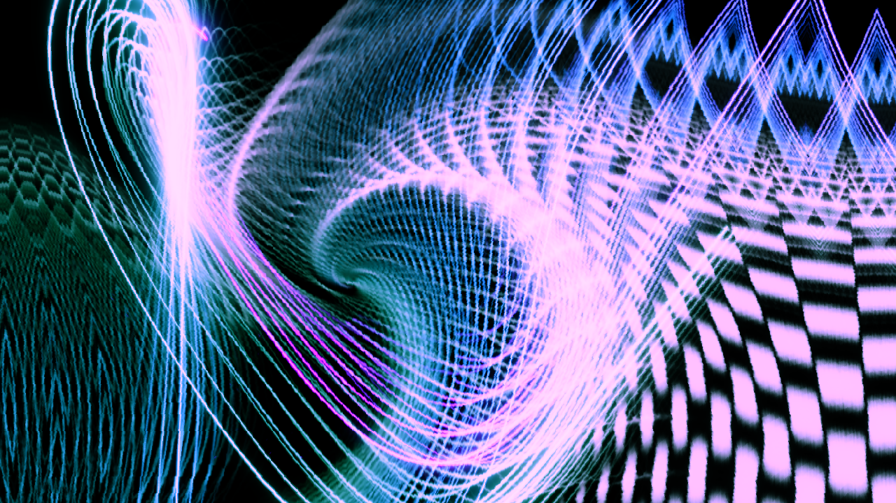

# PSSS V2 — new generation Particle Systems Screen Saver

<!-- LATEST-RELEASE:BEGIN — generated from release-notes/v1.3.0.md; edit that file, never this block -->
> **🆕 Latest release: [v1.3.0](https://github.com/alassio/psss-v2/releases/tag/v1.3.0)** — **New since the first public release: a second figure type, self-similar curves.** Alongside the wave figures, PSSS now draws fractal curves built from thirteen production rules (Hilbert, dragon, Koch, Gosper, Moore and more), with fourteen demo presets to start from.
> [What's new, and the downloads →](https://github.com/alassio/psss-v2/releases/tag/v1.3.0)
<!-- LATEST-RELEASE:END -->

[](https://alassio.github.io/psss-v2/)

### ▶ [Run it in your browser](https://alassio.github.io/psss-v2/)

No install, no build: the whole engine, its preset library and the full control surface run from that
page. A frame like the one above is a click away in it.

> ### And it is a real Windows screensaver, not only a web demo
>
> The same TypeScript engine is wrapped in a .NET 8 host and installs as a genuine Windows `.scr` — a
> single self-contained binary of about 16 MB that needs no runtime, no Node and no browser install
> (WebView2 ships with Windows 11). It plays your own **Reel** full screen on the primary monitor with the
> other displays blacked out, and the Settings dialog's *Configure* button opens the engine's own Reel
> editor rather than a stand-in.
>
> ### ⬇ [Download the screensaver](https://github.com/alassio/psss-v2/releases/latest)
>
> Each release carries `psss.scr`, both reference manuals as PDFs and a distribution zip. Or build it yourself with
> `npm run build:all` — the wrapper is `psss-engine/screensaver/`, and *Install it as a Windows
> screensaver* below walks the install.

> ### Built with three tools, each doing a different job
>
> **[Reversa](https://github.com/sandeco/reversa)** reverse-analysed the original JavaScript implementation into written
> specifications — control flow, data model, preset format, figure mathematics — and this TypeScript
> engine was built against *those*, not against a reading of the old source. It is why an original preset
> still loads unchanged.
>
> **[hyperresearch](https://github.com/jordan-gibbs/hyperresearch)** did the deep research and ideation behind the later features: each pass read
> papers and reference implementations and recorded every claim against its source, so a feature traces
> to a citation or a measurement rather than to a hunch — and several of the strongest ideas were dropped
> on inspection, with the reason written down.
>
> **[Claude Code](https://claude.com/claude-code)** implemented all of it: engine, checkers, tests and both manuals, with
> `npm run verify` as the gate and an eye as the gate for anything that changes a picture.
>
> `ENGINEERING-NOTES.md` has the longer account, including why none of those artefacts are in this
> repository.

3D particles travelling along one of two kinds of figure — modulated sine waves (3D Lissajous figures)
or self-similar fractal curves such as Hilbert, dragon and Koch — projected to 2D, trailed, warped and
colour-graded. It runs in a browser, and on Windows it can also be installed as a real screensaver.

**PSSS was created by Andreas Kardin (*mephzara*)** — the idea, the name, the mathematics and most of the
preset library are his. It began as a Windows screensaver written in Delphi, was later rewritten by him in
JavaScript, and this engine is a third implementation built from that version. See §8 for the full credits.

This repository holds the last two of the three:

| | `psss-engine/` | `psss-original/` |
|---|---|---|
| What it is | **the current engine** — use this one | Andreas Kardin's JavaScript version, **verbatim** |
| Built with | TypeScript, WebGL2, Vite | plain JavaScript, Canvas2D |
| Status | active | **read-only**, never edited |

Everything below is about `psss-engine/`. **`psss-original/` is the original author's own code and
nothing else:** all ten files of upstream commit `2934077` (18 September 2023, still the upstream tip),
his own README and licence copy included, every one of them hash-identical to its upstream counterpart.
Open it to read PSSS as he wrote it; `NOTICE` carries the attribution.

ℹ️ There was an intermediate step between the two columns — further work done here on the *JavaScript*
version (attractors, preset breeding, a preview grid, a control surface), and that is what the rewrite's
specifications were actually extracted from. It is kept separate rather than published, so that
`psss-original/` can mean exactly one thing.

### The three documents you are most likely to want

| Document | Read it for |
|---|---|
| **`psss-engine-v2_how_to_use_it.md`** | **How to use the program** — every control, what it does, and recipes to try. Start here if you just want to make something look good. |
| **`psss-engine-v2_how_it_works.md`** | **How the engine works inside** — the rendering pipeline stage by stage, the mathematics, the file formats, and the references. |
| This file | Where things are in the project, and how to build and run it. |

---

# 1 · What is where

## 1.1 Repository root

| Path | What it is |
|---|---|
| `psss-engine/` | The current engine. See §1.2. |
| `psss-original/` | Andreas Kardin's JavaScript implementation, **verbatim** — upstream commit `2934077`, all ten files hash-identical, his own `README.md` included. Read-only, never edited. |
| `psss-engine-v2_how_to_use_it.md` | The user manual. |
| `psss-engine-v2_how_it_works.md` | The technical reference. |
| `manual-images/` | Screenshots used by the user manual. See §6. |
| `release-notes/` | One file per GitHub release (`vX.Y.Z.md`), used as that release's description. A release cannot be published without its file. |
| `LICENSE` | GNU GPL v3, covering **the whole repository**. `psss-original/` keeps its own copy. |
| `NOTICE` | Who wrote the original, what this version changed, and under what licence. |

## 1.2 Inside `psss-engine/`

| Path | What it is |
|---|---|
| `src/` | The engine source. See the map below. |
| `public/` | The preset library that ships as an external file, plus reference data. |
| `checks/` | Static checkers that `npm run verify` runs. |
| `tests/` | The browser test suite (Playwright). |
| `scripts/` | Build steps: one exports the preset and reel files, one builds the screensaver. |
| `screensaver/` | The Windows `.scr` host (C# + WebView2). Has **its own `README.md`**. |
| `index.html`, `vite.config.ts` | The page and the build configuration. |
| `dist/` | Build output. Regenerated every build; never edit it. |

### Map of `src/`

| Directory | What lives there |
|---|---|
| `main.ts` | The frame loop and all the wiring between the parts. |
| `core/` | Shader compilation, projection, rotation, noise, shared types. |
| `generators/` | What makes the particles move and take colour: waves, attractors, materials, crystals, sparks. |
| `renderers/` | How a particle becomes pixels: the main particle pass, ribbons, neon lines, film looks. |
| `post-processors/` | Whole-image stages: the warp chain, bloom, tone mapping, the fluid and dye fields. |
| `presets/` | The preset library, its format, migration of older presets, and the reel store. |
| `exploration/` | The Lab's logic: mixing, randomising, evolution, shared state. |
| `ui/` | The preview grid and the Synthesis Lab panel with its tabs. |

The pipeline these directories implement is described stage by stage in
**`psss-engine-v2_how_it_works.md`**; what the Lab's tabs do is in **`psss-engine-v2_how_to_use_it.md`**.

---

# 2 · Run it while developing

```bash
cd psss-engine
npm install
npm run dev            # then open http://localhost:5173/
```

## 2.1 What you need, and for which command

Only the first two rows are needed to run the engine or check it. The rest are build-time, and the
last two are Windows-only.

| Tool | Needed for | Notes |
|---|---|---|
| **Node 22.18+** | everything | `npm run verify` imports TypeScript directly under Node, which needs its type stripping; Node 20 fails one checker with an unrelated-looking error. `package.json` declares this, so `npm ci` will tell you |
| **npm** | everything | `npm ci` for a reproducible install, `npm install` while developing |
| **Chromium** | `verify:browser`, `docs:pdf` | `npx playwright install chromium`. The PDF step borrows the same browser to print |
| **bsdtar** | `package:dist` | bundled with Windows 10 1803+; on Debian/Ubuntu it is in `libarchive-tools`. GNU `tar` cannot write a zip and is rejected |
| **.NET 8 SDK** | `build:screensaver` | Windows only. See `psss-engine/screensaver/README.md` |
| **Visual Studio** | `build:screensaver` | Windows only, for the native linker the single-file publish calls. Same file covers it |

No Python is needed anywhere.

The page opens on the **preview grid**: a wall of live thumbnails, one per preset. Click one to make it
the main animation, or press **▶ Play** to start the main reel. The user manual explains the rest.

Some URL parameters are useful while developing:

| Parameter | What it does |
|---|---|
| `?reel=1` | Start the main reel immediately, full screen, with the UI hidden. `?reel=0` forces it off. |
| `?screensaver=1` | Behave like the Windows screensaver: play, and quit on the first key press, click or mouse move. |
| `?tab=<name>` | Open the Lab on a named tab, e.g. `?tab=reel`, `?tab=visual-fx`. |
| `?renderscale=1` | Render at the display's native resolution instead of the default performance cap. |
| `?gldiag=1` | Print graphics diagnostics. Off by default because it slows every frame. |
| `?testhook=1` | Expose engine state for the browser tests. |

⚠️ **A clean console does not mean the picture is correct.** A broken shader draws black without
reporting anything, so any change to rendering has to be looked at in a browser.

---

# 3 · Checks

```bash
npm run verify           # type-check plus every static checker in checks/ — run this before calling a change done
npm run verify:browser   # the Playwright browser tests
npm run check:specs      # type-check the test files
npm run check:ui         # browser check of the Lab's grouped tabs; needs a dev server
npm run check:demos      # smoke test over the demo presets; needs a dev server
```

`npm run verify` is the gate: if it is not green, the change is not finished. Individual checkers can be
run on their own — see the `check:*` entries in `psss-engine/package.json`. The last two need a browser
and a running dev server, so they are outside `verify` and are run deliberately.

---

# 4 · Build and deploy in a browser

```bash
npm run build          # the browser deployment
npm run build:all      # everything: the above, the Windows screensaver, the PDFs and the release zip
npm run preview        # serve the built output locally to check it
```

`npm run build:all` runs four steps in order, and each can be run on its own:

| Step | Command | Produces |
|---|---|---|
| 1 | `npm run build` | `psss-engine/dist/` — the four files below |
| 2 | `npm run build:screensaver` | `psss-engine/dist/screensaver/` — the Windows screensaver (§5) |
| 3 | `npm run docs:pdf` | `psss-engine-v2_how_it_works.pdf` and `psss-engine-v2_how_to_use_it.pdf`, beside the markdown |
| 4 | `npm run package:dist` | `psss-engine-v2-distribution_<date>_<time>.zip` in the repository root |

Step 3 renders the markdown with `marked` and prints it through the Chromium that Playwright
installs — both come from `npm install`, so there is nothing extra to add. Step 4 writes the zip with
`bsdtar` (§2.1).

On Linux and macOS, step 2 is unavailable and `npm run build:all` stops there. Use **`npm run
release:web`** instead: it runs steps 1, 3 and 4 and writes a `..._web.zip` that carries no
screensaver.

The manual's screenshots are **re-encoded for the PDF only** — `manual-images/` keeps the originals.
Each one is offered as PNG, as JPEG and as itself, and the smallest wins, with anything wider than
200 dpi also downsampled. That takes the manual's PDF from 13.7 MB to **5.1 MB** with no visible
difference. `npm run docs:pdf -- --dpi 150` or `-- --full-res` build the other variants to compare.

`npm run docs:pdf -- --doc <file.md> --title "..."` renders **one** other root-level document with the
same stylesheet, instead of the two above. It is for one-off documents — a research study, a review —
and deliberately does **not** add them to the build: `build:all` and the release zip still contain
exactly the two engine documents in the table above.

The archive name carries the build time — `psss-engine-v2-distribution_20261011_171900.zip` — so each
build keeps its own release file and **nothing is overwritten**. Old archives are never deleted; the step
says how many have collected in the root.

It holds the built deployment, the sources needed to rebuild it, the screensaver's source, and the
documentation with its PDFs — about 130 files, 28 MB. It leaves out build output (`bin/`, `obj/`,
`Payload/`) and the screensaver's test instrument (`probe/`).

`npm run package:dist -- --list` prints what the archive would contain without writing it — note the bare
`--`, without which npm keeps the flag for itself.

`npm run build` produces **exactly four files**:

```
psss-engine/dist/
├── index.html          the page
├── psss-engine.js      the whole engine
├── psss_presets.json   the preset library
└── psss_reels.json     the reels, and which one plays first
```

**To deploy, copy all four files anywhere** — a folder, a USB stick, a web host — and open `index.html`.
It needs no server, no install and no network. It opens on the preview grid, exactly like the dev server.

Two things are worth knowing about those files:

- **`psss_presets.json` must be present.** Without it there is nothing to draw and the page says so.
  `psss_reels.json` is optional: if it is missing, the reels built into the engine are used instead.
- **Both can be replaced with your own.** The program's own *Export All* and *Export Reels* buttons write
  these two files under these exact names, so swapping in your own library is a copy-over with no editing.
  §7.4 of the user manual walks through it.

### For a dedicated display

Launching the browser in kiosk mode leaves no tab strip or address bar, so the animation fills the screen
with no clicks at all:

```bash
# Chrome
chrome.exe --kiosk "file:///C:/path/to/psss-engine/dist/index.html"

# Edge
msedge.exe --kiosk "file:///C:/path/to/dist/index.html" --edge-kiosk-type=fullscreen

# a full-screen window you can still leave normally
chrome.exe --start-fullscreen "file:///C:/path/to/dist/index.html"
```

Add `?reel=1` to the file URL to have it start playing by itself.

**Which reel plays first** is the `mainReelName` field in `psss_reels.json`, so a display can choose its
own opening animation by editing one line.

---

# 5 · Install it as a Windows screensaver

`npm run build:all` additionally produces **`psss-engine/dist/screensaver/`**, containing three files:

```
psss.scr             the screensaver (the engine is embedded inside it)
psss_presets.json    required
psss_reels.json      optional
```

**To install:** right-click `psss.scr` → **Install**, or copy all three files into `C:\Windows\System32\`
and choose *psss* under **Settings → Personalisation → Lock screen → Screen saver**.

All three files must stay together — the `.scr` reads the two data files from beside itself.

Building the host needs a second toolchain (.NET 8), which is why `npm run build` alone does not produce
it. **`psss-engine/screensaver/README.md`** covers the prerequisites, installing, and the known limits.

---

# 6 · The manual's screenshots

The images in `manual-images/` are generated against a running dev server:

```bash
npm run dev -- --port 5174
node scripts/capture-ui.mjs --base http://localhost:5174 --mode panels
node scripts/capture-ui.mjs --base http://localhost:5174 --mode recipes
```

Use `--only <name>` to retake a single image. The script is a tool, not part of the build or the tests.

---

# 7 · How it works, in one paragraph

Particles are samples of a mathematical curve rather than independent objects. Three sine waves per axis,
each able to modulate the others, place every particle; colour comes from further waves cycling through
RGB. The result is projected to 2D and drawn into a buffer that fades a little each frame, which is what
produces the trails. From there the whole image is processed: a translation map displaces each pixel by a
sum of sine waves, then bloom, tone mapping and colour grading finish it. Strange attractors, curl-noise
turbulence, fluid and dye fields, fire, crystals and liquid surfaces can all feed into the same motion.

The long version, with the mathematics and the algorithms, is **`psss-engine-v2_how_it_works.md`**.

---

# 8 · Credits and the original PSSS

This engine is the third version of PSSS, and the first two were somebody else's work.

**PSSS — *Particle Systems Screen Saver* — was created by Andreas Kardin**, who publishes as *mephzara*.
The idea, the name, the mathematics of driving particles along amplitude- and frequency-modulated sine
waves, and the great majority of the preset library all originate with him. Many of the presets in the
library are his, carried across essentially unchanged.

| | |
|---|---|
| **Author** | Andreas Kardin (*mephzara*) |
| **Source of the JavaScript version** | <https://github.com/mephzara/psss_js> |
| **Live demo of the JavaScript version** | <http://mephzara.com/misc/psss_js/> |
| **Live demo of this version** | <https://alassio.github.io/psss-v2/> |

## How it was built

| tool | what it did |
|---|---|
| **[Reversa](https://github.com/sandeco/reversa)** | reverse-analysed the original JavaScript implementation into the specifications this engine was built against |
| **[hyperresearch](https://github.com/jordan-gibbs/hyperresearch)** | the deep research and ideation behind the later features, every claim recorded against its source |
| **[Claude Code](https://claude.com/claude-code)** | the implementation — engine, checkers, tests and both manuals |

`ENGINEERING-NOTES.md` has the longer account, including why none of those artefacts are in this
repository.

**Thank you, Andreas Kardin** — for the original program, and for publishing the source so that it could
be taken further.

### The three versions

**The first** was a native Windows screensaver, written in the late 1990s in **Delphi (Object Pascal)
with assembler** for the inner loops, doing all of its drawing on the processor — this was before a
program could assume 3D acceleration. It was released as shareware, passed **50 000 downloads on its
first night** on a 3dfx shareware site, was carried by Tucows, CNET and Download.com, and was shown at
the **Zeiss planetarium in Jena** during the Liquid Sound Festival, with the animations synchronised to
compositions by Jan Zehn.

**The second**, roughly two decades later, was the author's own **JavaScript rewrite** for the browser,
published as source: three files, no build step, drawing into a 2D canvas. That is the `psss-original/`
directory in this repository, verbatim, and it is the version this engine descends from.

**The third** is this engine: the same mathematics and the same presets, drawn by the graphics card
instead of the processor, with the trail, the warp chain, the materials and the grading built on top. The
short version is that the earlier releases *draw* the figure and this one *photographs* it. After
twenty-five years it ships as a Windows screensaver again (§5) — which is what the name always said it
was.

**Two things were kept on purpose:** the **preset format**, so an original preset still loads and looks
like itself, and the **Legacy** film look, so any preset can be put back into roughly the image the
earlier versions produced.

The full account — what each version could do, and what changed between them — is appendix **A** of
`psss-engine-v2_how_to_use_it.md` and chapter **12** of `psss-engine-v2_how_it_works.md`.

---

Licensed under the **GNU GPL v3** — see `LICENSE` in this directory, which covers the repository as a
whole, including `psss-engine/`. `psss-original/` keeps its own copy. **`NOTICE` names who wrote the
original and who holds copyright on the modifications.**
