# PSSS — How To Use It

**A user guide to the Particle System Screen Saver v2.**

This guide is about *using* PSSS: what you see on screen, what every control does, and how to get the
animation you want. It assumes no programming knowledge and no mathematics beyond the idea of a wave.

It is deliberately **not** a technical reference. If you want to know how the engine works inside — the
pipeline stage by stage, the mathematics, the algorithms — that is a separate document,
`psss-engine-v2_how_it_works.md`.

---

## Contents

**Part I — Foundations**

- [1. The Two Kinds of Figure](#1-the-two-kinds-of-figure)
  - [The idea in one picture](#the-idea-in-one-picture)
  - [Adding the third dimension](#adding-the-third-dimension)
  - [The second kind: self-similar curves](#the-second-kind-self-similar-curves)
  - [How PSSS uses them](#how-psss-uses-them)
- [2. What PSSS Does](#2-what-psss-does)
  - [The particle half](#the-particle-half)
  - [The image half](#the-image-half)
  - [Why this combination works](#why-this-combination-works)
- [3. The Stages of the PSSS Pipeline](#3-the-stages-of-the-psss-pipeline)
  - [Three consequences worth knowing](#three-consequences-worth-knowing)
**Part II — How to Use PSSS**

- [4. How to Run PSSS](#4-how-to-run-psss)
  - [4.1 Run it in the browser](#41-run-it-in-the-browser)
    - [Useful keys and clicks](#useful-keys-and-clicks)
  - [4.2 Run it as a screensaver](#42-run-it-as-a-screensaver)
  - [4.3 If it runs slowly](#43-if-it-runs-slowly)
- [5. UI Basics — the Preview Grid](#5-ui-basics--the-preview-grid)
  - [5.1 The layout](#51-the-layout)
  - [5.2 Finding a preset](#52-finding-a-preset)
  - [5.3 The buttons](#53-the-buttons)
- [6. The Synthesis Lab](#6-the-synthesis-lab)
  - [6.0 Five things that are true of every tab](#60-five-things-that-are-true-of-every-tab)
  - [6.1 Reel — playing presets by themselves](#61-reel--playing-presets-by-themselves)
  - [6.2 Visual FX — the rendering pipeline](#62-visual-fx--the-rendering-pipeline)
    - [6.2.1 The five groups](#621-the-five-groups)
    - [6.2.2 Figure — the shape itself, before anything draws it](#622-figure--the-shape-itself-before-anything-draws-it)
    - [6.2.3 Particles — how each particle is drawn](#623-particles--how-each-particle-is-drawn)
    - [6.2.4 Colour — the photography](#624-colour--the-photography)
    - [6.2.5 Image — the warp applied to the finished frame](#625-image--the-warp-applied-to-the-finished-frame)
    - [6.2.6 Fields — forces and dyes that move the particles](#626-fields--forces-and-dyes-that-move-the-particles)
  - [6.3 Materials — what the particles are made of](#63-materials--what-the-particles-are-made-of)
    - [6.3.1 The three groups](#631-the-three-groups)
    - [6.3.2 Material — the material itself, and the mark it leaves](#632-material--the-material-itself-and-the-mark-it-leaves)
    - [6.3.3 Fire — rising heat, and what it throws off](#633-fire--rising-heat-and-what-it-throws-off)
    - [6.3.4 Crystals — a third population that grows and stays](#634-crystals--a-third-population-that-grows-and-stays)
  - [6.4 Composer — the figure itself](#64-composer--the-figure-itself)
    - [Figure type — the first choice on the tab](#figure-type--the-first-choice-on-the-tab)
    - [Why there are three waves](#why-there-are-three-waves)
    - [The top of the tab](#the-top-of-the-tab)
    - [Framing & Preview — the one closed header](#framing--preview--the-one-closed-header)
    - [The curve controls](#the-curve-controls)
    - [A wave slot, control by control](#a-wave-slot-control-by-control)
    - [The seven values on every axis](#the-seven-values-on-every-axis)
    - [The readout line](#the-readout-line)
    - [Working in the Composer](#working-in-the-composer)
  - [6.5 Transmap — drawing the wave field](#65-transmap--drawing-the-wave-field)
    - [What this tab can and cannot edit](#what-this-tab-can-and-cannot-edit)
    - [What happens to your preset when you change something here](#what-happens-to-your-preset-when-you-change-something-here)
    - [The nineteen named patterns](#the-nineteen-named-patterns)
    - [The wave shape](#the-wave-shape)
    - [The wave direction](#the-wave-direction)
    - [The amount](#the-amount)
    - [The terms — drawing the field by hand](#the-terms--drawing-the-field-by-hand)
    - [Working in this tab](#working-in-this-tab)
  - [6.6 Sliders — fourteen qualities, one dial each](#66-sliders--fourteen-qualities-one-dial-each)
  - [6.7 Mixer — blending two presets](#67-mixer--blending-two-presets)
  - [6.8 Randomise — guided accident](#68-randomise--guided-accident)
  - [6.9 Evolution — breeding presets](#69-evolution--breeding-presets)
  - [6.10 History — getting back](#610-history--getting-back)
**Part III — Practice**

- [7. The Preset Library](#7-the-preset-library)
  - [7.1 What the groups feel like](#71-what-the-groups-feel-like)
  - [7.2 Finding your way around](#72-finding-your-way-around)
  - [7.3 A note on names](#73-a-note-on-names)
  - [7.4 How to replace the standard library](#74-how-to-replace-the-standard-library)
    - [What to expect if something is wrong](#what-to-expect-if-something-is-wrong)
    - [Why these files are not quite JSON](#why-these-files-are-not-quite-json)
    - [Two things worth knowing](#two-things-worth-knowing)
- [8. Recipes](#8-recipes)
  - [8.1 Change the film look and colour](#81-change-the-film-look-and-colour)
  - [8.2 Make it liquid](#82-make-it-liquid)
  - [8.3 Let it burn](#83-let-it-burn)
  - [8.4 Let it freeze](#84-let-it-freeze)
  - [8.5 See it through glass](#85-see-it-through-glass)
  - [8.6 Make it fractal](#86-make-it-fractal)
  - [8.7 Make it architecture](#87-make-it-architecture)
  - [8.9 Make it four-dimensional](#89-make-it-four-dimensional)
- [9. Design Your Own](#9-design-your-own)
  - [Step 0 — Set up](#step-0--set-up)
  - [Step 1 — The figure (Composer)](#step-1--the-figure-composer)
  - [Step 2 — Scale and motion (Visual FX → Figure → Framing & Timing)](#step-2--scale-and-motion-visual-fx--figure--framing--timing)
  - [Step 3 — What it is made of (Materials)](#step-3--what-it-is-made-of-materials)
  - [Step 4 — Colour](#step-4--colour)
  - [Step 5 — The trail](#step-5--the-trail)
  - [Step 6 — The warp, if any (Visual FX → Image, then Transmap)](#step-6--the-warp-if-any-visual-fx--image-then-transmap)
  - [Step 7 — Photography (Visual FX → Colour → Film Look)](#step-7--photography-visual-fx--colour--film-look)
  - [Step 8 — Refine with the Sliders](#step-8--refine-with-the-sliders)
  - [Step 9 — Save it](#step-9--save-it)
  - [Step 10 — Stress-test it](#step-10--stress-test-it)
  - [If you get stuck](#if-you-get-stuck)
- [A. Credits and the Original PSSS](#a-credits-and-the-original-psss)
  - [A.1 The author](#a1-the-author)
  - [A.2 The first version — a Delphi screensaver for Windows](#a2-the-first-version--a-delphi-screensaver-for-windows)
  - [A.3 The second version — a JavaScript rewrite for the browser](#a3-the-second-version--a-javascript-rewrite-for-the-browser)
  - [A.4 This version — TypeScript and WebGL2](#a4-this-version--typescript-and-webgl2)
  - [A.5 What deliberately did not change](#a5-what-deliberately-did-not-change)

# Part I — Foundations

## 1. The Two Kinds of Figure

### The idea in one picture

Imagine a pen that can only do one thing: swing back and forth. Now imagine two of them at right
angles — one swinging left-to-right, one up-and-down — and a sheet of paper under both. If they swing
at the same speed you get a circle. If one swings exactly twice as fast as the other you get a figure
eight. Change the speeds and you get flowers, pretzels, woven baskets.

That is a **Lissajous figure**: a shape drawn by combining simple back-and-forth motions at different
speeds. Nothing about it is random. The shape is completely decided by a handful of numbers, which is
precisely why it can be dialled in rather than drawn.

| Speed ratio | What you get |
|---|---|
| 1 : 1 | a circle, or an ellipse, or a diagonal line |
| 1 : 2 | a figure eight |
| 2 : 3 | a three-lobed pretzel |
| 3 : 4 | a woven four-lobed basket |
| 5 : 4 | a dense rosette with many crossings |

The single most important number is how many times a wave swings during one complete trip around the
figure. PSSS calls this the **winding**. A winding of 3 against a winding of 4 gives the basket above.
**Whole numbers close the loop; fractions leave it open**, and an open figure drifts forever instead of
retracing itself — which is sometimes exactly what you want.

### Adding the third dimension

Give the pen a third swing — toward you and away from you — and the flat figure lifts off the paper.
It becomes a loop in space that can pass over and under itself. A closed loop in space that cannot be
pulled flat without cutting it is a **knot**, and a Lissajous figure in three dimensions is a
**Lissajous knot**.

This matters for a simple visual reason: a flat figure is a line drawing, while a knot has a front and
a back. It can occlude itself, catch light differently where it faces you, and read as a solid object
rather than as a diagram.

### The second kind: self-similar curves

Everything above describes PSSS's original figure, and it is still the one most presets use. There is a
second kind, and it is built on a completely different idea.

A **self-similar curve** is one continuous stroke produced by **repeating a small rule**. You start with
a short path, replace every piece of it with a scaled copy of a pattern, and repeat. After a few rounds
the stroke has folded itself into something intricate — a lattice that fills a cube, a coastline, a
branching tree — while still being a single line you could draw without lifting the pen.

The famous members of this family have names: the **Hilbert** curve, which visits every cell of a cube
exactly once; the **dragon** and **terdragon**; the **Koch** curve and **snowflake**; the **Gosper** island; the
**Sierpiński** arrowhead; the **Minkowski** sausage; the **pentigree**; the **twindragon** and **fudgeflake**
tiles. PSSS ships nineteen of them.

What makes them useful here rather than merely pretty is one property that is easy to miss: **the angle
the rule turns at is not part of the rule.** Run the Koch production at its published 90° and you get
the Koch curve. Run the *same* production at 117° and you get a Sierpiński triangle — a different named
fractal, reached by moving one dial. So a single rule plus one continuous angle is a whole family, and
sweeping the angle animates the figure *between named shapes* rather than merely wobbling one.

The same idea gives a second axis. Every one of these curves is **copies of itself laid end to end**, so
the copies can also be **twisted** about their own axis, which lifts a flat curve into three dimensions.
On the dragon, a half-turn of one copy produces the **Lévy C** curve, so one slider folds one named
fractal into another through shapes that exist in neither.

Two more properties matter in practice:

- **Order is preserved.** Particle 1 and particle 2 sit next to each other along the stroke, exactly as
  they do on a wave figure. That is what lets trails, ribbons, neon lines and the per-particle colour
  controls work on this kind of figure at all.
- **Position along the curve means something.** Because the stroke visits each region of space as one
  unbroken run, colouring by particle index gives a smooth gradient through the figure's volume, and on
  a branching rule it bands by branch.

### How PSSS uses them

PSSS does not draw the figure as a line. It uses the figure as a **path**, and distributes thousands of
particles along it. Each particle sits at its own position on the path, and the whole population moves
as the figure evolves.

Three refinements turn this from a curiosity into something worth watching:

- **Three waves per axis, not one.** PSSS stacks three independent figures — it calls them **Body**,
  **Detail** and **Structure** — and adds them together. The Body gives the overall shape, and the
  other two add ornament at finer scales, the way a melody takes on character from its harmonics.
- **The waves are modulated.** Each wave's own speed and size can themselves rise and fall over time,
  so the figure breathes instead of repeating exactly.
- **Rotation.** The whole figure can turn on any of the three axes, which is what shows you it is a
  solid object and not a flat pattern.

You do not have to understand any of this to use PSSS. You will meet these ideas again as named
controls — **Winding**, **Size**, **Shift**, **Body / Detail / Structure** — in the Composer tab.

---

## 2. What PSSS Does

PSSS is a **particle system simulation** wrapped in an **image pipeline** to generate nice visual animations of the simulation. Those are the two halves, and almost
every control you will meet belongs to one or the other.

### The particle half

A population of particles — typically a few thousand, sometimes fifty thousand — is placed along the
Lissajous path. Every frame, each particle is given a position, a colour and a size. On its own that
would give you a bright wireframe: accurate, and rather clinical.

So the particles can also be given **behaviour**, and this is where most of the character comes from:

- **Materials** make particles behave like a substance — heat that rises, smoke that disperses, ice
  that holds its shape, liquid that pools and coheres.
- **Fields** push particles around after they have been placed: turbulence, drift, buoyancy, flow.
- **Extra populations** can be spawned alongside the figure — sparks that fly off it, crystals that
  grow on it, a liquid surface that forms around it.

### The image half

Once the particles are drawn, PSSS keeps working on the picture itself:

- **Trails.** Each frame is blended over a faded copy of the previous one, so moving particles leave
  streaks. This single mechanism is responsible for most of what people describe as "the look" — the
  difference between a cloud of dots and a flowing ribbon of light.
- **Warping.** The whole image can be sampled through a distorting field, so the picture is bent,
  split, mirrored or fed back into itself. The figure stays the same; the *view of it* is deformed.
- **Grading.** Finally the image is brightened, bloomed, toned and tinted — the same kind of treatment
  a film gets in post-production.

### Why this combination works

The particle half gives you **structure** that is precise and controllable. The image half gives you
**atmosphere** that is soft and organic. Most presets are one clear idea from each: *"a knot made of
fire, smeared into long trails"*, or *"a flat rosette, mirrored and graded cold"*.

When you come to make your own, that is the most useful way to think about it — pick a figure, then
pick what it is made of, then pick how it is photographed.

---

## 3. The Stages of the PSSS Pipeline

Everything you see is produced by the same sequence, every frame, in this order. You do not need to
know the mathematics, but knowing the **order** explains a great many surprises — most notably why a
control sometimes appears to do nothing.

| # | Stage | What happens | Which tab controls it |
|---|---|---|---|
| 1 | **The figure** | the three stacked waves are evaluated to produce a path in space | Composer |
| 2 | **Particle placement** | particles are spread along that path | Composer, Sliders |
| 3 | **Colour** | each particle is given a colour, either from the preset's own colour curves or from a palette | Visual FX → **Colour** |
| 4 | **Physics** | materials and fields nudge particles: heat, buoyancy, turbulence, cohesion | Visual FX → **Fields**; Materials |
| 5 | **Extra populations** | sparks, crystals and liquid surfaces are spawned and advanced | Materials → **Fire**, **Crystals**; Visual FX → **Particles** |
| 6 | **Projection** | the 3D positions are flattened to the screen, with perspective | Visual FX → **Figure** |
| 7 | **Drawing** | each particle is drawn as a point, a soft blob, a star or a volume | Visual FX → **Particles** |
| 8 | **The trail** | the new frame is blended over a faded copy of the last one | Visual FX → **Particles** |
| 9 | **The warp** | the whole image is sampled through a distortion field | Transmap; Visual FX → **Image** |
| 10 | **Grading** | bloom, exposure, saturation, tint, vignette | Visual FX → **Colour** |

**The bold names in that last column are the Visual FX tab's own groups**, and they line up with the
stages on purpose — so a question about a stage is answerable by opening one group. Chapter 6 is
organised the same way.

### Three consequences worth knowing

**Later stages can hide earlier ones.** Colour is decided at stage 3, but a palette applied at stage 3
*replaces* the preset's own colour curves. So if a palette is active, adjusting those curves changes
nothing you can see. This is the single most common "is it broken?" moment in PSSS, and the interface
tells you when it happens.

**The trail dominates.** Stage 8 is where most of the visual identity lives. A long trail turns a
sparse figure into a solid ribbon; a short one turns the same preset into a cloud of fireflies. When a
change does not look like you expected, the trail length is usually why.

**The warp is a lens, not an edit.** Stage 9 deforms the *picture*, not the figure. The particles are
exactly where they were; you are looking at them through bent glass. This is why a warp can make a
simple figure look enormously complex without touching a single wave.

---

# Part II — How to Use PSSS

## 4. How to Run PSSS

### 4.1 Run it in the browser

PSSS is a web page. It needs no web server and no network connection.

**A build is four files**, which must stay in the same folder:

| File | What it is |
|---|---|
| `index.html` | the page itself — this is the one you open |
| `psss-engine.js` | the engine |
| `psss_presets.json` | the preset library |
| `psss_reels.json` | the saved reels |

Open `index.html` by double-clicking it. If you move `index.html` on its own, the page loads and
reports that the library is missing. A missing *reel* file is not fatal — the engine falls back to the
reels built into it.

**What you should see.** The **preview grid**: the whole library as live animated tiles, with the
selected preset shown large on the left. Give it a second or two — the tiles start as they come into
view. This is the same thing you get from a development server, so there is only one front door to
learn.

**To watch rather than browse, press ▶ Play.** It is the blue button in the header, to the left of the
**Sort:** control. It plays the **main reel** — one preset after another, full screen, with no
interface in the way. **Escape** stops it and brings the grid back. The main reel is chosen in the Reel
tab (§6.1), and it is the same playback the screensaver uses.

> **PSSS does not start playing by itself in a browser.** Only the screensaver does that, which is what
> a screensaver is for. If you *want* a page that plays the moment it opens — for a kiosk or a display
> screen — add `?reel=1` to the address: `index.html?reel=1`. In that mode the page asks the browser for
> real full screen as it loads, the browser normally refuses because a page that has just loaded has had
> no click yet, and the first click is spent buying the full screen rather than stopping the reel. Any
> key stops it.

#### Useful keys and clicks

| Key | Effect |
|---|---|
| **▶ Play** (header) | play the main reel full screen |
| **Click the animation** | full screen, and click again to come back |
| **Escape** | leave full screen, and stop a reel that is playing |
| **L** | open and close the Synthesis Lab |
| **← →** | step to the previous or next preset — it follows what the grid is currently showing, so a filter narrows the walk |
| **1**–**9** | jump to a film look by number |
| **R** | cycle the ribbon mode: off, hybrid, streaks, adaptive |
| **A** | cycle the attractor presets; **+** and **−** then step within them |

Keyboard shortcuts are ignored while you are typing in the search box, so a preset called "Ribbon" can
be searched for without cycling anything.

> **There is no pause key.** To stop the motion, set **Speed** to 0 in Visual FX — the figure holds its
> current pose, which is the way to study a still frame.

> **There is no hosted demo of this version.** The online demo at `mephzara.com` runs the *original*
> JavaScript PSSS, which is a different and much smaller program. See the
> [Appendix](#a-credits-and-the-original-psss).

### 4.2 Run it as a screensaver

On Windows, PSSS can run as a real screensaver that plays a reel of presets by itself.

**What you need.** Three files, which must stay together in one folder:

- `psss.scr` — the screensaver
- `psss_presets.json` — the preset library
- `psss_reels.json` — the reels

> **The data files are not inside `psss.scr`.** If you copy the `.scr` on its own, the screensaver
> starts and then tells you the library is missing. Always copy all three.

**To try it without installing:** double-click `psss.scr`.

**To install it**, either:

- right-click `psss.scr` → **Install** — this works from any folder, as long as the files stay
  where they are; or
- copy all three files into `C:\Windows\System32\`, then choose *psss* in
  **Settings → Personalisation → Lock screen → Screen saver**. Windows only lists screensavers kept in
  `System32`, which is why this route needs the copy.

**Choosing what it plays.** The screensaver plays its **main reel**. It keeps its own settings,
separately from any browser you have used — so a main reel you chose in the Lab does **not** carry over
to the screensaver, and vice versa. Set the screensaver's own reel through its **Settings** button in
the screensaver configuration dialog.

**Which version you have.** The screensaver's **Settings** window shows its version in the title bar, and
so does Windows: right-click `psss.scr` → **Properties** → **Details** lists the product version. It is the
same number as the release on GitHub, so it is the quickest way to tell whether an installed copy is
current.

**Updating it.** If you install a newer build, copy all three files over the installed ones. Nothing
updates an installed copy automatically, and an old copy will keep running happily on its old library.

### 4.3 If it runs slowly

PSSS looks after the main animation first. On a slower machine the thumbnails in the preview grid animate
less, or stop animating and just show their picture, so the big view stays as smooth as the machine allows.
Some presets are much heavier than others: those drawn with **Neon Lines**, those drawn as glowing **material
splats** (Fire, Ember, Ice, Plasma), and those with very many particles.

**To see what it costs on your machine, add `?perf=1` to the address**, e.g. `index.html?perf=1`. A small
readout appears in the top-left corner and updates twice a second:

| Line | What it tells you |
|---|---|
| **main** | the big view's frames per second, its typical (p50) and worst-case (p95) frame time, and **worst 10 s** — the single longest frame of the last ten seconds, which shows a brief freeze such as the moment a reel switches presets |
| **guard**, **canvas** | how hard PSSS is protecting the big view (0 relaxed, 2 thumbnails frozen), and the drawing size in pixels |
| **per frame** | for each part of the frame — `trail` (fading the previous frames), `figure` (calculating the curve), `particles`, `lines`, `ribbons`, `warp`, `discharge`, `glow`, `grade` (or `present` on presets without a grade), `tiles` — the time it takes on the processor (**cpu**) and on the graphics card (**gpu**). The graphics times appear only on machines whose browser can measure them; otherwise the column says *n/a* |
| **grid**, **reel**, … | per thumbnail grid: how many thumbnails it holds, how many it draws and shows per second, and **pressure** — 1 means the big view keeps up with the screen (or holds 60 fps on a faster screen); the thumbnails animate fully up to about 1.05, slow down above it, and stop animating at about 1.4 to protect it |

The readout only reads; it changes nothing, so it is safe to leave on while you try presets.

**To measure a machine the same way every time, add `?reel=2`** instead, e.g. `index.html?reel=2`. It plays a
fixed **performance test reel** of 18 presets chosen to cover every kind of cost — light and heavy figures, glowing
splats, smoke, liquid, Neon Lines, curl noise and the field effects. **Click once** to go full screen; measuring
starts only in full screen, and a preset that passed before the click is measured on the next round. Each preset is
held 16 seconds: the readout records the brief freeze as it appears, lets it settle for 10 seconds and measures it
for 5. After the last one the reel stops, a text file named `psss-perf-…txt` is **downloaded**, and the same log is
shown on screen with a **Copy** button. It takes about six minutes; the line in the bottom-left corner says how far
it has got. The log starts with the machine's graphics card, processor threads, screen size and refresh rate, so a
log can be read without knowing where it came from.

---

## 5. UI Basics — the Preview Grid

The first thing you see is the **preview grid**: the whole library as live animated tiles, with the
currently selected preset shown large. Each time the page opens it starts on a preset chosen at random from the
library; to start on a particular one, add `?preset=` and its name to the address, e.g. `index.html?preset=Quader`.

### 5.1 The layout

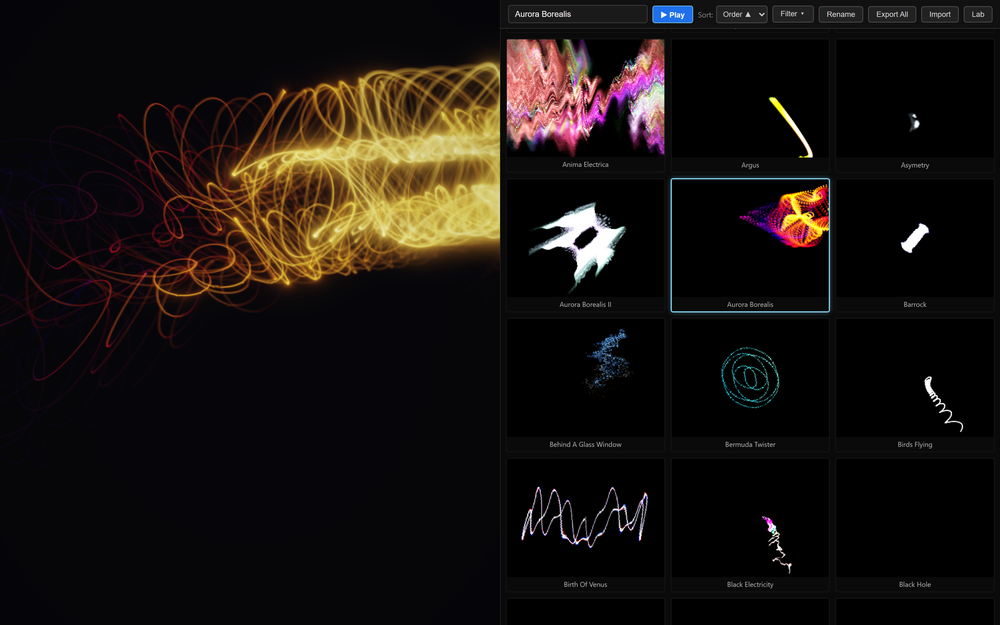

*The whole window. The selected preset animates at full quality on the left; the library fills the
right-hand panel as live tiles.*

| Area | What it is |
|---|---|
| **The main view** | the selected preset, animating at full quality. Click it for full screen |
| **The grid** | every preset in the library as a small live tile. Click one to select it |
| **The header** | search, sort, filter, and the buttons below |

Tiles are deliberately lower quality than the main view — fewer particles, smaller canvas. A tile is
there to help you recognise a preset, not to judge it. **Always judge a preset in the main view.**

### 5.2 Finding a preset

**Search.** Type in the *Search presets…* box to narrow the grid by name. The **×** clears it.

**Sort.** The *Sort:* control reorders the grid, and the arrow beside it (**▲** / **▼**) flips
the direction. This changes only the order you see; it does not change the library.

**Filter.** The **Filter ▾** button opens a set of chips grouped by what a preset actually
*does*, measured from the preset itself rather than from its name:

| Group | Examples of what you can pick |
|---|---|
| **Figure** | how many waves are live, flat or 3D, open or closed, the design aspect |
| **Particles & Trails** | render mode, ribbon rendering |
| **Colour & Grade** | film look, colour palette, palette mapping |
| **Materials** | which material, or *No material* |
| **Motion & Fields** | turbulence, flow, buoyancy and the other fields |
| **Populations** | sparks, crystals, liquid, dye |
| **Attractor Type** | which strange-attractor family, if any |

Chips combine, so *Material: Ice* plus *Populations: Crystals* shows only presets that have both. The
same filter is available inside the Reel tab when you are choosing presets to play — it is the same set
of chips, so a filter you learn once works in both places.

> **This is the fastest way to learn the library.** Asking *"which presets use a warp?"* has no answer
> from the names alone; the filter answers it directly.

### 5.3 The buttons

| Button | What it does |
|---|---|
| **▶ Play** | plays the **main reel** full screen — one preset after another, chosen in the Reel tab (§6.1). **Escape** stops it. It is the blue button, and the only emphasised one, because it is what a first-time viewer is meant to find |
| **Rename** | renames the selected preset. The box at the top left becomes the name field while you do it |
| **Export All** | saves the entire library to one file, ready to drop into a build — see §7.4 |
| **Import** | loads a preset from a `.json` file you have saved |
| **Lab** | opens the Synthesis Lab, where presets are edited. The grid and the Lab are two views of the same panel, so opening one hides the other |

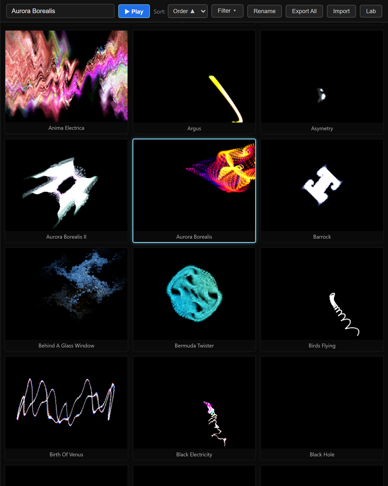

*The preview grid. The header carries, left to right, the search field, the blue **▶ Play** button, the
**Sort:** dropdown with its direction arrow, **Filter ▾**, **Rename**, **Export All**, **Import** and
**Lab**. Every tile is live, the selected preset is outlined in blue, and each tile's name sits beneath
it.*

**Renaming.** A preset can be renamed from the grid; the header's search box doubles as the rename
field while you are doing it. Names must be unique — PSSS will not accept a duplicate, because names
are how reels, snapshots and exports refer to presets.

---

## 6. The Synthesis Lab

Press **Lab** (or **L**) to open it. The Lab is where presets are made, modified, blended and played.

It has ten tabs, and they are in a deliberate order: **presentation first, then authoring, then
exploration.** The Lab opens on the first one.

| Tab | One-line purpose |
|---|---|
| **Reel** | assemble presets into a sequence that plays by itself |
| **Visual FX** | the whole rendering pipeline — the biggest tab |
| **Materials** | give particles physical behaviour |
| **Composer** | the figure itself — the three waves |
| **Transmap** | the image warp |
| **Sliders** | fourteen high-level qualities as simple multipliers |
| **Mixer** | blend two presets |
| **Randomise** | mutate the current preset |
| **Evolution** | breed presets from parents |
| **History** | everything you saved with Snapshot |

### 6.0 Five things that are true of every tab

**The header buttons.**

| Button | What it does |
|---|---|
| **Reset** | undoes your edits in the current tab and restores the preset as it was when you entered |
| **Snapshot** | saves the current state to the History tab, so you can come back to it |
| **Rename** | renames the preset you are working on |
| **Export** | saves the current preset to a `.json` file |
| **Import** | loads one |
| **Grid** | goes back to the preview grid |
| **Find a setting…** | the search field at the right — see *Finding a setting* below |

These are always present, whichever tab you are on, and the tab bar below them is always in the same
order.

**Changes are live but not saved.** Everything you do shows immediately in the main view, and nothing
is written to the library. Use **Snapshot** to keep a state, or **Export** to keep a file.

**`Reset` is per-tab.** It restores the preset and that tab's own controls. It does not touch other
tabs, and it does not clear your History.

**Loading a preset resyncs every control.** If you pick a different preset, all controls jump to the
new preset's values. This is intentional — a control showing a value the engine is not using would be
worse.

**The three biggest tabs are grouped, and they hide what is switched off.** Visual FX, Materials and
the Composer each open as a short list of **group headers** rather than as hundreds of controls. Three
conventions are shared between them, and knowing them once is enough for all three:

| Convention | What it means |
|---|---|
| **Click a header to open it** | The groups start closed, apart from Materials' first one. Opening one does not close the others, so you can have two open at once |
| **A blue number on a header** | How many features inside that group are **active**. No number means nothing in it is doing anything. Hover the header and it says so in words |
| **A feature's settings appear when you switch it on** | Anything with its own **Enable** box shows only the box until it is ticked. The settings are still there — hidden, not removed |

> **Hiding is never forgetting.** A closed group, an unticked feature and a switched-off wave all still
> export, still snapshot, still take a **Reset**, and still blend in the Mixer. Nothing you cannot see
> has been dropped from the preset.

**Finding a setting.** Type into **Find a setting…** at the right of the header and a list of matching
settings drops down — from **every** tab, not only the one you are on. Click one, or move to it with the
arrow keys and press Enter, and the Lab takes you there: it opens the tab, opens every closed group and
section on the way, scrolls the setting into view and briefly lights its row. **Escape** closes the list.

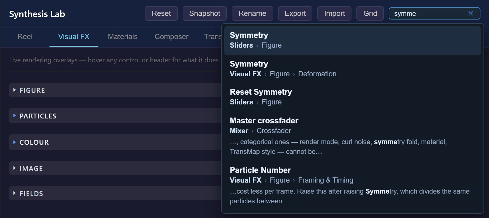

*Each result shows the setting's name and, under it, **where it lives** — the tab first, then the group
and section. That second line is usually what tells two results apart: there is a **Symmetry** in Visual
FX and another in Sliders, and only the path says which is which.*

- **It reads what a setting does, not only its name.** A word from a tooltip finds the setting too. When
  a row matched only on its tooltip, the matching phrase is shown under it with the word picked out, so
  you can see *why* it is there — searching **symme** also finds the Mixer's crossfader, because the
  crossfader treats the symmetry fold specially.
- **Named values are searchable.** Film looks, palettes, materials, render modes and curve rules are
  found by name and marked **VALUE**; clicking one takes you to the dropdown that sets it.
- **Some results cannot be jumped to, and say so.** A setting switched off by another control in its
  section names that control, and clicking takes you to it instead. A setting that does not exist for
  the current preset — **Pitch** on a curve rule that never turns in that plane, for instance — is shown
  dimmed with its reason, rather than left out, so the list never suggests a control is missing from
  the program.
- **Two words narrow the list**: every word you type must match.

---

### 6.1 Reel — playing presets by themselves

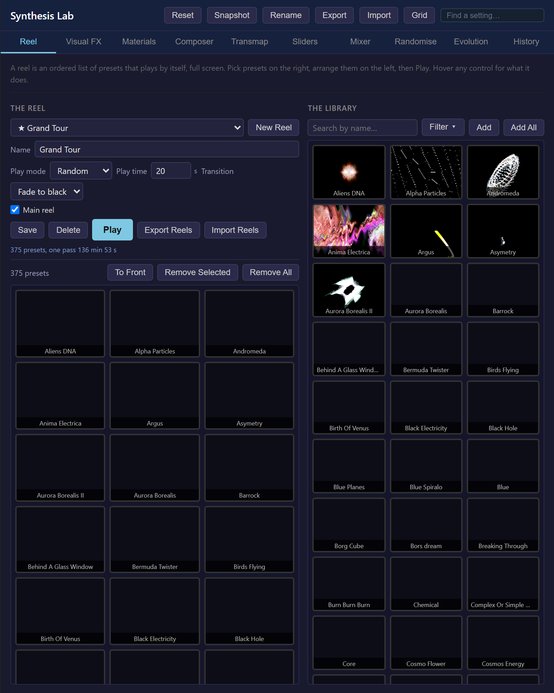

*The Reel tab. The dropdown at the top chooses which reel you are editing, with **★** marking the main
reel; the two dropdowns beneath it are the play order and the transition. Below those, **The reel** is
the list you are building and **The library** is everything you can add from. **Play** sends it full
screen.*

A **reel** is an ordered list of presets plus three settings. It holds no preset data, only names, so a
reel stays correct when you edit the presets it names.

**The three panes.**

| Pane | What it is for |
|---|---|
| **Main reel** | which reel plays when PSSS starts itself (the deployment and the screensaver both use this) |
| **The library** | every preset, with the same **Filter ▾** chips as the grid. Pick presets from here |
| **The reel** | the presets you have chosen, in play order |

**Building a reel.** Filter or search the library pane, then add presets. **Add All** adds everything
the current filter shows — this is the quick way to build *"a reel of every crystal preset"*. In the
reel pane you can reorder by dragging, send a preset **To Front**, or remove it.

**The three settings.**

| Setting | Choices | Effect |
|---|---|---|
| **Play mode** | *Sequential* or *Random* | in order, or shuffled |
| **Seconds** | a duration per preset | how long each one runs before handing over |
| **Transition** | *Fade to black* or *Cross-fade* | how one preset becomes the next |

**Choosing a transition.** *Fade to black* is the safe choice and works everywhere. *Cross-fade* holds
the outgoing image and mixes it into the incoming one — prettier, but on presets with long trails it
can show a brief double image, and on some machines it falls back to a hard cut.

**Playing it.** **Play** sends the reel full screen and runs it by itself. **Escape** stops it. A reel
with one preset simply shows that preset. The grid header's **▶ Play** button does the same thing for
whichever reel is the **main reel**, without opening the Lab at all.

> **Names are resolved when the reel plays.** If a reel names a preset that no longer exists, that
> entry is shown as missing and skipped rather than breaking the reel.

---

### 6.2 Visual FX — the rendering pipeline

This is the largest tab in the Lab by a wide margin, and the one that changes the *look* most. It is
organised into **five groups**, which follow the pipeline order from §3 — so working down the tab works
in the engine's own order rather than against it.

**The tab opens as five headers and nothing else.** That is deliberate: it is a map of the tab rather
than a wall of controls, and the blue badges tell you at a glance which parts of this preset are doing
something.

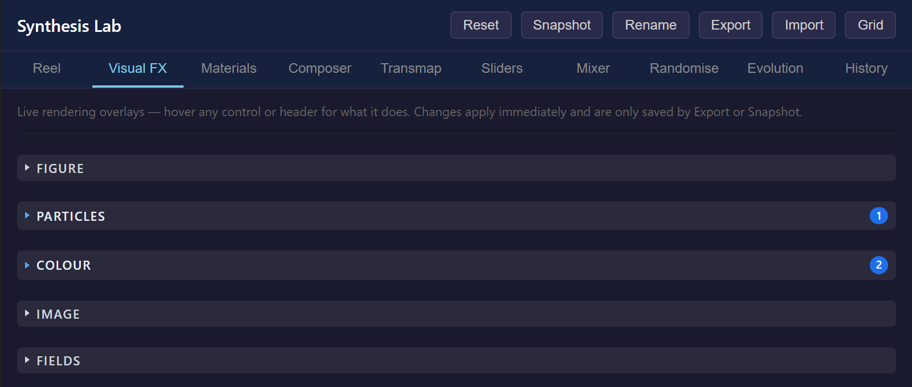

*The Visual FX tab as it opens. Five closed groups; the badge on **Particles** says one feature in it is
active, and **Colour** two. **Figure**, **Image** and **Fields** carry no badge, so nothing in them is
doing anything on this preset.*

#### 6.2.1 The five groups

| Group | What it is for | Sections inside it |
|---|---|---|
| **Figure** | the shape itself, before anything draws it | Framing & Timing · Curve Basis · Deformation · Attractor |
| **Particles** | how each particle is drawn | Render Mode · Volume Render · Liquid Surface · Per-Particle · Splat Shear · Ribbon Rendering · Neon Lines · Electric Discharge |
| **Colour** | grading and palette — the photography | Film Look · Colour Palette |
| **Image** | the warp applied to the finished frame | Translation Map |
| **Fields** | forces and dyes that move the particles around | Cohesion · Liquid Field · Dye Field · Fluid Advection · Curl Noise · Physarum Network |

**The order is the pipeline's order**, so working down the tab works with the engine rather than against
it, and **Fields is last because it is the least used** — not because it matters least.

**This chapter is now in that same order**, one part per group. Two sections inside **Particles** appear
only when their render mode is chosen: **Liquid Surface** under *Liquid*, and **Volume Render** under
*Volume*, so on any one preset you will see at most one of them.

---

#### 6.2.2 Figure — the shape itself, before anything draws it

Four sections, and they run before anything is drawn: the figure is sized and posed, the curve it is built
from is chosen, then the whole thing is bent, then — if you want — replaced outright by a chaotic orbit.

> **This group's badge counts the Deformation operators and the Attractor, and nothing else.** The six
> controls in **Framing & Timing** and **Curve Basis** that change the figure's own shape —
> **Travel**, **Offset**, **Sharpness**, **Grow** and their breathing — are **not** among them, so a
> figure that is faceted, open, off-centre or tapered can still show no number on **Figure**. Nor does
> Framing & Timing contribute: size, speed and particle count have no off state, so counting them
> would light the badge on every preset and the number would stop telling you anything.

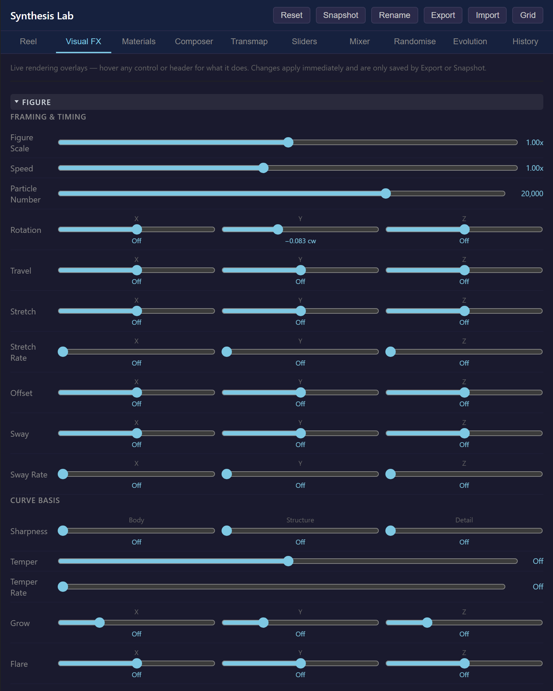

*The **Figure** group, opened. The picture reaches the first two of its four sections — all of
**Framing & Timing**, and **Curve Basis** as far as **Flare**. **Deformation**, itself a header you
open, and **Attractor** are below the foot of the panel; **the second picture of this group, under
Deformation further down, is the same group scrolled to its foot and shows both.***

*Many rows here are **triplets**: one row, three sliders. **Rotation**, **Travel**, **Stretch**,
**Stretch Rate**, **Offset**, **Sway**, **Sway Rate**, **Grow** and **Flare** are all one slider per
**axis**, captioned X, Y and Z.*

*⚠️ **`Sharpness` is a triplet too — and its three cells are LEVELS, not axes.** Its captions read
**Body**, **Structure** and **Detail**, which is the one row in this group where a cell is not an axis.
On the preset pictured all three levels carry a wave, so all three cells are live; **on a figure whose
Structure or Detail level is silent that cell is greyed and refuses the drag**, with the reason on hover —
there is no curve at that level to facet.*

*⚠️ **`Sharpness` is the one triplet whose cells are not axes, and it is the easiest row on the tab to
misread.** Its three cells are captioned **Body**, **Structure** and **Detail** — the figure's three
**wave levels**, the same three the Composer names. Faceting the Body alone is a different figure from
faceting all three, which is why there is no X, Y or Z above these three sliders.*

*Every slider that drives an operator reads **Off** at its identity, because that is where the operator
is skipped entirely rather than applied as a no-op — which is what nearly every row in this picture is
showing. **Figure Scale**, **Speed** and **Particle Number** are the exceptions: they have no off state,
so they print their value instead.*

*The **Figure** head is the only group head visible here: it is the first of the tab's five, so nothing
is closed above it, and with it open its own rows run past the bottom of the panel — so **Particles**,
**Colour**, **Image** and **Fields** are below the picture rather than stacked under it.*

##### Framing & Timing

The figure's size, tempo, population, where it sits and how it moves — the turning, the travelling and
the drifting. These are saved with the preset.

| Control | Range | Effect |
|---|---|---|
| **Figure Scale** | 0.2×–5× | Multiplies the automatic canvas fit. The fit keeps the preset's authored aspect ratio, so a wide window letterboxes rather than stretching — raise this to fill the screen, or go past 1× to frame part of a large figure |
| **Speed** | 0.01×–5× | Master time multiplier. It scales the wave motion *and* every rotation rate together, so the figure keeps its exact shape and only its tempo changes. At **0** the figure freezes in its current pose, which is how to study a still frame |
| **Particle Number** | 100–200 000 | How many particles trace the curve. More fills the curve into a continuous surface; fewer leaves it as discrete points and costs less per frame |
| **Rotation X / Y / Z** | ±10 rpm | Full turns per minute, one slider per axis. Left of centre is clockwise, right counter-clockwise, centre none. X and Y tumble the figure toward and across the camera; Z spins it in the picture plane |
| **Travel X / Y / Z** | ±1.00 half-extent | Slides the figure steadily along each axis **as it is drawn**, so instead of a closed loop you get an open arc — a spring, a conical spiral, a barber-pole stripe. One slider per axis, centre is off and the slider snaps to it |
| **Stretch X / Y / Z** | ±1.00 half-extent | Makes **Travel** breathe, so the open arc extends and retracts instead of sitting at one length. One slider per axis |
| **Stretch Rate X / Y / Z** | `Off`, then about 2 s to 300 s | How fast each axis of Travel breathes. The readout is the time for one full extend-and-retract cycle, **per axis** |
| **Offset X / Y / Z** | ±2.00 half-extent | Moves the whole figure **off centre**, by a fraction of the design box's half-width. One slider per axis, centre is off and the slider snaps to it. **Its real point is motion — see below** |
| **Sway X / Y / Z** | ±2.00 half-extent | Makes **Offset** breathe, so the figure **drifts** rather than sitting off centre. One slider per axis |
| **Sway Rate X / Y / Z** | `Off`, then about 2 s to 300 s | How fast each axis of Offset drifts. **Three different rates is what makes it wander rather than shuttle** |

> **Rotation numbers are nominal.** **Speed** multiplies the actual rate, so at 0.5× a 2 rpm spin
> really takes two minutes. **The same is true of every Rate row in the Lab**: the printed seconds are
> scaled by Speed *and* by the preset's own sweep speed, so the real cycle is faster or slower than the
> number says. Where a preset's sweep speed is 0 the readout says the figure is paused, which is the
> honest answer rather than *off*.

> ⚠️ **Travel is the one control that makes the figure OPEN**, and nothing else in the Lab does. The
> curve gains **two free ends** instead of meeting itself, which is a shape, not a fault. **1.00** means
> the figure walks one half of its own design box between the first particle and the last.

> ⚠️ **Nothing auto-fits Travel or Offset.** Every other figure quantity is caught by the automatic
> canvas fit; these two are not, so at large settings the figure can simply travel or sit out of frame
> and no fit pulls it back. If part of the shape disappears off an edge, that is what happened — bring
> the slider back toward centre, or lower **Figure Scale**, which scales the offset along with the
> figure and so keeps a composition's proportions.

> ⚠️⚠️ **AN OPEN CURVE SHOWS A COLOUR SEAM AT ITS FREE END, AND THE SEAM IS CORRECT.** The colour law
> repeats along the curve; a closed loop hides that because its two ends meet, and an open one does not,
> so the hue jumps where the arc stops. **The fix is one dropdown: set `Map` to *Particle index*** under
> Colour → Colour Palette, which runs the palette once from one free end to the other instead of cycling
> it. ⚠️ **A Map needs a Palette**, so pick one as well if the preset has none. `Quader Square Spring`,
> `Pipes Sweep Breath` and `Pipes Conical Vortex` all ship set that way, and comparing one of them
> against a cycling mapping is the quickest way to see what the seam is.

> ⚠️⚠️ **OFFSET IS A MOTION CONTROL, AND A STILL FRAME CANNOT SHOW YOU THAT.** The engine spins a
> figure about the **centre of the design box**, not about the figure itself — so every preset in the
> library turns in place. Move the figure off that centre and the same spin becomes an **orbit**: push
> it by about **its own radius** and a ball opens into a ring with a hole in the middle; push it by two
> or three radii and you get a wide wreath. Judge it in radii rather than in the slider's own number,
> because how big one half-extent is next to your figure depends on the figure.
> On a still frame all you see is a figure that is off centre, which looks like a mistake. **Give the
> preset a Rotation before you judge it** — and **one axis, not three**, because a tumble on three axes
> smears the swept ring into a shell. `Quader Orbit Wreath` and `Quader Deep Orbit` ship as the two
> worked examples.

> ⚠️⚠️ **ON Z, A NOTE APPEARS UNDER THE OFFSET ROW, AND IT IS THERE FOR A REASON WORTH READING.** Z
> moves the figure toward or away from the camera, and far enough back the particles pass **behind** it
> and are dropped — which looks like a streak leaving the screen rather than like a clip. The note
> prints how far the figure's deepest point now reaches toward that limit, as a percentage, and past
> 100 % you are losing particles. **Offset Z and Travel Z add up toward it**, so a figure carrying both
> gets there sooner than either alone.
>
> ⚠️ **The limit is set by the window size, not by the preset** — so a value that is safe on your window
> can clip on a different one, and no preset can be authored to be safe everywhere. ⚠️ **And the note is
> refreshed when a control or a preset changes, not when you merely resize the window.** If you resize,
> nudge any control to re-read it.

> **Rotation and Travel together are where the helices are.** A turn plus a slide along the turning axis
> is a spring; a slide plus a taper is a conical spiral. `Blue Planes Helix`, `Water Ice Crystal Spire`
> and `Pipes Sweep Breath` ship as worked examples, and `Quader Torus Knot`, `Pipes Toric Lissajous`,
> `Cylinder Viviani`, `Quader Granny` and `Cylinder Spherical Spiral` are named curves built the same
> way. All of them sit at the very end of the library list.

> **Worked examples for the breathing pairs.** `Pipes Sweep Breath` is the one preset that ships **all
> three breaths at once** — **Stretch** (the figure extends and collapses back through zero travel, which
> is the identity), **Sway** (an Offset breath over bases at zero) and **Temper** (Sharpness breathing).
> ⚠️ **Each breath has a depth AND a rate PER AXIS**, and three different rates are what make a Sway
> wander rather than shuttle: one rate for all three axes could only give a straight line back and forth.
> **Set the three rates equal and watch the wander collapse into a diagonal** — that is the A/B, and it
> takes two drags.

> **The trail is part of all three of these, and they want opposite things from it.** A travel sweep is
> *spatial* — the whole helix is on screen in one frame and needs no trail at all — while an orbit and a
> drift are *temporal*, and the swept path **is** the trail. So if an orbit reads as a dot going round
> rather than as a ring, raise **Trail Decay** (Particles → Render Mode). ⚠️ **No reachable trail holds
> a whole slow revolution**, though: what you get is an arc behind the figure, not a closed ring.

##### Curve Basis

What the curve is **made of**, before anything in **Deformation** bends it: whether it is built from
smooth waves or from straight faceted segments, and whether its size holds along the stroke or ramps.

| Control | Range | Effect |
|---|---|---|
| **Sharpness** (Body / Structure / Detail) | 0 to 1 each | Rebuilds the figure from **straight segments meeting at sharp corners** instead of smooth curves — a wireframe armature rather than a neon tube. **One slider per wave level**, so you can facet the broad shape and leave the fine detail smooth, or the reverse. The readout says `Off`, then a percentage, then `faceted` at the top |
| **Temper** | ±0.50 blend | Makes **Sharpness** breathe, so the figure crystallises and melts continuously. **One depth for all three levels** — they breathe together on one cycle |
| **Temper Rate** | `Off`, then about 2 s to 300 s | How fast it breathes. The readout is the time for one full crystallise-and-melt cycle |
| **Grow X / Y / Z** | −1.00 to +3.00 | Ramps the figure's size **along the curve as it is drawn**, so the stroke opens out or closes down from one end to the other — a circle becomes a cone, a helix a conical spiral. ⚠️ **`Off` means no change: the number is a ramp, not a multiplier** |
| **Flare X / Y / Z** | ±2.00 ramp | Makes **Grow** breathe, so the stroke tapers and flares. One slider per axis |
| **Flare Rate X / Y / Z** | `Off`, then about 2 s to 300 s | How fast each axis of Grow breathes, per axis |

> **The figure keeps its exact knot.** Sharpness cannot change *which* shape the figure is — only how it
> is drawn. Whatever it was tangled into, it stays tangled into, at every setting of all three sliders.

> ⚠️⚠️ **THE THREE SHARPNESS CELLS ARE WAVE LEVELS, NOT AXES**, and they are the one triplet in this tab
> that is not X/Y/Z. **Body**, **Structure** and **Detail** are the three waves the **Composer** tab
> builds the figure from: Body carries the silhouette, Structure a fringe along it, Detail a fine
> texture.

> ⚠️⚠️ **A LEVEL SHOWS IN PROPORTION TO HOW MUCH OF THE FIGURE IT ACTUALLY DRAWS — THIS IS THE RULE TO
> USE, AND IT IS MEASURED.** Across the library a level's share of the figure averages roughly **Body
> 71 %, Structure 24 %, Detail 6 %** — and **about three presets in five have no live Detail wave at all**, so on
> most of the library the third slider does nothing whatever you do with it. **The cell stays visible and
> working anyway**, by decision, because nothing in this tab knows which of a preset's levels are silent.
>
> So the advice is *not* "sharpen Body". That is wrong on every preset whose Structure outweighs its
> Body, which several of the faceted ones do. **Open the Composer and look at the Score**: the levels
> drawing the figure are the levels worth faceting, and the rest will read as a dead slider.

> ⚠️ **The difference lives entirely in the corners, so a preset with a long trail averages it away.**
> This is the control most likely to look broken on the wrong preset. **Judge it on `Cylinder`, `Quader`
> or `Pipes`** — sparse figures with short trails, where a single pass of the curve is still visible as a
> line. On a dense, heavily accumulated preset you will see almost nothing at any setting.

> ⚠️⚠️ **GROW'S NUMBER IS A RAMP, AND `0` IS "NO CHANGE" — NOT `1`.** This is the one place in the Lab
> where a reader's instinct is actively wrong: typing **1** does not leave the figure alone, it
> **doubles** the far end of the stroke. `Off` is no change; **+1.00** doubles the size by the end of the
> stroke; **−1.00** tapers it to a point and is the bottom of the range. The readout never prints a bare
> multiplier at 0, which is why it says `Off` rather than `×1.00`.

> **Grow's useful band is about 0.5 to 1.8**, and the slider goes to 3 because that is what the control
> may reach rather than what it is for. Past about 1.8 the end of the stroke starts leaving the frame,
> and nothing auto-fits it — so the two ways back are to bring **Grow** down, or to lower **Figure
> Scale**, which shrinks the whole figure with it. ⚠️ **How soon it leaves depends on the window shape**,
> so check it at the shapes you care about rather than trusting one.

> ⚠️ **At the taper end the particles pile up and the tip goes bright.** That is geometry, not grading:
> every particle near the end of the stroke converges on the same point, and no brightness control will
> remove it. Back the slider off the bottom of the range if you do not want it.

> **Grow ramps the wave only.** Travel and Offset still move the figure by the same amount wherever the
> ramp has taken it, so a cone's axis stays straight and only its mouth opens.

> **Crossing zero is worth setting up on Flare.** Zero is the identity, so a breath that passes through
> it shows the figure's own unmodified shape once per cycle — which is the one thing that makes an
> amplitude ramp read as an *operator* rather than as a figure that happens to be a different shape.

> ⚠️⚠️ **A BREATHING CONTROL THAT PAUSES AT ONE END IS WORKING, NOT STUCK.** Every breath here is held
> inside its own range, so a swing that would pass an end **stops there and dwells** — for Temper the
> motion is crystallise, hold, melt, hold. **The readout prints `(clipped)` whenever a dwell is
> active**, which is how to tell a dwell from a jammed slider. To remove the pause, move the base value
> away from the end of its range rather than reaching for the depth.

> ⚠️ **A Rate with its depth at `Off` does nothing**, and that is true of all four pairs: Temper Rate
> needs Temper, Stretch Rate needs Stretch, Sway Rate needs Sway, Flare Rate needs Flare — per axis
> where the depth is per axis. Set the depth first.

> **Worked examples.** For Sharpness: `Quader Faceted` and `Cylinder Chamfered` are one change each from
> their parents, and `Quader Star Eight`, `Quader Star Twelve` and `Pipes Star Twenty`
> are faceted stars at the top of the range. **For per-level Sharpness, `Multiple Faceted Core` facets
> the Body alone and `Quader Square Spring` facets Body and Structure while leaving the Detail level
> smooth** — read the first beside `Quader Faceted` and the pair shows that per-level is not merely
> "less sharpness". ⚠️ **Every preset that ships a non-uniform set leaves the Detail level at zero, so
> the Detail cell is the one to drag yourself** — and on a figure with no Detail wave at all it is
> disabled, with the reason on hover. `Pipes Sweep Breath` is Temper. For Grow: `Pipes Conical Vortex`
> opens into a cone, `Pipes Taper Comet` sits at the very bottom of the range where the stroke tapers to
> a point, and `Multiple Faceted Core` carries the Flare breath. All of them are at the end of the
> library list with the other demos.

##### Deformation

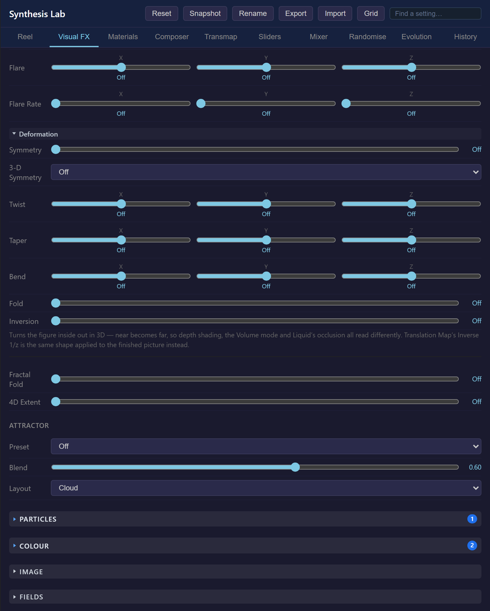

*The same **Figure** group, scrolled to its foot — the view the picture above runs out of room for. From
the top: the tail of **Curve Basis** (**Temper Rate** on the top edge, then **Grow**, **Flare** and
**Flare Rate**), then **Deformation** with its own ▾ header open, then **Attractor**. The four closed
group heads at the bottom — **Particles**, **Colour**, **Image**, **Fields** — are the rest of the tab
waiting underneath; the **Figure** head itself is off the top of this frame.*

*Seven of **Deformation**'s rows are showing and the rest are not in the panel at all: **Mirror**,
**Cell Size**, **Fold Scale**, **Sphere**, **4D Spin** and **4D Winding** each appear only once the
operator they belong to is above its identity, and on this preset every operator reads **Off**. The grey
paragraph under **Inversion** is the one piece of prose in the section — it says what that operator does
and where its image-domain namesake lives, not what the slider is set to.*

*In **Attractor**, **Preset** is **Off**, so the figure is the curve rather than a fractal; **Blend**
keeps its stored value and is read the moment a preset is chosen. Those two rows are the whole section.*

Everything above this bends the *picture*. These bend **space**, before the figure is turned toward the
camera — so the result reads as a solid object being deformed rather than as an image being distorted. They
are functions **of** where a point is, unlike the flow and turbulence controls further down, which add a push
**to** it. **Curve Basis above decides what the figure is made of; this section bends the finished figure.**

| Control | What it does |
|---|---|
| **Symmetry** | Folds the figure into *n* identical sectors **in model space**, so the symmetry axis tumbles with the 3D rotation instead of being pinned to the screen. Whole numbers only — at 1 it is off |
| **Mirror** | Appears underneath only once Symmetry is above 1. It alternates the handedness of successive sectors, which turns a pinwheel into a true mirror pattern |
| **3-D Symmetry** | Repeats the **whole** figure in three dimensions around the centre, and says **where the copies sit**: on a **Ring** or a **Sphere** of as many positions as you choose, or on the points of a solid — **Tetrahedron**, **Octahedron**, **Cube**, **Icosahedron**, **Dodecahedron**. Each copy is the complete figure, never cut, and the arrangement turns with the figure. **Off** changes nothing. The rows below appear only while an arrangement is chosen, and each shows only what that arrangement uses |
| **Ring Positions** | Only for **Ring**: how many positions around it, 1 to 24, evenly spaced — 2 doubles the figure, 3 triples it |
| **Sphere Positions** | Only for **Sphere**: how many positions, 2 to 60, spread as evenly as a sphere allows (most counts have no perfectly symmetric arrangement, so this is even rather than crystal-like) |
| **On** | Only for a solid: which of its points carry a copy — its **Vertices**, the middles of its **Edges** or the centres of its **Faces**. The cube has 8, 12 and 6; the icosahedron 12, 30 and 20 |
| **Copies at Each** | How many copies share each position, turned evenly about it, 1 to 12: 2 makes a pair, 3 a three-way star. The total is the positions times this |
| **3-D Radius** | How far the positions are from the centre. At 0 every copy sits on the centre and they overlap into one symmetric solid; from about 1.5 they separate into distinct copies. The whole arrangement is scaled back so it keeps the figure's size |
| **3-D Mirrors** | Appears once **Copies at Each** is 2 or more: mirrors every second copy at a position, so a pair becomes a figure and its mirror image |
| **Facing** | **Outward** turns each copy to face away from the centre, so a ring reads as a wreath and a sphere as a shell; **Parallel** keeps every copy the way the original faces |
| **Twist** (X / Y / Z) | Wrings the figure about each axis, by an angle proportional to how far along that axis a point sits — so the near and far ends turn opposite ways. One full turn from the centre to the edge of the figure's own box per 1.00. **Needs a figure with depth**: on a flat one it correctly does nothing. |
| **Taper** (X / Y / Z) | Scales the figure's cross-section along each axis, so it **flares open at one end and pinches shut at the other** — a tube becomes a cone, a trumpet or a spindle. The readout says *flare* or *pinch* because the sign is the gesture. Centre is off, and the slider snaps to it |
| **Bend** (X / Y / Z) | **Curves the figure's axis**, like bending a pipe into an arc. The readout also prints `r`, the radius of curvature, because that is the quantity the limit is about — the range stops short of the point where the figure would turn inside out |
| **Fold** | Reflects the figure back inside an invisible box whenever it strays outside, so the curve becomes architecture — mirrored chambers and corridors with the trail still sweeping through them. Off hides the two rows below. ⚠️ **2, 3 and 4 usually do nothing on their own** — see the note below. |
| **Cell Size** | How big that invisible box is, as a share of the figure's own design box. Nothing folds while the whole figure fits inside, so turn it **down** until the outer parts start reflecting. |
| **Fold Scale** | Shrinks or grows the figure between one fold and the next, which turns repeated folds into self-similar nesting rather than the same reflection twice. |
| **Inversion** | **Turns the figure inside out through a sphere**: what was near the centre explodes outward, what was far collapses inward, and straight runs become arcs. Low values are the usable range |
| **Sphere** | The radius of the sphere it inverts through, as a multiple of the figure's own size. Points exactly on the sphere do not move |
| **Fractal Fold** | Folds the figure back into itself again and again and pulls every fold back toward where each point started, so a smooth figure turns into nested, self-similar structure — rings within rings, layered shells, a boxy frame. 1 to 3 folds; **Off** changes nothing and hides the rows below. It folds across the screen only: near and far are never swapped, so depth shading stays right. The figure keeps its own size |
| **Fractal Cell** | The size of the invisible box the figure is folded into, as a share of the figure's own size. It picks the family of shapes: small cells shatter, then come layered sheets, a frame, and at the largest a lobed ring. Small changes morph smoothly |
| **Fractal Scale** | How strongly each fold stretches the figure. Negative values turn it inside out as well and often give the most striking shapes. At **0** the fold does nothing, and a note under the row says so |
| **Cell Breath**, **Cell Rate** | Make the cell size swing either side of its setting, and how fast. Off holds it still |
| **Scale Breath**, **Scale Rate** | The same for the fold strength; a swing through 0 passes through the unfolded figure |
| **4D Extent** | Treats the figure as a slice of a *four*-dimensional object, using each particle's place along the curve as its fourth coordinate, and sets how far it reaches into that direction. On its own it makes one end of the curve nearer than the other. Off is exact and hides the row below. |
| **4D Spin** (X-W / Y-W / Z-W) | Rotates the figure *through* the fourth dimension. These are rotations with no three-dimensional equivalent. The ordinary three-axis rotation is **Rotation** near the top of the tab — it is not repeated here. |
| **4D Winding** | How many times the fourth coordinate reverses as you walk along the curve, 1 to 8. **This is what makes 4D Spin more than a stretch**: at 1 the figure simply leans into the fourth direction, while higher values push successive stretches of it in opposite directions so the strands sweep through one another. Try 3 to 6. |

> **The Fractal Fold works on every figure** — wave figures, self-similar curves and attractors — and keeps
> the curve continuous, so trails, ribbons and Neon Lines keep working. **Worked examples:** `Fractal Cross`
> (a ring of loops folded into a glowing cross, as LiquidLight splats), `Fractal Butterfly` (a ring folded into
> soft lobes, in the Pastel palette), `Fractal Star` (one strong fold into a spiky star whose spikes breathe) and
> `Fractal Lattice` (the Hilbert 3-D curve folded into a jagged architecture). Load each one's base preset beside
> it — `Cycloid`, `Quader`, `Curve Lattice` — to see what the fold does.

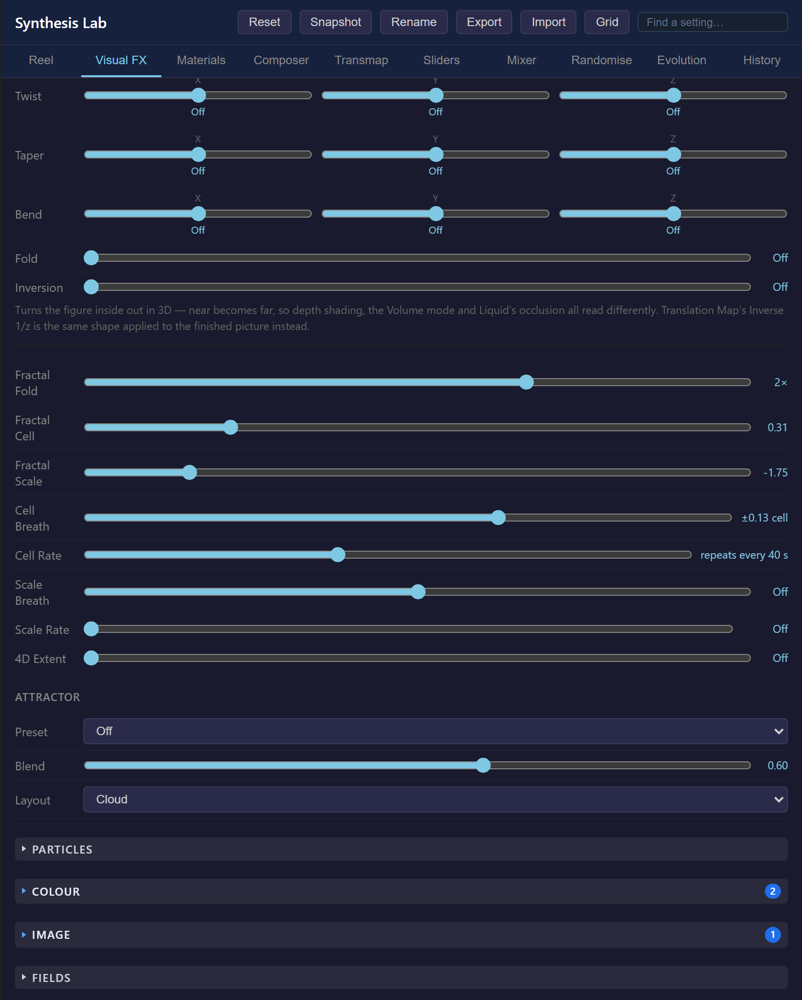

*The **Deformation** section on `Fractal Butterfly`: **Fractal Fold** at 2, and its rows appear below it —
**Fractal Cell**, **Fractal Scale** at −1.75, **Cell Breath** with its **Cell Rate** (a period that follows the
figure's speed), and **Scale Breath** and **Scale Rate**, both Off here.*

> **Symmetry divides the particles between the arms** — each arm carries 1/n of the density. After
> raising it, raise **Particle Number** to compensate, or the figure thins out.

> **3-D Symmetry divides them between the copies.** The line under the rows multiplies it out — for
> example *6 positions × 4 = 24 copies, about 2,083 particles each* — and from 24 copies it adds that the
> figure thins. Particle Number tops out at 50 000, so keep the total modest for a dense figure: a ring of 3
> or a cube's 6 faces already reads as a sculpture. **Worked examples**, each a figure that animates by
> itself: `Breathing Crown` (a ring of 6 with 3 copies at each — plants growing and receding), `Morph
> Wreath` (a ring of 3 mirrored pairs, close in), `Subdivide Sphere` (a sphere of 7 — a count no solid has), `Thicket Globe` (the icosahedron's 12
> vertices at Radius 0, so the copies overlap into one solid), `Cesaro Cube` (a sphere of 6 with 3 copies at each,
> close in at Radius 0.5), `Hilbert Tetra` (the tetrahedron's 4
> faces with 3 mirrored copies at each) and `Tilt Octahedron` (the octahedron's 6 vertices, kept parallel). Of
> these, only `Subdivide Sphere` and `Tilt Octahedron` hold their copies fully apart — the rest let them overlap,
> which is the other picture 3-D Symmetry makes. Because none of them draws Neon Lines, the depth cues work on
> them: `Hilbert Tetra` and `Tilt Octahedron` use them to bring the near copies forward.

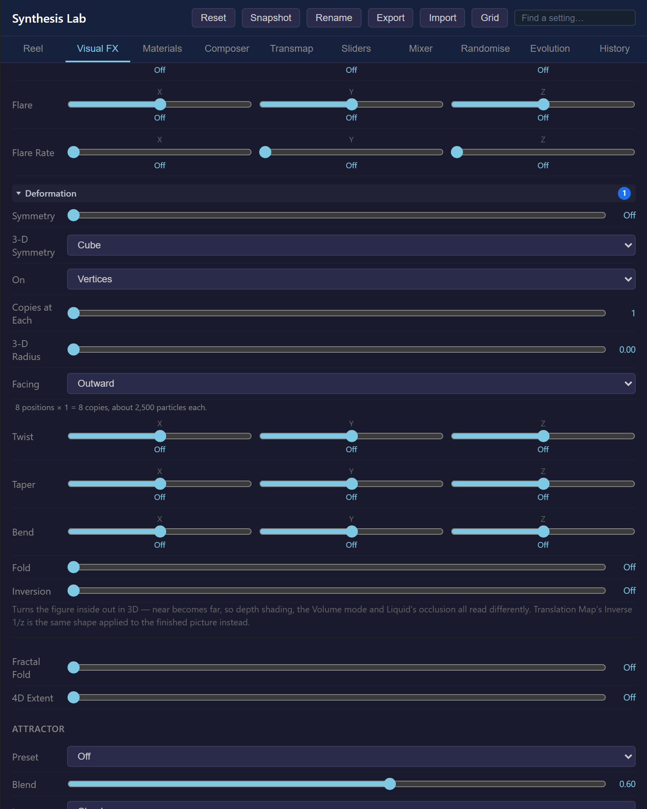

*The **Deformation** section with **3-D Symmetry** set to **Cube**: its rows appear below it — **On**, **Copies
at Each**, **3-D Radius** and **Facing** (the two Positions rows are absent, as they belong to the Ring and the
Sphere, and **3-D Mirrors** waits for a second copy at each position) — and the line under them multiplies the
copies out: *8 positions × 1 = 8 copies*. The section's badge counts it as one active operator.*

> **The bright creases are the point.** A fold sends many separate stretches of one curve to the same place,
> and overlapping particles are what makes a region bright — so the chambers arrive outlined in light. If the
> seams are not bright, nothing is folding: turn **Cell Size** down.

> ⚠️ **Taper and Bend change the brightness too, and the engine corrects for it.** Twist moves particles
> without changing how densely they are packed, so it never alters brightness. Taper and Bend do change the
> packing — that is what flaring and bending *are* — and in an additive renderer denser means brighter. The
> engine compensates automatically, which is why a pinched end does not go dark. At extreme settings the
> correction runs out of range and saturates.

> ⚠️ **Inversion acts in 3D, before the figure is turned toward the camera**, so it also changes **which
> particles are in front**. Depth shading, the Volume render mode and Liquid's occlusion all read
> differently under it. **Translation Map has a style called `Inverse 1/z` that is the same shape applied to
> the finished picture instead** — that one leaves depth alone. If you want the look and not the depth
> change, use that one.

> ⚠️ **All five of these read a coordinate, so an axis the figure has no extent on does nothing.** 68
> of the library's presets are flat in z, and on those the Z sliders are correctly and invisibly inert.

> **Fold Scale changes the brightness, and that is correct.** Squeezing the figure genuinely does put more
> particles in each pixel. It also compounds — at 4 folds a scale of 1.5 is already about 5x.

> ⚠️ **Fold 2, 3 and 4 are usually identical to 1, and this is the control's one real surprise.** One
> reflection already brings the whole figure inside the box, so a second has nothing left to fold — on
> `Pipes` every cell size behaves this way, and on `Quader` and `Cylinder` every size down to 35 %.
> **To make the higher counts count, move Fold Scale off 1.00** (it pushes the figure back out between
> folds, so each one has work to do) **or turn Cell Size right down.** That is also the only way to get
> self-similar nesting rather than the same reflection repeated.

> **Twist costs no brightness of its own**, but it spreads the figure over more of the frame, so a wound
> figure reads brighter and clips less than the same figure unwound.

> **4D Spin changes the brightness and nothing compensates it, which is correct.** The projection from four
> dimensions down to three genuinely crowds some particles together and spreads others apart, and crowded
> particles are brighter. Turning **4D Extent** up and the figure down is the usual pairing.

> **4D Spin changes which parts of the figure are nearest the camera** — especially **Z-W**, which turns
> depth itself. A preset that relies on depth
> colour, Depth Parallax or depth of field will read differently once either is on. That is the figure
> having turned, not a fault; the engine's ordinary Rotation does the same thing.

##### Attractor

| Control | Effect |
|---|---|
| **Preset** | Replaces the sine-wave curve with a **strange attractor**, keeping the current rendering and grading. Thirty-five are offered, from the Clifford, De Jong, Lorenz, Rössler, Thomas, Halvorsen, Aizawa and Nosé-Hoover families, plus a long list of Julia and Mandelbrot windows. *Off* restores the preset's own waves |
| **Blend** | How far to move from the wave figure toward the attractor: 0 is the preset untouched, 1 the attractor alone |
| **Layout** | How the attractor's particles are arranged. **Cloud** spreads them over many unrelated orbits, for even coverage. **Strand** follows ONE trajectory, so neighbouring particles are neighbouring points along the path: the figure becomes a single moving stroke with two free ends. Only the six flows (Lorenz, Rössler, Thomas, Halvorsen, Aizawa, Nosé-Hoover) have a trajectory to follow; on the others the row says so and the cloud draws |
| **Strand Length** | How much of the trajectory the strand shows, in multiples of the attractor's size. Around 48 shows most of the shape; longer strands pile up where the path retraces itself and wash towards white. Thomas and Aizawa never fill in the way their clouds do, because one orbit does not visit all of them |
| **Strand Speed** | How fast the strand travels along its trajectory, in new points per frame. 0 freezes it |
| **Length Breath**, **Length Rate**, **Speed Breath**, **Speed Rate** | Make the length or the speed swell and settle over time. The length breathes by stretching the strand, not by redrawing it. 0 holds it still |

Use **Blend** rather than switching outright — a mid value gives an attractor that still has some of
the preset's character in it. Blend also fades the Translation Map warp as it rises.

**A strand changes what colour and motion mean.** With the palette mapped by **particle index**, the colour
runs as a gradient along the stroke instead of as noise. The **velocity** colour and stretch measure how
fast the strand travels, not the attractor's own speed. And because a strand's value is its order, the
effects that push particles around (curl noise, fluid, physarum) work against it. A long trail with a
fast strand smears it into a blur, so a strand reads best with a shorter trail than a cloud.

**Blend works point by point on a strand.** Both the wave figure and the strand are ordered strokes, so a
mid Blend gives a single stroke between the two, and dragging Blend from 0 to 1 morphs one into the other
(`Lorenz Strand Morph`). A cloud cannot do this, because its neighbouring particles sit on unrelated orbits.

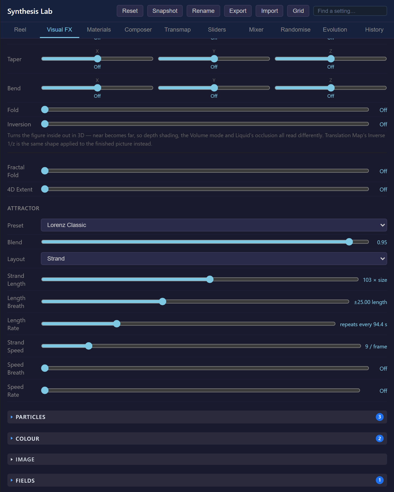

*The **Attractor** section on `Lorenz Strand`: **Preset** *Lorenz Classic* at **Blend** 0.95, **Layout** set to
**Strand**, and its rows below it — **Strand Length** 103 × size breathing ±25 every 94.4 s, **Strand Speed** 9 new
points per frame, its breathing Off. On **Cloud** the six strand rows are hidden.*

> The preview tiles draw a lighter version of the attractor — fewer particles and a shorter start-up, so a
> tile shows the right figure but a thinner sample of it than the main view. Judge the detail in the main view.

> Some attractor families flicker slightly by their nature. That is the mathematics, not a fault.

#### 6.2.3 Particles — how each particle is drawn

Seven sections deciding what a single particle looks like. **Render Mode comes first because it governs the other six**: two of them only exist under one mode, and the rest change meaning with it.

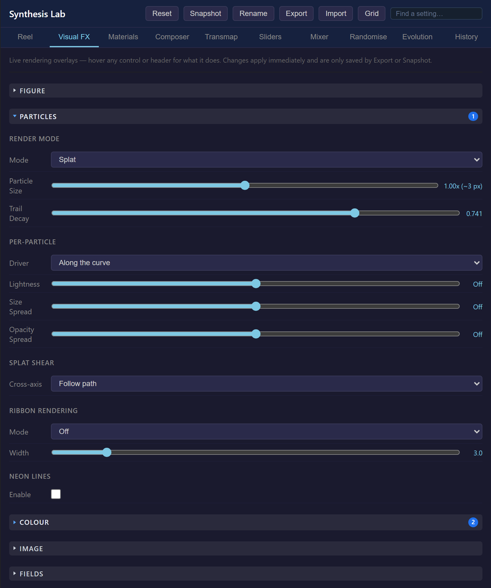

*The **Particles** group, opened: **Render Mode** with Particle Size and Trail Decay, then
**Per-Particle**, **Splat Shear**, **Ribbon Rendering**, **Neon Lines** and **Electric Discharge** — the
whole group in one view, with the other four closed around it. **Neon Lines** and **Electric Discharge**
show only their **Enable** box until it is ticked; **Ribbon Rendering** is switched off by its own *Mode* dropdown instead, which is why its
**Width** row is still here. **Volume Render** and **Liquid Surface** are absent because this preset's
mode is *Splat* — they are shown further down, each with the mode that creates it.*

##### Render Mode

How each particle is drawn. This has a bigger visual effect than almost anything else in the tab.

| Mode | What it looks like |
|---|---|
| **Pixel** | Hard single points. Sharpest and most diagram-like — one of the two flat legacy looks |
| **Blend** | Soft additive dots that pile into glow where they overlap |
| **Star** | A bright core with a soft halo. The usual choice |
| **Splat** | Overlapping particles accumulate into smooth density. Good for dense figures. **Needs a material** — with none selected it draws nothing at all |
| **Volume** | Ray-marches the accumulation as fog, and adds its own section at the bottom of the tab |
| **Liquid** | The odd one out: instead of *adding* light it merges nearby particles into one closed surface, and adds its own ten-control section. The only mode in which the figure can hide what is behind it |

| Control | Effect |
|---|---|
| **Particle Size** | Scales every particle 0.25×–4× on top of the mode's own base size — 3 px for Pixel and Blend, 5 px for Star, and the material's splat size (or 16 px without one) for Splat and Volume. The pixel figure beside the handle is what the current mode and canvas actually produce, so it changes when you switch mode |
| **Trail Decay** | **How much of the previous frame survives — in other words, trail length.** 0 draws each frame clean, 0.9 keeps roughly a ten-frame smear, 0.99 nearly never forgets |

> **Trail Decay is the single control most responsible for a preset's "feel".** If you change one thing
> and the preset stops looking like itself, this is usually it.

> **Two things override Trail Decay**, and in both the real trail is shorter than the handle says: an
> **additive material** caps it, and the Translation Map's *Fluid Feedback* style replaces it with its
> own persistence.

##### Volume Render — only with render mode *Volume*

Two controls, at the very bottom of the tab.

| Control | Effect |
|---|---|
| **Extinction** | How quickly the ray-marched fog absorbs light with depth. High gives a dense surface-like cloud, low a thin translucent haze you can see through |
| **Density Scale** | Multiplies the accumulated density the fog is built from. Raise it when the volume reads as too faint to have a shape; lower it when it saturates into a solid block |

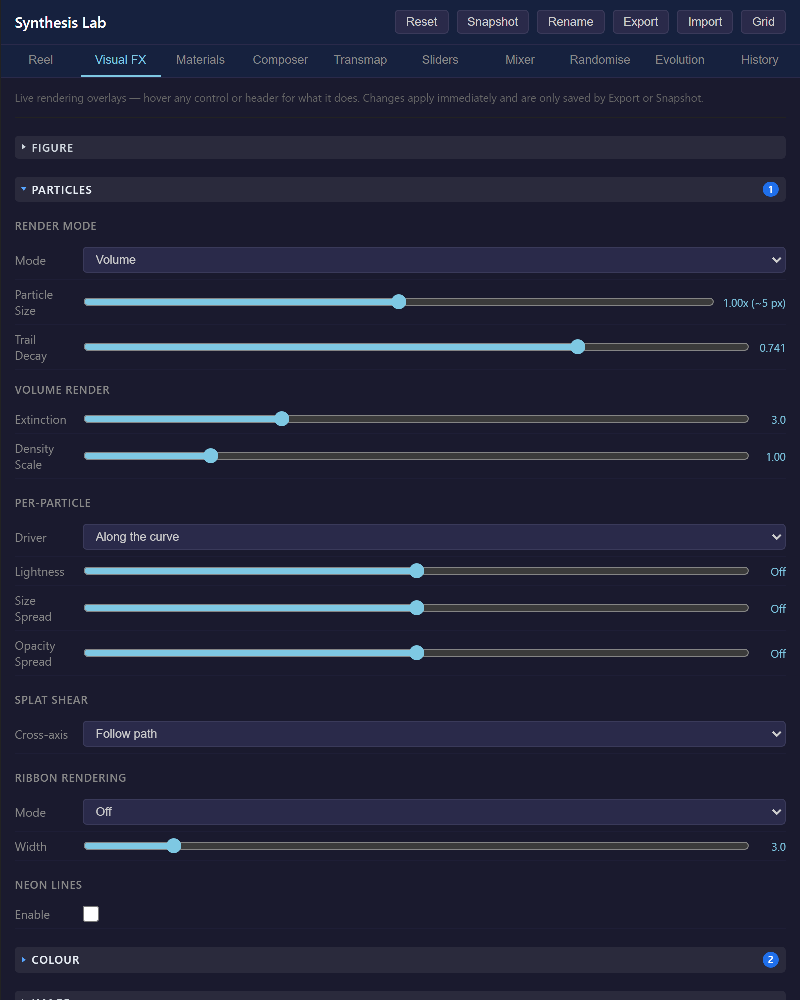

*The **Volume Render** section — **Extinction** and **Density Scale** — which exists only while the
render mode is *Volume*, at the very bottom of the tab.*

##### Liquid Surface — only with render mode *Liquid*

Appears directly beneath Render Mode. Ten controls that turn a point cloud into a body of liquid.

| Control | Effect |
|---|---|
| **Iso Level** | Where the surface forms, in multiples of the density measured along the figure itself — so it means the same thing at 4 000 particles as at 20 000. **1.0 is the balanced surface**: below it the lobes fuse, above it they separate into droplets |
| **Kernel Width** | How far each particle's influence reaches. With Iso Level, this sets how close two drops must come before they merge into one shape. The range is **0.5× to 16×** — but see the note below the table |
| **Edge Softness** | Feathering on the boundary. 0 gives a hard painted edge; high values give a misty falloff that reads as spray rather than liquid |
| **Tint Source** | Where the surface takes its colour: *Preset* (the figure's own), *Palette*, *Material Ramp*, *Ramp* or *Dye*. **The rows below it change with this choice** — see the note after the table |
| **Surface Ramp** | The gradient the body is coloured by, indexed by how thick it is at each pixel — thin rim one end, thick core the other. **Shown for *Ramp* and for *Dye***, which are the two sources that read it |
| **Figure Colour** | How much of each pixel's colour comes from the particles that actually built it. 1 keeps the figure's own colours; 0 leaves the surface coloured by Tint Source alone. **Absent under *Dye*** |
| **Mix Model** | *Light* blends toward the brighter constituent, the way lit fluid behaves. *Pigment* deepens where layers stack, the way ink does, and leaves the thin rim untouched — so it reads as a material rather than a brightness change. **Absent under *Dye*** |
| **Refraction** | How much light appears to bend travelling through the body, so the shape reads as seen-through rather than filled in |
| **Specular** | Strength of the glint where the surface faces the light. It follows the surface's curvature, so it slides across a moving figure — the clearest cue that the shape is wet |
| **Thickness** | How much light the body absorbs on the way through, so a thick core goes deeper and darker while the thin rim stays bright. This is what separates a *volume* of liquid from a flat fill |
| **Edge Bright** | Brightness of the rim where the surface turns away from you. Raise it when the shape reads as a solid silhouette rather than a body |

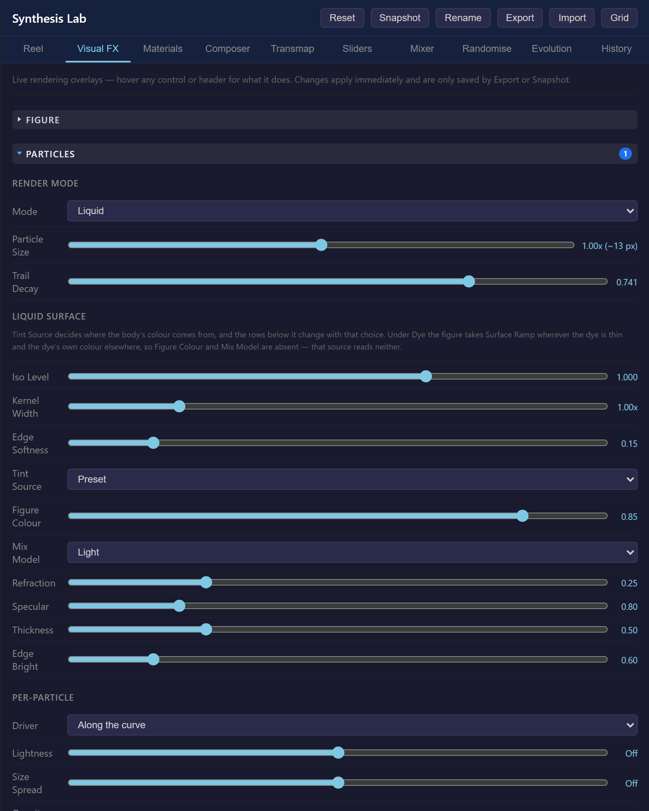

*The **Liquid Surface** section, which exists only while the render mode is *Liquid*. It appears
directly beneath Render Mode, and runs from Iso Level down to Edge Bright.*

> **Kernel Width can stop having an effect before the end of its track, and the window size decides
> where.** The surface is built from one sprite per particle, and your graphics driver puts a hard ceiling
> on how large a sprite can be. Past that point raising Kernel Width changes **nothing at all** — not
> "less and less", but exactly nothing, because the threshold the surface is measured against is derived
> from the same clamped size. **The bigger the window, the sooner it happens:** on a 4K canvas it can stop
> responding as low as about 2.4×, while on a small window the whole range is live.
>
> So if the control seems dead, make the window smaller or lower **Particle Size** and try again — and
> treat the top of the range as headroom for small windows rather than as a setting you can rely on
> everywhere.

> **Figure Colour defaults to 0.85, and that masks Tint Source.** Changing the tint looks weak until you
> lower this, because the figure's own colours are dominating. With Tint Source on *Preset* the two are
> the same colours anyway, so the difference only really shows on *Ramp*, *Material Ramp* and *Palette*.
> **It does not apply to *Dye*, which ignores Figure Colour entirely** — which is why the row is not
> there when you pick it.

> **Three rows move when you change Tint Source, and two of them leave.** *Ramp* and *Dye* both show
> **Surface Ramp**; *Dye* also removes **Figure Colour** and **Mix Model**, because that source reads
> neither of them. A row that the current source cannot read is hidden rather than greyed out, here and
> throughout the tab — a greyed row would suggest it still applies.

> **Setting the two colours under *Dye*.** The dye gives you a figure colour and a dye colour that are
> genuinely separate: **Surface Ramp** colours the body wherever the dye is thin, **Dye Colour** colours
> the dye itself and the wake around the figure, and **Dye Amount** is the balance between them. Low Dye
> Amount leaves the body mostly Surface Ramp with a tint of dye; high Dye Amount hands the body to the
> dye and leaves the ramp visible only at the moving edge. **Raising Dye Amount after choosing a Surface
> Ramp will hide that ramp again** — it is a crossfade, not a mixture.

---

##### Per-Particle

Until now every particle in a figure looked the same. These rows let **one ordered quantity** set each
particle's size, brightness and solidity individually.

| Control | What it does |
|---|---|
| **Driver** | Which ordering the three rows below read: *Along the curve*, *Speed*, *Depth*, *Colour cycle* — and, on a fractal, *Escape time (distance from the set)*. All three share this one choice, so the same particles end up large, bright and solid together |
| **Lightness** | Makes some particles brighter than others. Centre is neutral; right brightens the high end of the ordering, left swaps them |
| **Size Spread** | Makes some particles bigger than others. At the extremes the smallest nearly vanish while the largest double |
| **Opacity Spread** | Makes some particles more solid than others. Clearest on a preset with a visible trail or a material |

> ⚠️ **THESE THREE ROWS ONLY REACH THE PARTICLE PASSES — they do nothing while Ribbon Rendering or Neon
> Lines is drawing.** A ribbon and a neon line are drawn by their own renderers, which do not read these
> three values, so on a preset whose **Ribbon Rendering → Mode** is anything but *Off* (or whose **Neon
> Lines** are on) all three sliders move and the frame does not change. **Set that Mode to *Off* first.**
> `Pipes Taper Comet` is the preset this is easiest to meet it on; `Pipes Taper Bend Spread` is the one
> built to show the rows working — with its ribbon already off for exactly that reason.

> **Try Lightness first.** At the size of a particle the eye reads brightness far better than it reads
> colour, so this is the row most likely to show. Size Spread is the one that most changes the *shape* of
> the figure, because it gives it a sense of near and far.

> **The left and right halves of each slider are different pictures, not more and less.** Pushing right
> emphasises the high end of the ordering and pushing left emphasises the low end — the same structure
> seen the other way round.

> **At the extremes the spread is large**: the biggest particle can be 25 times the smallest, and the
> brightest 25 times the dimmest. Nothing ever reaches zero, so no particle disappears outright.

> **Speed needs a figure that moves.** At Speed zero every particle has the same velocity — none — so these
> rows correctly do nothing. *Along the curve* always works.

> ⚠️ **The fifth Driver is not always in the list, and that is deliberate.** *Escape time* reads how
> quickly each particle's point left the Julia or Mandelbrot set it is sitting in, so it only means
> anything while such an attractor is actually running — see **Attractor**. On any other preset the
> option is **not offered at all**, which is why the dropdown is four items long most of the time and
> five on a fractal. The one exception: if a preset was saved using it, the option stays visible on that
> preset even where it has no data, so the dropdown never shows you a different driver from the one the
> preset carries.

> **Escape time is the driver that paints the fractal's own structure**, because the quantity it reads is
> the thing the picture is made of: distance from the set. The bands come out as size, brightness or
> solidity instead of only as position. `Black Hole Relief`, `Mandelbrot Seahorse Bands` and
> `Mandelbrot River Glow` ship as worked examples, at the end of the library list.

> **With Size Spread on, the pixel estimate beside Particle Size reports the SMALLEST particle.** There is
> no longer a single size, and the smallest is the one number you can reason about.

##### Splat Shear

One control, and it only does something when a **material** is active — it shapes the marks the splat
path draws, so with no material there is nothing for it to shear.

| Control | Effect |
|---|---|
| **Cross-axis** | *Follow path* or *Flat nib*. **Follow path** keeps every mark the same apparent width whichever way the particle is travelling — this is how the engine has always drawn them, and it is what every existing preset was authored against. **Flat nib** pins the mark's cross-axis to the screen instead, so marks widen when a particle moves across the screen and narrow when it moves along that fixed direction — the look of drawing with a flat-nibbed calligraphy pen |

> **What to look for, because the difference is easy to miss.** Pick a preset with a stretched
> material — anything using *Fire*, *Plasma* or *Liquid Light* — and watch a part of the curve where
> the direction of travel changes a lot, such as a tight loop. On **Follow path** the stroke keeps an
> even thickness all the way round. On **Flat nib** it swells and thins as it turns. On a curve that
> travels in one direction the two settings look nearly identical.

> **It is saved with the preset.** Export, Snapshot and the Mixer all carry it, and *Follow path* is
> what a preset gets when it does not mention the setting at all — so nothing in the library changes
> appearance until you pick *Flat nib* yourself.

##### Ribbon Rendering and Neon Lines

Two different ways to turn separate points into continuous strokes. They are mutually exclusive — one
switches the other off.

| Control | Effect |
|---|---|
| **Ribbon · Mode** | *Off*, *Hybrid*, *Streaks* or *Adaptive*. Draws the path as a continuous solid band, so the curve reads as a surface with an inside and an outside. *Off* is the point cloud every legacy preset was authored against |
| **Ribbon · Width** | Thickness of the band in pixels. Narrow reads as a drawn line; wide reads as a folded sheet that occludes itself where the curve crosses |
| **Neon · Enable** | Draws each particle's recent path as a short glowing trail, so the figure's motion shows as light-trails. A figure that does not move draws no trails |
| **Neon · Width** | Line thickness in pixels. Past about 4 the segments merge into a solid ribbon and the wireframe reading is lost |

> **Neon Lines reads best at a moderate particle count.** The effect depends on the individual trails
> being legible; at 50 000 particles they overlap into a solid mass.

##### Electric Discharge

Crackling, flickering filaments of light around the figure, like an electric discharge. The light on
screen is pulled toward its own brightest parts, which keeps collapsing it into thin, unstable filaments
that form, snap and re-form every frame. It works on any figure, whatever its trail length.

**It needs Neon Lines.** What it tears into filaments is the glow of the neon lines; on plain points or
ribbons it has nothing to work with and only thins the figure. So the two are linked: turning **Electric
Discharge** on also turns **Neon Lines** on (which, as always, switches Ribbons off), and turning **Neon
Lines** off also turns **Electric Discharge** off.

| Control | Effect |
|---|---|
| **Enable** | Switches the effect on, and Neon Lines with it. Off, nothing about the preset changes |
| **Intensity** | How strongly the light is pulled into filaments: low is a faint shimmer, high a violent, tightly wound discharge |
| **Filament** | How thick the filaments are, in pixels: low is hair-fine, high is thicker, softer arcs |
| **Crackle** | How fast the filaments flicker and how long they live. High also keeps a slow-moving figure crackling |
| **Branching** | Makes the filaments fork and wander along a slowly drifting field, from none to lightning-like arcs |

> **Worked examples:** `Quader Discharge` (the same figure as `Quader Star Eight`, where the effect was
> first found as a Translation Map setting) and `Curve Weave Lightning` (Branching).

#### 6.2.4 Colour — the photography

Two sections: the grading chain, and the gradient that can replace per-particle colour. This is the photography, applied to a figure that is already drawn.

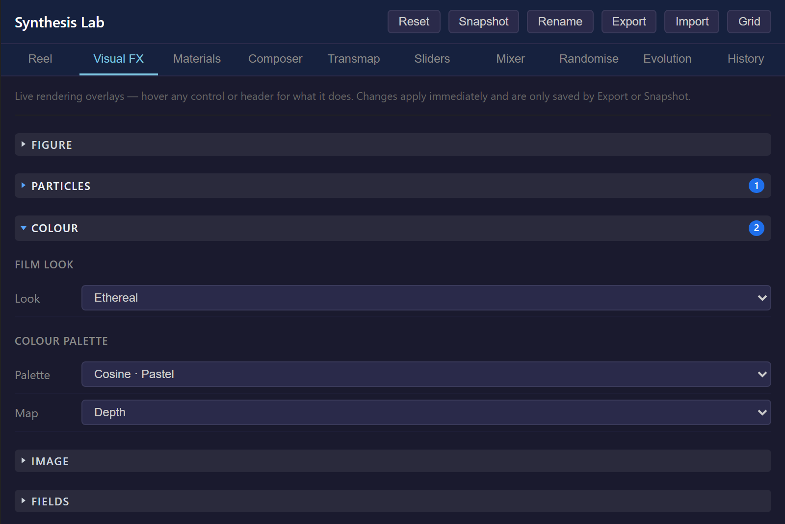

*The whole **Colour** group with a named look chosen. **Film Look** is a single row — just **Look** —
because the named bundle is deciding the other eighteen values for you. **Palette** and **Map** below it
belong to **Colour Palette**, which is a separate section.*

##### Film Look — one pick, or eighteen controls

The whole photographic treatment of the image: bloom, tone curve, exposure, colour balance, vignette
and the particle shape controls. There are **fifteen named looks** —

*Legacy*, *Legacy Graded*, *Luminous*, *Cinematic*, *Neon*, *Ethereal*, *Dramatic*, *Vintage*,
*Glacier*, *Plasma*, *Monochrome*, *Teal & Orange*, *Holographic*, *Void*, *Overexposed*

— and a sixteenth entry, **Customize**, which is not a look but a door.

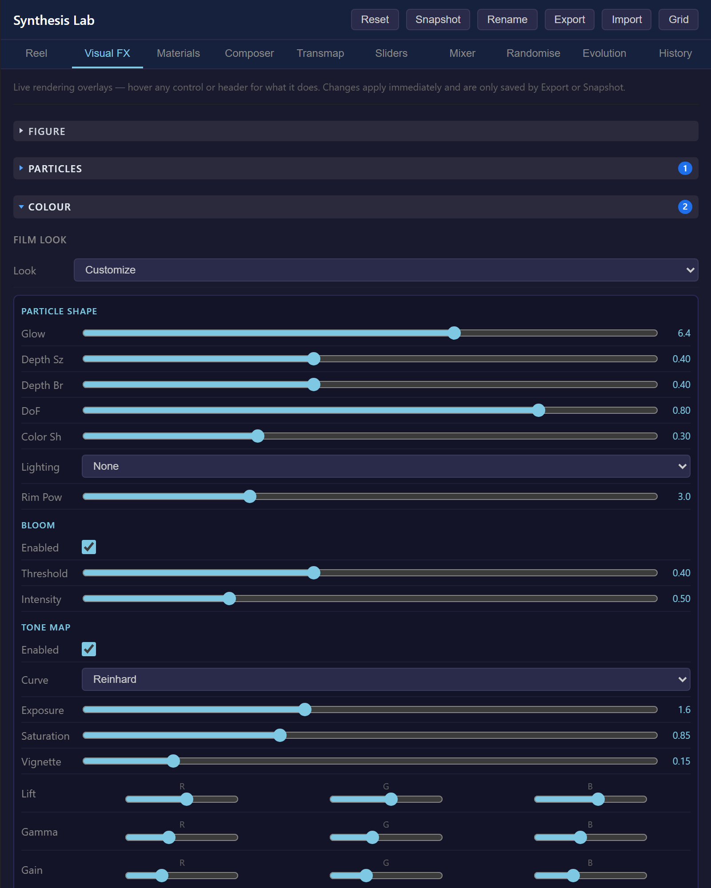

*With **Customize** chosen, eighteen controls appear under **Film Look** in three labelled groups, and
the whole chain fits in one view: **Particle Shape** (Glow, Depth Sz, Depth Br, DoF, Color Sh, Lighting,
Rim Pow), **Bloom** (Enabled, Threshold, Intensity) and **Tone Map** (Enabled, Curve, Exposure,
Saturation, Vignette, then Lift, Gamma and Gain as one slider per colour channel).*

Switching to **Customize** starts from whatever look was active, so you can take *Cinematic* and adjust
from there rather than starting from nothing. Going the other way — picking any named look —
**re-seeds all eighteen values**, so your edits are replaced rather than kept.

**Opening the door changes nothing.** Switching to **Customize** leaves the picture exactly as it was —
the same eighteen values, and the same palette, because *Customize* makes no colour decision of its own.
Picking a *named* look does set the **Palette** row where that look carries a palette — see **Colour
Palette** below; *Customize* never does, so a preset's own palette survives the switch and you can edit the
grading without losing it.

The panel is divided into three labelled groups: **Particles**, **Bloom** and **Tone Map**.

**Particles** — seven controls deciding what a single particle looks like:

| Control | Effect |
|---|---|
| **Glow** | Size and softness of each particle's halo. This is a **shape** control, not a brightness one — low gives a tight bright core, high a wide diffuse bloom. Used only by the *Star* and *Blend* render modes |
| **Depth Sz** | How much larger near particles are drawn than far ones. This is the main cue that makes a 3D figure read as having depth rather than as a flat pattern |
| **Depth Br** | How much brighter near particles are drawn. Use it with Depth Size when the figure looks uniformly lit and therefore flat |
| **DoF** | Depth of field — blurs particles away from the focal depth, so only the middle of the figure is sharp. A photographic cue: it makes the figure read as an object being photographed. It blurs the near and the far side alike, so it does **not** say which part is in front — use **Depth Sz** and **Depth Br** for that |
| **Color Sh** | Tints distant particles away from near ones — aerial perspective. Adds depth separation without changing size or brightness, which is useful when both are already committed |

The last two of that group give the figure a surface rather than leaving it as emissive dust:

| Control | Effect |
|---|---|
| **Lighting** | *None*, *Directional*, *Rim* or *Both*. Flat ignores direction entirely; the lit modes add a directional highlight and a rim, so the figure gains a surface instead of reading as emissive dust |
| **Rim Pow** | How tightly the rim highlight hugs the silhouette. High gives a thin bright outline, low a broad wash across the whole facing side |

**Bloom** — three controls:

| Control | Effect |
|---|---|
| **Enabled** | Bleeds light from bright pixels into their surroundings, the way a camera does. This is what makes bright cores read as genuinely hot rather than merely white |
| **Threshold** | How bright a pixel must be to bloom. It *subtracts* against accumulated values that can reach the hundreds, so on a dense trail it is a weak lever |
| **Intensity** | How strongly the bloom is added back. A plain multiplier — so this, not Threshold, is the effective control over how much the image glows |

**Tone Map** — eight controls, the last three one slider per colour channel:

| Control | Effect |
|---|---|
| **Enabled** | Compresses out-of-range brightness into what the display can show, instead of letting it clip flat. Turn it off only to see the raw accumulation |
| **Curve** | *None*, *ACES* or *Reinhard*. ACES rolls the highlights off like film; *None* clips hard, which flattens bright cores into featureless white |
| **Exposure** | Overall brightness before the tone curve. The right **first** control for an image that is too dark or blown out, because it moves the whole picture through the curve |
| **Saturation** | Colour intensity after tone mapping |
| **Vignette** | Darkens the frame edges, drawing the eye to the centre. Also hides the hard edge where a warp meets the frame border |
| **Lift** (R/G/B) | Raises or lowers the **blacks** per channel. Use it to tint the empty background, which is what the darkest pixels almost all are |
| **Gamma** (R/G/B) | Bends the **midtones** per channel without moving black or white. The control for colour balance in the body of the image |
| **Gain** (R/G/B) | Scales the **highlights** per channel. Past the tone curve's knee the output no longer depends on the input, so this — not Exposure — owns the colour of a saturated core |

> **Saturation cannot bring back a colour that was already lost.** A pixel clipped to white upstream has
> no hue left to intensify. Fix those with **Exposure** or **Gain** instead.

---

##### Colour Palette

| Control | Effect |
|---|---|
| **Palette** | The gradient in force, whatever supplied it. It replaces per-particle colour. There are over forty, in four families — *Cosine*, *Cycle*, *Classic* and *Material* — plus **None**, which means no palette at all |
| **Map** | Which per-particle quantity is looked up in the gradient: *Depth*, *Phase*, *Velocity*, *Position*, *Age*, *Temperature* or *Particle index* |

The **Map** is worth experimenting with before the palette itself — the same gradient mapped by *depth*
reads as atmosphere, and mapped by *particle index* reads as a rainbow laid along the figure.

> **A palette replaces the preset's own colour.** While one is active, colour edits elsewhere will seem
> to do nothing, because they are being overwritten rather than ignored. Set the palette to **None** to
> get them back.

> **Two mappings have conditions.** *Temperature* needs a material to read temperatures from. *Depth*
> gives one flat colour on a figure with no rotation, because every particle is then at the same depth.

> **Particle index is the odd one out**, and usefully so: it is computed on the processor rather than
> the graphics card, which means it reaches *every* render mode — including ribbons and neon lines,
> which the others cannot colour.

> **It is also the answer to an open figure's colour seam.** **Travel** gives the curve two free ends
> (Figure → Framing & Timing), and because every other mapping *cycles*, the hue jumps where the arc
> stops. *Particle index* runs the gradient once from one end to the other instead, so the seam becomes
> a gradient. ⚠️ **A Map needs a Palette** — with **None** selected there is no gradient to map, so pick
> one as well. `Quader Square Spring`, `Pipes Sweep Breath` and `Pipes Conical Vortex` ship set up
> this way.

#### 6.2.5 Image — the warp applied to the finished frame

One section. Everything above has produced a finished frame; this re-samples it through a displacement field. The field itself is shaped on the **Transmap** tab.

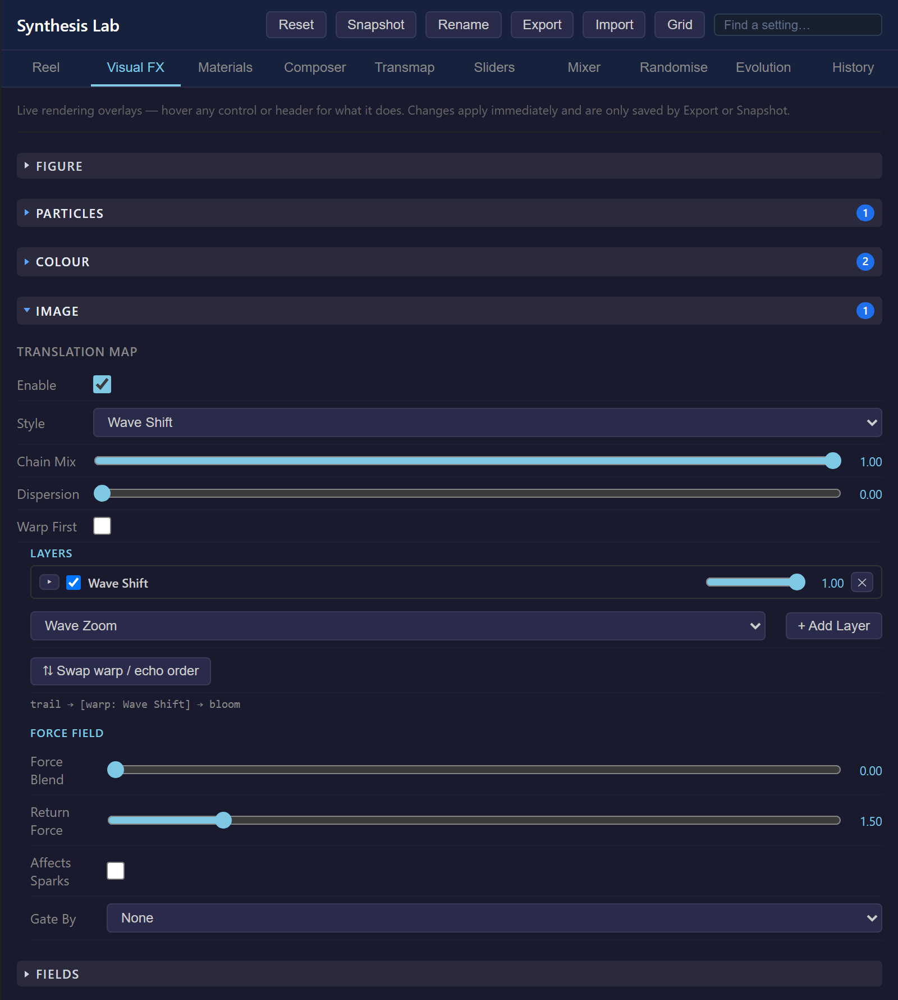

*The **Image** group holds one section, **Translation Map**, and this is it with **Enable** ticked. With
the box clear the group is one line — which is the normal state, since most presets do not warp the
frame at all.*

*⚠️ **The one layer in the list is shut.** Its row carries a **▸**, and everything that belongs to the
layer rather than to the chain — **Pattern**, **Shape**, **Shape Mix**, **Angle**, **Strength**,
**Detail**, **Drift** and, on **Zoom Combined**, a whole **Zoom half** — is behind it. **The picture
under Building the chain below shows one of those bodies open.***

##### Translation Map — the image warp

###### What a warp does

Everything else in PSSS decides where the particles go. The warp does something different: it takes the
**finished picture** and bends it, like holding a sheet of patterned glass in front of it. The figure
itself never moves — only the image of it.

That is worth picturing, because it explains both why the warp is so powerful and how it goes wrong. A
simple figure of a few thousand particles can come out looking like lace, because the warp is
multiplying the detail that is already there. Equally, a figure that is *already* complicated turns to
mush, because there is nothing left to see through the glass.

The warp is built as a **chain of layers**. Each layer is one piece of glass; the chain is the stack.
**This section is where the chain is assembled** — layers are added, weighted, muted and removed here,
and each layer's own controls open here. The **Transmap** tab (§6.5) is where the *wave field* behind
the four wave styles is drawn.

###### The five chain-wide controls

| Control | Effect |
|---|---|
| **Enable** | Master switch for the whole warp pass. With it off no layer does anything, whatever its settings. **This is the only true bypass** |
| **Style** | The operator for a **single-layer** chain. Shown only while the chain has one layer — add a second and each layer carries its own style instead |
| **Chain Mix** | Master strength for the summed warp of every layer, and the multiplier every layer weight feeds into. **0 looks exactly like the pass being off**, which makes it the fastest way to A/B a whole chain without losing your settings |
| **Dispersion** | Chromatic fringing along the warp direction — red and blue are sampled slightly ahead of and behind green, so edges get a faint colour split. It scales with the **local** offset, so it appears exactly where the chain displaces the image and nowhere else. It applies to the whole chain, not to one layer |
| **Warp First** | Runs the warp **before** this frame's particles are drawn, so only the accumulated trail is displaced and the figure stays crisp — a flowing wake behind a solid subject. It needs a long trail to show: with a one-frame trail there is no history to displace and both orders look identical |

> **Chain Mix 0 is not the same as Enable off.** Chain Mix scales the result; Enable removes the pass.
> Use Chain Mix to compare, Enable to switch off.

> Sixty of the legacy presets load with the warp switched **off**, and adding a layer does not turn it
> on.

###### Building the chain

Under those five controls is the **layer list**. Each layer has a row:

| On the row | What it does |
|---|---|
| the **style name** | What this layer does. On a chain of two or more, each row carries its own |
| **weight** | How much this layer contributes. **0 switches it off but keeps its settings** |
| the **tick** | Mute — takes the layer out of the sum while keeping everything about it |
| **▸** / **▾** | Opens that layer's own controls. They differ per style, and the catalogue below lists them |
| **✕** | Removes the layer |

| Button | What it does |
|---|---|
| **+ Add Layer** | Adds a layer. The menu offers only the styles **not already in the chain**, so each style appears at most once and a chain is at most twelve layers long. To get "more of the same", raise a layer's weight rather than adding it twice |
| **⇅ Swap warp / echo order** | Swaps which of the two passes runs first, when *Fractal Feedback* is in the chain — see below |

> **Read the pipeline line at the foot of the section.** It prints what is actually running, for example
> `trail → [warp: Wave Shift + Vortex, time-warp] → [echo: IFS] → bloom`, or
> `trail → bloom (no active layer)`. It is the quickest way to find out why a chain is doing nothing.

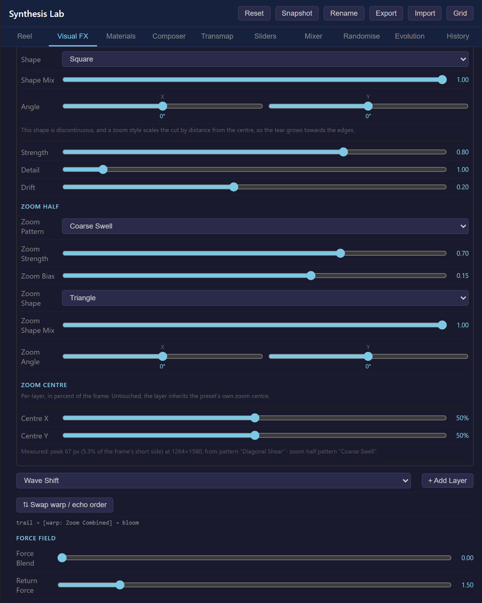

*What **▸** opens. This is a single **Zoom Combined** (style 3) layer with its body expanded, scrolled so
the two halves meet in one frame — the layer's own **Pattern** row is just above the top edge, and the
measured line near the bottom names it (`Diagonal Shear`), with the zoom half's own pattern beside it.*

*The **shift half** comes first: **Shape** is **Square** at **Shape Mix 1.00**, so the grey line under
**Angle** warns that this shape is discontinuous and that a zoom style grows the cut towards the edges.
Then **Strength 0.80**, **Detail 1.00**, **Drift 0.20**.*

*The **Zoom half** below it is a second, independent field with its own everything: **Zoom Pattern**
**Coarse Swell**, **Zoom Strength 0.70**, **Zoom Bias 0.15**, and its own shape pair — **Zoom Shape**
**Triangle** at **Zoom Shape Mix 1.00**. **That is the point of the picture: one layer, two shapes, a
hard-edged shift inside a smooth zoom.** Both **Angle** rows are at **0° / 0°**, so neither half is
rotated here.*

*⚠️ **The two shapes are set by hand for this picture, not loaded from a preset.** No shipped preset
drives the zoom half's shape any more, so the figures above are what the rows read after four deliberate
changes — which is also how you would reach this state yourself.*

*Under **Zoom centre** the measured line reports the whole layer in pixels — `peak 61 px (4.9% of the
frame's short side)` at this window size — and below the body sit the **+ Add Layer** row, **⇅ Swap warp
/ echo order**, the pipeline line (`trail → [warp: Zoom Combined] → bloom`) and the start of
**Force Field**.*

###### The three kinds of style — and how layers interact

This is the part that decides what a combination will do. The twelve styles are not twelve variations of
one thing; they belong to **three kinds**, and the kinds combine differently.

| Kind | Styles | How it reaches the picture |
|---|---|---|
| **Field** — 8 styles | Wave Shift, Wave Zoom, Zoom Overlay, Zoom Combined, Procedural Flow, Fluid Feedback, Density Refraction, Vortex | Each produces a **displacement** — an amount and a direction for every pixel. All field layers are **added together** into one displacement, applied in a single pass |
| **Modifier** — 3 styles | Time Warp, Band Split, Depth Parallax | Produces **no displacement of its own**. It changes *how* the summed displacement is applied, so it **needs at least one field layer** and on its own does nothing at all |
| **Colour** — 1 style | Fractal Feedback | Not a displacement but a **separate pass**, which feeds the picture back into itself. It runs either before or after the warp pass, and **⇅ Swap warp / echo order** chooses |

Four consequences worth knowing:

- **Two field layers add up.** Pointing the same way they reinforce; pointing opposite ways they cancel.
  This is why one strong layer plus one light one reads as *structure*, while two strong layers often
  flatten each other out.
- **A modifier added to an empty chain looks broken.** It is not — there is no displacement for it to
  modify. Add a field style first.
- **Each style appears at most once**, so a chain is a set of different operators rather than a stack of
  repeats.
- **Order only matters for the colour style.** The field layers are summed, so their order in the list
  makes no difference; only the warp-versus-echo order is a real choice.

###### The twelve styles in detail

**The four wave styles** are the classic warp and the oldest part of PSSS. All four read a **wave
field** — a pattern of ripples drawn across the frame — and turn it into movement. They are the only
four whose field you can draw by hand, in the Transmap tab (§6.5).

| Style | What it does to the image |
|---|---|
| **Wave Shift** | Slides each pixel sideways by the wave. Think of looking at the picture through rippled window glass: nothing changes size, things just sit in the wrong place. The plainest warp, and what most legacy presets use |
| **Wave Zoom** | Pushes pixels away from or towards a centre by the wave, so the image breathes in and out instead of sliding |
| **Zoom Overlay** | The same zoom, but laid **over** the unzoomed picture rather than replacing it — so you see both at once, like a double exposure with one copy magnified |
| **Zoom Combined** | A shift and a zoom together, each from **its own** set of waves. The picture slides *and* breathes, and the two can be set to fight or to reinforce |

All four share these controls in their layer panel:

| Control | Effect |
|---|---|
| **Pattern** | Where the wave field comes from: **(Preset)** — the preset's own waves, which is what almost every shipped preset uses — or one of **nineteen named patterns**, catalogued under *Transmap* |
| **Shape** | Which **wave** the field is built from: *Sine*, *Triangle*, *Trapezoid*, *Square* or *Sawtooth*. Sine is the default, and the whole library is built on it apart from the eight **wave-shape demos** at the end of the list. ⚠️ **It does nothing until Shape Mix is above 0** |
| **Shape Mix** | How much of that shape is blended into the plain sine field: **0 is pure Sine whatever Shape says**, 1 is the shape alone |
| **Angle X / Angle Y** | Which direction each of the two waves runs in, in degrees. At **0 and 0** they are at right angles, the way almost every shipped preset is built — only the **warp-orientation demos** at the end of the library list are built off it; turn them apart for an arbitrary lattice orientation, or together for stripes in one direction only. The range is **±90**, because a wave at +120° is the same field as one at −60° with its amplitudes flipped |
| **Strength** | How big the warp is. **0.5 is neutral**: the preset's waves exactly as authored. Above it the field is stronger than intended, below it weaker, **0 means no warp**, and below 0 the same field is inverted — every offset pointing the other way |
| **Drift** | How fast the whole field slides, in pattern cells per second. It moves the field **rigidly**, so the ripples keep their shape and size and only change where they sit. 0 holds it still, which is what almost every preset does |
| **Centre X / Centre Y** | Where the zoom pushes away from, in percent of the frame. **Wave Shift ignores it.** Touching either axis fixes both for this layer |
| **Zoom Pattern**, **Zoom Strength**, **Zoom Bias** | Zoom Combined only — the second field, its own size, and a steady push in or out underneath the oscillation |
| **Zoom Shape**, **Zoom Shape Mix** | Zoom Combined only — the zoom half's own wave shape, independent of the shift half's, so one half can be shaped and the other left smooth |
| **Zoom Angle X / Y** | Zoom Combined only — the zoom half's own pair of directions, so the zoom can keep its lattice square while the shift half tilts |

> ⚠️⚠️ **PICKING A SHAPE AND LEAVING SHAPE MIX AT 0 DOES NOTHING AT ALL, AND THAT IS THE FEATURE'S ONE
> REAL TRAP.** The two are deliberately independent: *Sine* is one way of saying "no shape", and a mix of
> 0 is the other, so choosing *Square* on its own changes nothing on screen. **A grey line appears under
> the row saying exactly that** — if you have picked a shape and the picture has not moved, read it, and
> raise **Shape Mix**.

> **Shape and Shape Mix are also on the Transmap tab**, with the same two rows and the same behaviour.
> Either editor drives the same layer; the catalogue of what each shape looks like is under *Transmap*.

**The other four field styles** each generate their own field and cannot be drawn by hand.

**Procedural Flow** — drifts the picture along a generated current, as if the image were paint on
moving water. Pick the shape first, then adjust it.

| Control | Effect |
|---|---|
| **Archetype** | A named flow shape: *Fire Rise*, *Smoke Drift*, *Vortex*, *Expansion*, *Implosion*, *Wind Shear*, *Thermal Column*, *Ocean Current*, *Chaos*, *Gentle Drift*, *Strong Expansion*, *Strong Implosion*, or *Custom*. Moving a slider below keeps the shape |
| **Strength** | Peak displacement, in the same frame-relative unit the other styles use |
| **Scale** | Size of the flow features — small gives fine local swirls, large one broad sweep |
| **Curl Amount** | Blends from straight flow toward pure curl. Curl circulates instead of translating, so **this is what turns a push into a swirl** |
| **Direction** | Direction of the straight part, in degrees. Irrelevant once Curl Amount is at 1 |
| **Radial** | An inward (negative) or outward (positive) pull about the centre — a drain or a fountain. With Curl Amount it becomes a spiral |
| **Evol. Speed** | How fast the flow itself changes. At 0 the flow is fixed, so the image settles into a static distortion instead of continuously moving |

**Fluid Feedback** — a warp that feeds into its own next frame, which is what turns a displacement into
a current that keeps flowing after the figure has moved on.

| Control | Effect |
|---|---|
| **Trail Persist** | How long the trail survives inside this style's own loop. High values let the warp compound over many frames |
| **Warp Amplify** | The loop gain — whether the motion settles into a steady flow or runs away into chaos |
| **Field Decay** | How long the flow remembers its own history. Near 1 it has momentum; lower values track the figure closely |
| **Glow Boost** | Extra brightness for the feedback trail, so the flowing part stands out from the figure feeding it |

> **Fluid Feedback brings its own trail.** It replaces the normal trail persistence, so while it is
> running the **Trail Decay** slider no longer tells you the real trail length.

**Density Refraction** — bends the picture through the figure's own brightness, so the figure acts as
its own lens and reads like thick glass.

| Control | Effect |
|---|---|
| **Refract** | Peak displacement, in the same unit as a wave layer's Strength |
| **Reach** | How far apart the picture is sampled to find an edge. Small reads fine strand edges as sharp lens rims; large reads the whole knot as one soft glassy mass |
| **Invert** | Bend *toward* the dense parts instead of away — pinch rather than bulge, so the figure reads as collapsing into itself |
| **Source** | *Density (coverage)* follows how much is piled up; *Luminance (brightness)* follows the bright core, which on a palette-mapped preset travels as the figure animates |

**Vortex** — rotates the picture about a point, like water going down a drain.

| Control | Effect |
|---|---|
| **Swirl** | How much rotation. Negative turns the other way |
| **Eye Radius** | Size of the turning region, as a fraction of the frame's shorter side. Small spins a tight knot inside a still frame; large turns the whole composition |
| **Eye X / Eye Y** | Where the eye sits. Inherited from this layer's zoom centre if it had one, so a vortex added to a zoomed chain spins about the same point |
| **Falloff** | *Gaussian (contained)* stops cleanly and leaves the rest of the frame alone — a whirlpool in still water. *Inverse (long tail)* keeps turning faintly out to the frame edge, so the whole composition drifts around the eye |

**The three modifiers** displace nothing by themselves. Each needs a field layer in the chain and
changes how that displacement is applied.

**Time Warp** — makes the warp lag, so the image smears through *time* rather than space.

| Control | Effect |
|---|---|
| **Time Warp** | 0 is identical to having no layer. The lag compounds frame over frame, so past about 0.8 the figure reads as being dragged through syrup |
| **Source** | *Coordinate* lags by **position in the frame**: one edge is live and the opposite edge is up to half a second behind, evenly graded between — so the figure is sheared through *time* instead of space. Pick the axis with **Lag Axis** and swap which edge lags with **Lag Bias**. *Field (warp strength)* lags most where the chain displaces most, so the effect varies within one frame. *Density (trail alpha)* lags the dense core and leaves sparse arcs crisp — the inverse of a blur |

**Band Split** — warps the fine detail while holding the broad composition still, so the picture keeps
its shape and only its texture crawls.

| Control | Effect |
|---|---|
| **Band Split** | 0 is exactly the unsplit behaviour; 1 freezes the broad base completely and warps only the fine detail |
| **Band Radius** | Where "composition" ends and "texture" begins, as a blur radius in pixels. Small reads as a fine electric crawl along each strand; large holds the tonal masses instead |

**Depth Parallax** — warps near and far parts of the figure by different amounts, so a flat lens gains a
sense of depth.

| Control | Effect |
|---|---|
| **Parallax** | 0 is identical to having no layer; 1 applies the near/far pair in full |
| **Near** / **Far** | Displacement multipliers for the closest and most distant pixels, where **1.0 is exactly the warp you get with no parallax layer**. The *difference* between them sets how much depth separation you see; the *level* of the pair scales the warp overall. At Far 0 the far side holds perfectly still while the near side sweeps |
| **Curve** | *Linear* spreads the effect evenly through the scene; *Squared (near-biased)* concentrates it at the front, so most of the figure holds and only the nearest part sweeps |
| **Depth Range** | What "near" and "far" are measured against. *Figure (auto-fit)* fits the figure you actually have, and is the one to use. *Canvas (raw)* uses the raw canvas scale, on which a legacy figure usually occupies only a thin band and Near/Far cannot open it up. *Manual* lets you set it yourself |

**The colour style.** **Fractal Feedback** is the odd one out: not a displacement at all, but a second
pass that feeds the picture back into itself through a set of repeated copy-and-place rules. That is
what produces kaleidoscopes, tunnels and spirals — shapes no displacement can make.

Its panel is a **list of transforms** — *Transform 1*, *Transform 2* and so on. Each transform is one
copy-and-place rule, and the pattern is what happens when they are applied over and over.

| Control | Effect |
|---|---|
| **Preset** | A named set of rules: *Spiral*, *Zoom Tunnel*, *Vortex*, *Kaleidoscope*, *Mirror*, *Fern*, *Double Helix*, *Cascade*, *Explosion*, *Crystal*. Picking one replaces the whole list; editing any value afterwards reads as *(Custom)* |
| **+ Add Transform** / **✕** | Add a rule, or remove one. More rules give a busier, more structured pattern; fewer give a cleaner one |

And per transform:

| Control | Effect |
|---|---|
| **Angle** | How far this rule rotates its copy, 0–360°. This decides whether the result reads as a spiral or as a mirror |
| **Scale** | How much this rule shrinks its copy. Near 1 the copies barely recede and pile up; well below 1 gives a receding tunnel |
| **TX / TY** | How far this rule moves its copy sideways and vertically — what turns a concentric pattern into a drifting cascade |
| **Weight** | This rule's share relative to the others, so it decides how much of the picture each rule accounts for. Lowering one weight makes that branch of the pattern fainter without removing it |

Because it is a separate pass, its **order matters**: warping an already-echoed picture and echoing an
already-warped one look quite different. **⇅ Swap warp / echo order** switches between the two, and the
pipeline line names this pass `echo: IFS`.

###### Putting a chain together in practice

1. **Start with one field layer** and raise its weight until you can just see it. One layer at a modest
   weight is usually plenty.
2. **Keep the figure simple.** A figure with few particles and clean lines gains the most from a warp;
   a dense one turns to mush under it. Recipe §8.5 is built on exactly that.
3. **Add a second field layer for detail, not for strength.** Two strong layers tend to cancel; one
   strong plus one light reads as structure.
4. **Add a modifier last**, once there is a displacement worth modifying.
5. **A/B with Chain Mix** rather than by switching layers off, so you never lose a setting you liked.
6. **If nothing is happening**, read the pipeline line, then check **Enable**, then **Chain Mix**, then
   whether every layer is muted or at weight 0.

#### 6.2.6 Fields — forces and dyes that move the particles

Six sections, and the group is **last because it is the least used** — not because it matters least. ⚠️ **All six end in the same place: a gentle nudge to where each particle sits.** That is worth knowing before you reach for a second one to fix what the first did not do.

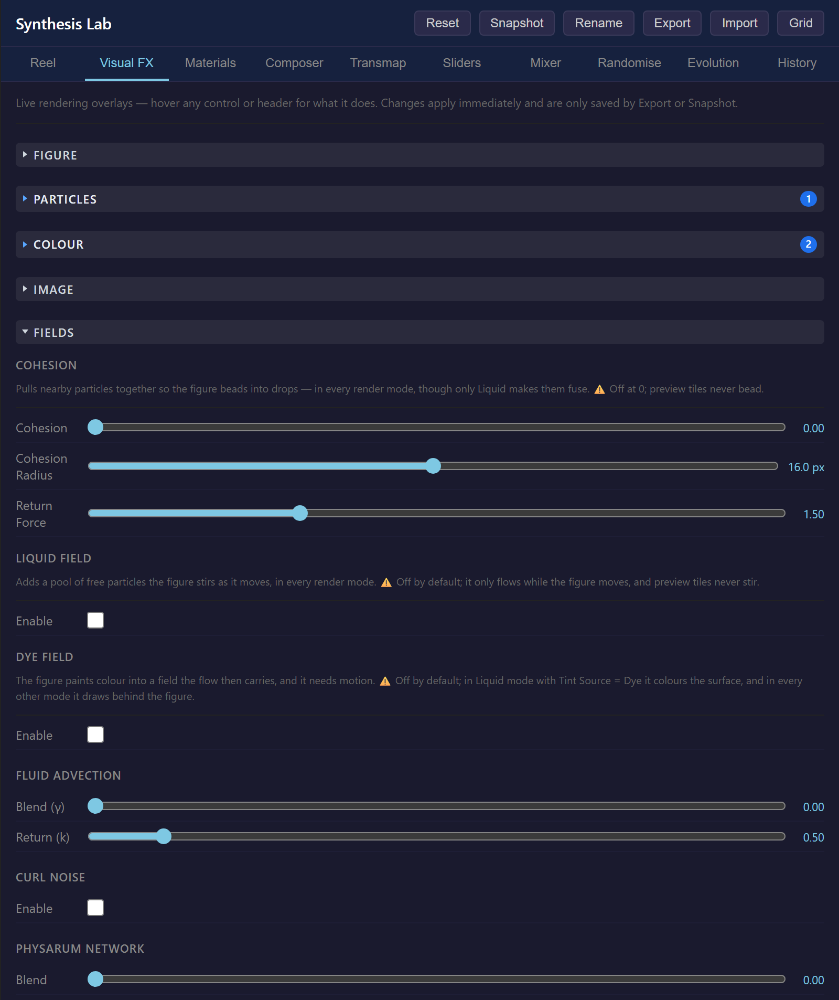

*The **Fields** group, opened on a preset that uses none of it — all six sections in about one screen,
which is what they cost when nothing is on. **Three of them are gated and three are not**, and the
difference is whether the feature has a switch of its own: **Liquid Field**, **Dye Field** and
**Curl Noise** each show only their **Enable** box, while **Cohesion** and **Fluid Advection** have no
switch and so always show their rows (both are off at **0** instead). **Physarum Network** is the odd
one out — no box either, but its **Blend** is its switch, so anything above zero turns it on.*

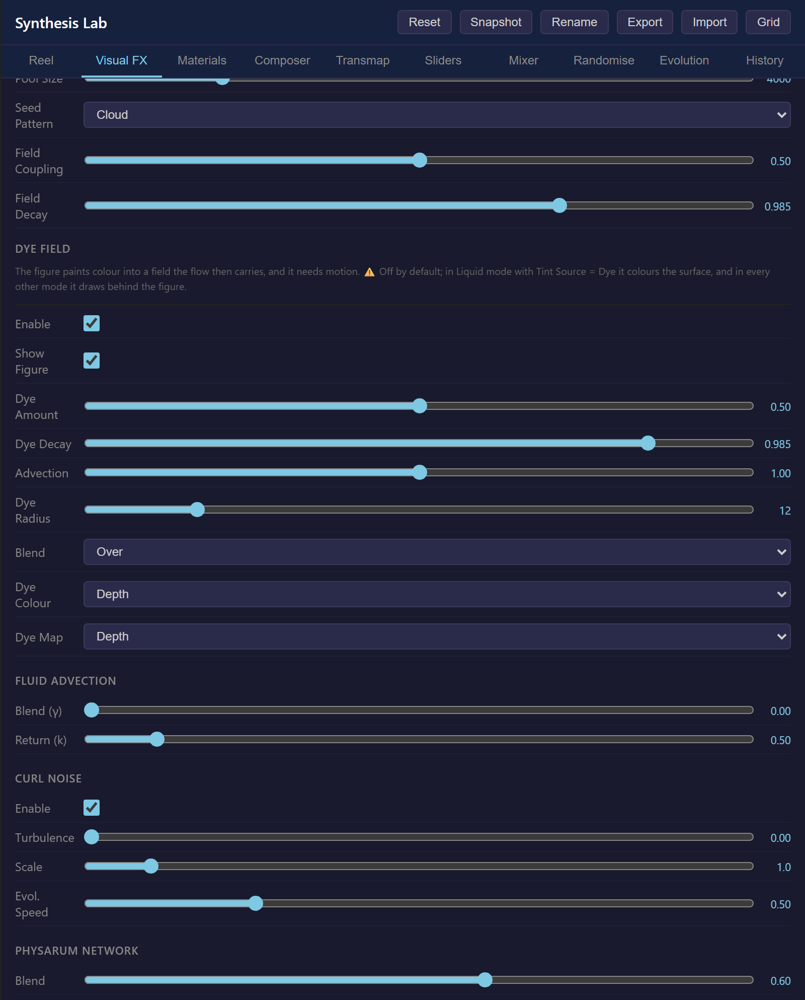

*The same group with **Liquid Field**, **Dye Field** and **Curl Noise** ticked and **Physarum**'s Blend
raised off zero. The same six sections now carry over thirty controls — so the picture above is not a
smaller tab, it is the same tab with nothing running in it.*

##### Cohesion

| Control | Effect |
|---|---|
| **Cohesion** | How hard nearby particles pull on each other, so the figure beads into separate drops instead of one continuous curve. **0 is off** |
| **Cohesion Radius** | How far apart two particles can be and still attract, in **screen** pixels — so it is unaffected by how big the figure is in the scene. It sets the drop **size**: small radii give many fine beads, large ones a few fat lobes, and past about 64 px the whole figure collapses back into one lump |
| **Return Force** | How strongly each particle springs back to where its curve says it belongs. This is what keeps the beading stable — at 0 the drops drift away, while high values hold the figure's shape and allow only small tight beads |

> **Cohesion moves the particles themselves**, so it works in every render mode — but only **Liquid**
> actually fuses the drops into single shapes. Preview tiles never bead, so judge it in the main view.

##### Liquid Field — a pool for the figure to stir

| Control | Effect |
|---|---|
| **Enable** | Adds a pool of free-floating particles that the figure drags through as it moves, so the figure **stirs** a body of liquid instead of being one. They join the same particle set, so every render mode draws them |
| **Pool Size** | How many particles the pool holds, on top of the figure's own. Around the figure's own count gives a body comparable in mass to what is stirring it; far above that and the pool dominates its own cause |
| **Seed Pattern** | Where the pool starts: *Fill* spreads it over the whole frame, *Cloud* concentrates it where the figure draws (so the stirring shows immediately), *Blobs* starts as separate islands that can merge, *Basin* pools it along the bottom edge. Changing this re-places every particle |
| **Field Coupling** | How strongly the figure's motion pushes the pool around. High values throw particles far enough to leave the frame and be recycled |
| **Field Decay** | How long the flow remembers a stir. Low values let the wake settle at once; high values let currents build and keep circling after the figure has gone |

> **The pool only flows while the figure actually moves.** On a still or very slowly rotating preset it
> sits where it was seeded, no matter how high Field Coupling is.

> **Field Coupling 0 is not an off switch** — the pool is still drawn, it just holds still. Use
> **Enable** to remove it.

##### Dye Field — colour painted into the pool

| Control | Effect |
|---|---|
| **Enable** | Turns on a colour field the figure paints as it moves, which the flow then carries and smears |
| **Dye Amount** | How much colour each particle lays down per frame. It is a deposit **strength**, not a layer opacity — the dye is the surface's own colour, not a veil over it |
| **Dye Decay** | How long the dye lingers after the figure has moved on. **This is where the visible structure comes from** — dye that never fades has none, and near the top the whole body ends up one saturated colour |
| **Advection** | How far the flow drags the dye each frame. At 0 it stays where it was painted, which reads as a static stain; raising it pulls colour into streaks and swirls |
| **Dye Radius** | How wide a mark each particle paints, in screen pixels. Small gives fine threads, large gives broad strokes that merge into flat colour |
| **Show Figure** | Draw the figure itself, or hide it and keep only the dye it stirs up. See **Showing the dye without the figure** |
| **Blend** | How the dye combines with what is behind it — *Over* or *Add*. See the note below |
| **Dye Colour** | Where the dye takes its colour: *Depth* (the one to start with — near and far parts lay down different colours and the flow mixes them), *Palette*, *Ramp*, *Velocity*, *Figure*, *Temperature* or *Fixed* |
| **Dye Map** | Whether the gradient runs *Depth* (near to far) or *Index* (along the curve, giving bands). Only shown for *Depth*, *Palette* and *Ramp* — the other four read no gradient |
| **Dye Cycles** | How many times the gradient repeats along the curve. Only shown when **Dye Map** is *Index* |
| **Dye Ramp** | The gradient *Ramp* colours the dye by. Only shown when **Dye Colour** is *Ramp* |

> **The dye is visible in every render mode.** In *Liquid* with Tint Source = *Dye* it colours the
> surface itself; in every other mode it draws **behind the figure**, so you can put a dye field under a
> *Star* or *Splat* preset without giving up the material.

> **Choosing a Blend.** *Over* lets dense dye read as real, possibly dark fluid and can never
> overbrighten, but where the dye is thick it thins the figure's own trail. *Add* only ever adds light,
> so it hides nothing — but then **Trail Decay** also controls how bright the dye gets, and a long trail
> with *Add* will wash out toward white. **Start with *Over*.** Neither applies in *Liquid* with Tint
> Source = *Dye*, where the surface does its own blending.

> **Transmap warps the dye along with the figure, and that cannot be separated.** The warp acts on the
> finished picture, which no longer knows which part came from the figure and which from the dye — so a
> *Wave Shift* ripples both in step. **Trail Decay** smears the dye too, for the same reason.

> **Banding the dye along the curve.** Set **Dye Map** to *Index* and the gradient is laid along the
> order the particles are drawn rather than from near to far, so the dye arrives in bands. **Dye Cycles**
> is how many. This is the one setting combination that produces a striped dye, and the recipe is: **Dye
> Colour** = *Ramp*, **Dye Map** = *Index*, a **Dye Ramp** you like, then raise **Dye Cycles**.
>
> **If raising Dye Cycles stops adding bands, the marks are too wide for them.** Each particle paints a
> mark `Dye Radius` wide, and everything inside one mark is averaged together — so fine bands blur into a
> single wash. Lower **Dye Radius**, lower **Advection**, or use a sparser figure (fewer particles, or one
> that covers more ground). `Breathing Dye` is the preset to compare against.
>
> **Pick a *Cycle:* gradient to avoid a seam.** The band pattern wraps, so a gradient whose two ends are
> different colours shows a visible join once per cycle. The *Cycle:* palettes begin and end on the same
> colour, so they wrap invisibly.

> **Use *Figure* for the particles' own colours, and *Velocity* for the same thing dimmed by speed.**
> *Velocity* fades slow-moving particles (it never fades them away entirely, so the wake keeps its shape
> where the figure turns around); *Figure* applies no speed term at all.

> **Use *Ramp* to give the dye a colour nothing else can move.** It colours by distance exactly as
> *Depth* does, but through a gradient you pick in **Dye Ramp** — so unlike every other source, neither
> the material nor the figure's palette can change it. That matters most when you hide the figure
> (**Showing the dye without the figure**) and have no material live, where *Depth* would paint the
> whole field ice-blue.

> **Use *Palette* if you want to choose the dye's colour from the palette list.** It colours the dye by
> distance from the viewer exactly as *Depth* does, but through the palette picked under **Colour
> Palette** — **Warmth** on the Sliders tab rotates it along with everything else the palette feeds.
> With no palette live it falls back to *Depth*, so it is never a blank. **It is the only source that
> reads the palette list directly**: *Depth* and *Temperature* colour through the live material's ramp,
> *Ramp* through the gradient you pick below, *Fixed* through the single colour you set, and *Velocity*
> and *Figure* through the particles' own colours — which the figure's palette does feed, so those two
> follow it at one remove.
>
> `Dye Palette Wake` is the demo. It is `Dye Wake` with this one field changed, so switching between the
> two tiles shows the difference and nothing else.

> **It needs motion twice over.** The field fills only where the figure has been, so a still preset
> dyes one fixed shape — and **Advection** is the one dye control that does nothing at all without
> rotation or wave motion.

##### Showing the dye without the figure

Untick **Show Figure** and the curve stops being drawn — but it keeps moving, and it keeps painting. The
dye becomes the whole picture, stirred by something you cannot see.

| What happens | |
|---|---|
| The curve | hidden |
| Sparks, crystals, the liquid pool | **still drawn** — only the curve is hidden |
| The dye | unchanged; it is still painted from exactly the same particles |
| Transmap, Film Look, bloom | all still apply, to the dye |

> **Expect the frame to go much darker, and plan to re-expose it.** The figure was most of the light. A
> preset converted by just unticking the box will look underexposed — raise **Dye Amount** first, then
> **Exposure** on the Film Look controls. This is the one change in the section that is not a small
> adjustment.

> **It does nothing while the dye is not visible.** If the dye is off, or its amount is 0, the figure
> stays on screen whatever this box says — so you can never end up with an empty window. The box keeps
> whatever you set, the same way the Liquid Field rows keep their values before you tick **Enable**.

> **In *Liquid* mode there is nothing left to see but the dye.** The surface *is* the figure there, so
> hiding the figure hides the surface too. In every other mode you still get sparks and crystals.

> **A good first try:** a preset with a stretched material (*Fire*, *Plasma* or *Liquid Light*), **Dye
> Colour** = *Ramp* with a gradient you like, **Dye Decay** near the top for a long plume, **Advection**
> at 0.8 or more so it drifts. Leave **Show Figure** on until the field looks right, then untick it.

> **Three presets ship with the figure hidden, and they are three different routes to it.** `Breathing
> Dye` paints a *Star*-mode curve through a banded **Ramp**; `Dye Holi Festival` and `Dye Sunset` both
> keep a material live and colour the dye from the particles themselves. Load one and tick **Show
> Figure** back on to see what is doing the painting.

> **On a hidden figure, Rotation and Speed are what you reach for.** They are the only things left that
> change the picture much, because the dye is painted *where the particles have been* — so the figure's
> path matters more than its shape. `Dye Sunset` is the clearest case: its curve is a plain ring, and
> everything in the frame comes from spinning that ring fast.

---

##### Fluid Advection

| Control | Effect |
|---|---|
| **Blend (γ)** | Blends the particles' positions toward being carried by a fluid velocity field, so the figure is dragged and sheared as if suspended in a current. 0 is off |
| **Return (k)** | How strongly each particle is pulled back to its mathematical position on the curve. High values let the fluid only ripple the figure; low values let it wash the figure away entirely |

##### Curl Noise

The first field system to reach for, and the most controllable.

| Control | Effect |
|---|---|
| **Enable** | Adds a divergence-free turbulent flow to every particle, so the figure churns and eddies instead of tracing a clean curve. *Divergence-free* means the particles swirl without piling up |
| **Turbulence** | Strength of the churn. Low values wobble the curve; high values dissolve it into smoke, so raise it slowly if you want the figure to stay recognisable |
| **Scale** | Size of the eddies. Small gives fine local jitter, large gives slow whole-figure drift — this is what decides whether the noise reads as *texture* or as *motion* |
| **Evol. Speed** | How fast the noise field itself changes. At 0 the flow is frozen, so particles follow fixed streamlines and the figure holds a distorted shape rather than boiling |

##### Physarum Network — a grown vein structure

Blends in a slime-mould simulation: agents follow and reinforce their own deposited trail until it
condenses into a branching vein network. It costs nothing until **Blend** is raised above 0.

| Control | Effect |
|---|---|
| **Blend** | How much of the simulation is mixed in. 0 is off |
| **Sensor Angle** | How wide the agents look to either side, in degrees. Narrow gives long straight veins, wide a dense tangled mesh |
| **Sensor Dist** | How far ahead they look, as a fraction of the frame. This sets the **scale** of the network — short is fine capillaries, long is a few thick trunks |
| **Turn Speed** | How sharply an agent may steer toward what it senses, in degrees per step. Low gives smooth sweeping curves, high a nervous crystalline mesh |
| **Decay Rate** | How fast the deposited trail fades. Low lets the network remember and thicken its paths; high keeps only what is actively travelled, so the pattern stays in motion |
| **Deposit** | How much trail each agent lays down. With Decay Rate this decides whether the network condenses into a few strong veins or stays a diffuse haze |
| **Show Trail** | Draws the trail field itself as well as the agents. Off shows only the moving agents, which reads as sparse drifting dust rather than a network |
| **Trail Opacity** | How strongly the trail is composited over the figure. Lower it when the network is burying the figure underneath |
| **Trail Colour** | Which ramp the trail is drawn through, mapped by **density** — so thick trunks and faint capillaries take different colours. *Preset (orange)* is the original fixed tint; *Auto* follows the film look's palette, falls back to the material's ramp, and lands on orange if neither is set |

##### A note on the six field systems

**Curl Noise**, **Cohesion**, **Liquid Field**, **Dye Field**, **Physarum Network** and **Fluid
Advection** are six quite different simulations, but they all reach the image in the same way: as a
smooth nudge to where particles are. That means a little goes a long way, and that two of them at once
will usually fight rather than combine. Add one, judge it, then decide whether you want another.

---

### 6.3 Materials — what the particles are made of

Where Visual FX decides how the figure is *photographed*, Materials decides what it is *made of* — how
particles heat and cool, whether they rise, whether they throw off sparks, and whether ice grows on
them. It is the second-largest tab, and it is arranged as **three groups** — one per population.

#### 6.3.1 The three groups

| Group | What it governs | Opens as |
|---|---|---|
| **Material** | which material, what counts as heat, how deposits combine, and the size and shape of each deposit | open, since this is the group you always want |
| **Fire** | hot particles rising (**Buoyancy**) and a second population thrown off the figure (**Sparks**) | closed |
| **Crystals** | a third population that grows on the figure and stays | closed |

**Every section inside Fire and Crystals is gated on its own `Enable`.** Until you tick it you see the
section's name and its switch, and nothing else — so a preset using no fire and no ice shows this tab as
about a dozen rows rather than fifty.

---

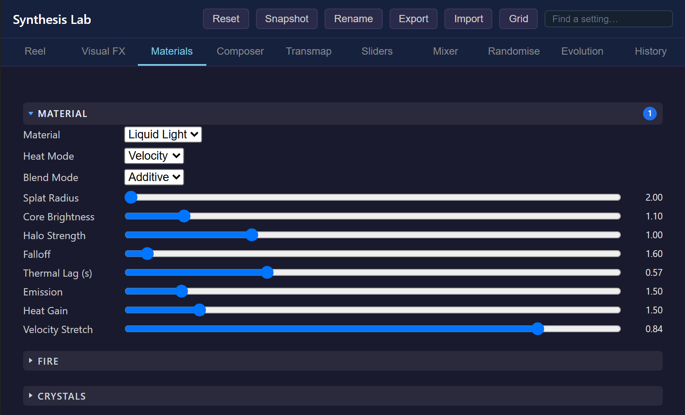

*The Materials tab as it opens. **Material** is open — the **Material** picker, **Heat Mode**, **Blend
Mode** and the appearance controls from **Splat Radius** down to **Velocity Stretch**. **Fire** and
**Crystals** are closed below it, each with a badge if anything inside is running.*

#### 6.3.2 Material — the material itself, and the mark it leaves

Three choices and then eight appearance controls. **This group is open when the tab opens**, because the picker at the top of it replaces everything below it in one move.

##### The material picker

Nine materials, plus **None**. Each is a bundle of every setting below it, so picking one replaces them
all at once — this is the fastest single change you can make to a preset's character.

| Material | Character |
|---|---|
| **Plasma** | hot, electric, bright core |
| **Fire** | rising, flickering, orange-hot |
| **Ember** | cooling, dimmer, slower |
| **Smoke** | dispersing, soft, dark |
| **Fog** | thick, even, atmospheric |
| **Ice** | holding, crystalline, cold — **the one material that switches crystals on** |
| **Liquid Light** | flowing and luminous: separate glowing sprites |
| **Organic** | irregular, growing |
| **Liquid** | the same values as Liquid Light, drawn as one merged surface |

> **Liquid and Liquid Light hold identical values** and differ only in how they are drawn. *Liquid*
> switches you to the merged iso-surface; *Liquid Light* keeps separate glowing sprites.

> **Picking a material can change the render mode for you.** That is why *Splat* and the materials are
> effectively one decision — *Splat* with no material draws nothing at all. Clearing the material hands
> the mode back.

> **Liquid gives the surface its motion and its drops, not its colour.** The colour of a liquid surface
> stays with **Tint Source**, over in Visual FX.

> **Ice switches crystals on; every other material switches them off.** So if you build a crystal
> structure and then try another material to see how it looks, the crystals go with it.

##### Heat Mode and Blend Mode

| Control | Effect |
|---|---|
| **Heat Mode** | Which per-particle quantity becomes temperature: *Velocity* (how fast it moves), *Position* (where it is) or *Age* (how old it is). This decides **where** the material is hot, and therefore what the figure's hot regions mean |
| **Blend Mode** | How deposits combine. *Additive* accumulates without limit, so overlaps brighten. *Alpha* composites with coverage and stays bounded |

> **Blend Mode also changes what trail length means.** An additive material would otherwise accumulate
> to flat white on any pixel the figure revisits, so the engine caps the trail when one is in use. A
> persistence value carried over from *Alpha* can end up many times too strong.

##### Appearance — the shape of one deposit

| Control | Effect |
|---|---|
| **Splat Radius** | Size of each particle's deposit in pixels. **This sets the scale of everything else in the material** — a small radius reads as sparks, a large one as a continuous body |
| **Core Brightness** | Brightness of the deposit's centre. Raise it to make hot particles read as incandescent rather than merely coloured |
| **Halo Strength** | Brightness of the soft surround outside the core. This is what makes a deposit glow into its neighbours instead of ending abruptly |
| **Falloff** | How sharply the deposit fades from core to edge. High gives a hard defined dot, low a wide soft cloud |
| **Thermal Lag (s)** | How long a particle takes to reach the temperature its motion implies. Near 0 the heat tracks the driver instantly; high values smear it, so hot regions trail behind the motion |
| **Emission** | How much light the material emits for a given temperature — the master brightness of the material |
| **Heat Gain** | How much heat the driver produces. Raise it to push more of the figure into the hot end of the colour ramp; lower it to keep only the fastest or highest particles hot |
| **Velocity Stretch** | Stretches each deposit along its direction of travel, so fast particles read as motion streaks rather than dots. Useful range is 0–1 |

> **Halo Strength cannot dim a particle's centre.** The core is drawn by **Core Brightness** alone, so
> if the figure is washed out in its bright middles, the halo slider is not the control that reaches
> them.

> **Emission does not reach crystals.** They are lit rather than emissive, so their brightness comes
> from **Specular**, **Edge Bright** and **Ice Opacity** instead.

---

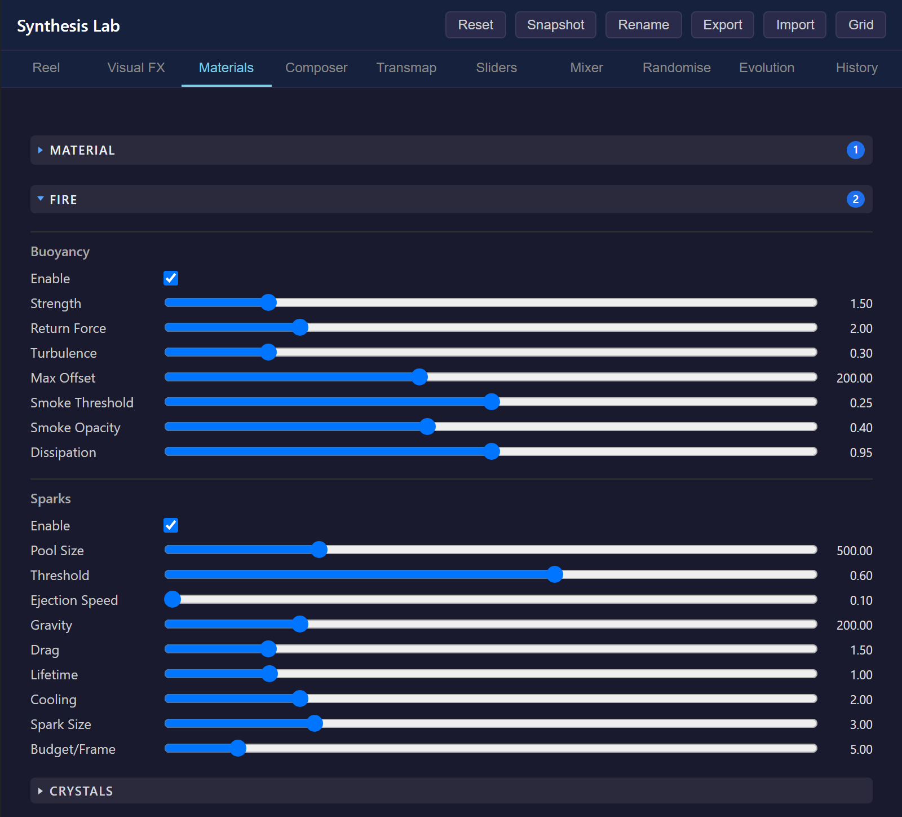

*The **Fire** group opened, with **Buoyancy** and **Sparks** both ticked. Each section's name and its
**Enable** switch stay outside the gate, so an off section still says what it is and its switch is
always reachable — with both boxes clear this whole group is four lines.*

#### 6.3.3 Fire — rising heat, and what it throws off

Two independent populations, each behind its own **Enable**. Neither exists on a preset with no material, and with both boxes clear this whole group is four lines.

##### Buoyancy — rising, and turning to smoke

**Enable** is a master switch: everything below it is inert until ticked.

| Control | Effect |
|---|---|
| **Strength** | How hard hot particles rise. This is what turns a heat map into a flame that has an *up* |
| **Return Force** | How strongly particles are pulled back to their position on the curve. High values keep the figure recognisable while it burns; low values let the flame leave it behind |
| **Turbulence** | Sideways jitter added to the rise, so the flame licks and wavers instead of climbing straight |
| **Max Offset** | Hard ceiling on how far a particle may be displaced, in pixels. The safety rail that stops a strong flame from evacuating the figure entirely |
| **Smoke Threshold** | The temperature below which a risen particle becomes smoke. Raise it to convert more of the flame to smoke; lower it to keep the column burning higher |
| **Smoke Opacity** | How visible smoke is. Smoke is drawn dark and unlit, so this is also how much of the figure behind it gets obscured |
| **Dissipation** | How slowly smoke thins out. Near 1 it lingers and builds into a column; lower values make it vanish just above the flame |

##### Sparks — a second population

Sparks are **additive**: they are extra particles thrown off the figure, and they never remove anything
from the figure itself. **Enable** is again a master switch.

| Control | Effect |
|---|---|
| **Pool Size** | Hard ceiling on how many sparks can exist at once. It bounds every rate below it — raising a birth rate past what the pool can hold simply recycles faster |
| **Threshold** | How hot a particle must be to eject a spark. Raise it to make sparks rare and meaningful; lower it for a continuous shower |
| **Ejection Speed** | How fast a spark leaves the figure. With **Gravity**, this sets the shape of the arc |
| **Gravity** | Downward acceleration, in pixels per second squared. 0 lets sparks fly straight out; high values give short ballistic hops that fall back |
| **Drag** | Air resistance. High values make sparks stall and hang; 0 lets them carry to the frame edge |
| **Lifetime** | How long a spark lives, in seconds, before returning to the pool. The main control over how far sparks travel |
| **Cooling** | How fast a spark loses heat, and so fades down its colour ramp. High gives brief bright flecks, low gives long-lived embers |
| **Spark Size** | Size in pixels, independent of the material's own Splat Radius. Sparks are authored small (2–4 px against material radii of 3–14) so they read as flecks thrown off the body rather than as more of it |
| **Budget/Frame** | Per-frame birth limit — a cost control. It caps the work regardless of how much of the figure is above Threshold |

---

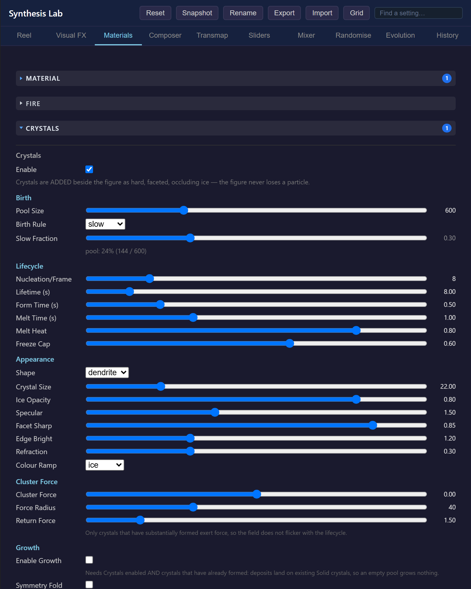

*The **Crystals** group opened and ticked, with the note that crystals are added beside the figure
rather than taken from it. Its first two sub-groups are **Birth** and **Lifecycle**. The
readout under Birth shows how full the crystal pool actually is.*

#### 6.3.4 Crystals — a third population that grows and stays

One section, behind its own **Enable**, and the largest in the tab. ⚠️ **Crystals are ADDED beside the figure, never taken from it** — the figure never loses a particle to them.

Crystals are the most involved thing in this tab, so it is worth saying plainly what they are. They are
a **third population**, like sparks: solid bodies that **nucleate** on the figure, **grow**, hold for a
while, then **melt**. The panel puts it well — *crystals are added beside the figure as hard, faceted,
occluding ice, and the figure never loses a particle.* Unlike every other element in PSSS they are
*alpha-occluding*: they hide what is behind them, so they read as solid objects rather than as more
light.

**To get crystals on screen, the short route is:**

1. Pick the **Ice** material. That switches crystals on and sets sensible values for all 23 controls.
2. Watch for a few seconds. Crystals are born at a rate, so the structure builds up rather than
   appearing at once.
3. If you see nothing, check **Enable** at the top of the Crystals section, and that **Nucleation/Frame**
   and **Pool Size** are not at 0.

**To build them by hand on another material:** tick **Enable**, set **Birth Rule** to *slow*, and raise
**Nucleation/Frame**. Then shape them with the Appearance group.

##### Birth — what makes a crystal appear

| Control | Effect |
|---|---|
| **Pool Size** | Hard ceiling on how many crystals can exist at once. It bounds every rate below it. A readout under the group shows how full the pool actually is |
| **Birth Rule** | What makes a particle nucleate: *slow* (low motion), *cold* (low temperature) or *random* (chance) |
| **Slow Fraction** | With *slow*, what proportion of the slowest particles are eligible |

> ***cold* needs an active material to read temperatures from**, and quietly behaves as *slow* without
> one. If you tick crystals on with Material = *None*, use *slow* or *random*.

##### Lifecycle — how a crystal lives and dies

| Control | Effect |
|---|---|
| **Nucleation/Frame** | How many crystals may be born per frame. With **Lifetime**, this sets the turnover rate — how lively the structure looks |
| **Lifetime (s)** | How long a crystal lasts before it melts. Long lifetimes build a persistent structure; short ones give a shimmering surface that is always renewing |
| **Form Time (s)** | How long it takes to grow to full size. **It is not yet solid during this ramp** — it exerts no cluster force and accretes nothing |
| **Melt Time (s)** | How long it takes to fade away. Longer melts read as thawing; short ones as shattering |
| **Melt Heat** | The temperature at which a crystal melts *early*, before its lifetime is up. This is the control for ice that retreats from a nearby flame |
| **Freeze Cap** | Soft target population, as a fraction of the pool. Nucleation halts above it while melting is never gated, so the population settles back toward this level on its own |

---

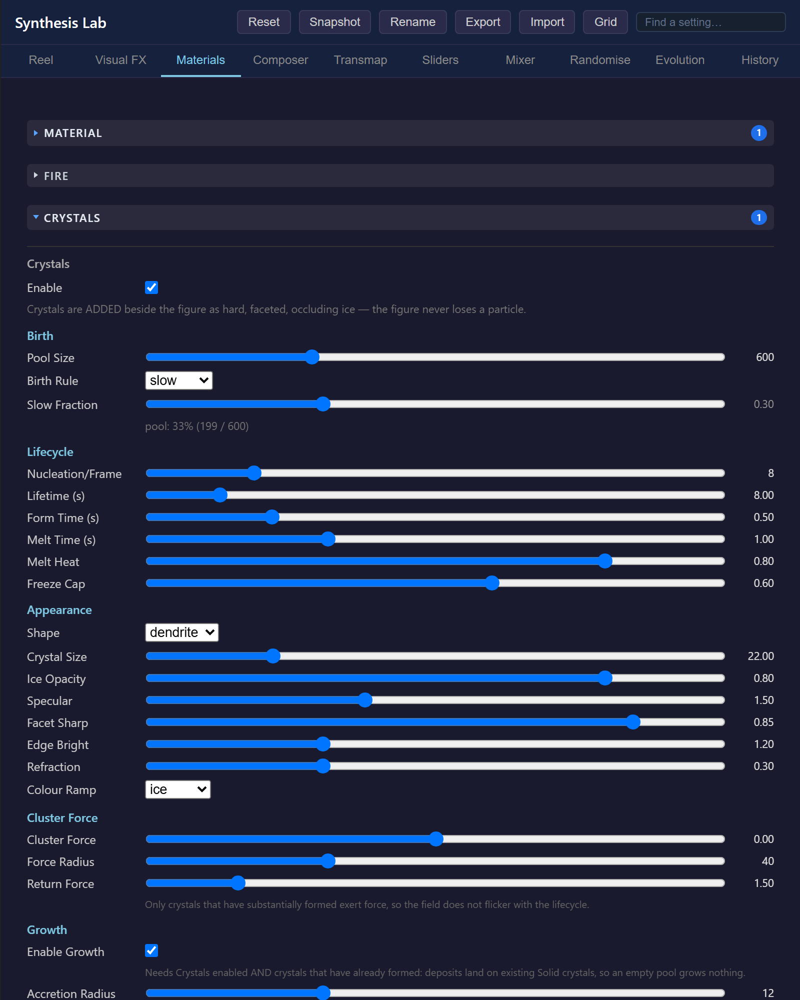

*The rest of Crystals: the **Appearance** group from Shape to Colour Ramp, then **Cluster Force** and
**Growth**. The grey lines under the last two are preconditions — they say when those controls can do
anything at all.*

##### Appearance — what a crystal looks like

| Control | Effect |
|---|---|
| **Shape** | The silhouette: *hexagon* (the original solid look), *plate* (a thin ringed disc), *dendrite* (a growth-driven snowflake) or *prism* (a quartz shard). *plate* and *dendrite* gain internal detail as they grow |
| **Crystal Size** | Base size in pixels. Compensated per shape, so switching shape changes the silhouette without also changing the apparent weight |
| **Ice Opacity** | How much a crystal occludes what is behind it. Crystals are the one alpha-occluding element here, so **this is what makes them read as solid** rather than as another glow |
| **Specular** | Brightness of the highlight on a facet. This is what says "mineral" rather than "fog" — raise it for glassy ice |
| **Facet Sharp** | How crisply the facets meet. High gives a cut-gem look, low a rounded water-worn one |
| **Edge Bright** | Brightness of the outline. It separates overlapping crystals from each other, which a cluster needs in order to read as many bodies rather than one mass |
| **Refraction** | How much the crystal appears to bend what is behind it, so it reads as a transparent solid with a thickness instead of a coloured shape |
| **Colour Ramp** | Which ramp maps a crystal's temperature to its colour: *ice* is the expected mineral reading; *liquid*, *organic*, *fire* and *smoke* deliberately break it |

> **Crystals are not sized by Particle Size.** They are excluded from it and use **Crystal Size**
> instead, so changing the figure's particle size leaves the ice alone.

##### Cluster Force — the one crystal control that moves the figure

| Control | Effect |
|---|---|
| **Cluster Force** | **Negative** deflects particles *around* the ice, as an obstacle. **Positive** draws them *toward* it, as an accretion bias. 0 is off |
| **Force Radius** | How far that force reaches, in **model** units — check it against the figure's own extent, not against the pixel size of the crystals |
| **Return Force** | How strongly deflected particles return to the curve. High values keep the figure intact while it flows around the ice |

> **Only crystals that have substantially formed exert any force**, so the field does not flicker in
> step with the lifecycle.

##### Growth — two switches

| Control | Effect |
|---|---|
| **Enable Growth** | Lets crystals accrete, so they thicken where the figure keeps passing instead of all reaching the same size |
| **Symmetry Fold** | Folds accreted deposits with the figure's own symmetry, so a symmetric figure gets a symmetric ice structure rather than a random scatter |

> **Growth needs crystals that have already formed.** Deposits land on existing solid crystals, so an
> empty pool grows nothing — and **Symmetry Fold acts only on accreted deposits**, which means it does
> nothing until **Enable Growth** is on as well.

> **Force Radius is in model units, not pixels.** It is the one crystal number that is not measured on
> the screen, which is why a value that looks small can still reach the whole figure — compare it with
> the figure's extent, not with how big the crystals look.

---

### 6.4 Composer — the figure itself

This is the only tab that edits the **figure**. Everywhere else in the Lab decides how it is drawn,
photographed or warped; here you decide **what shape it is**.

#### Figure type — the first choice on the tab

The row at the very top chooses which **kind** of figure the preset draws:

| Type | What it is |
|---|---|
| **Waves** | Up to three sine waves added together per axis. The original figure, and what most presets use. |
| **Self-similar curve** | One continuous stroke built by repeating a rule — a space-filling lattice, a coastline, a branching tree. |

The rest of the tab changes with this choice, because the two kinds have nothing in common to edit: a
wave slot cannot affect a curve, and a turn angle cannot affect a wave.

**Switching is safe to explore, and that is worth knowing before you try it.** Changing the type does
**not** clear the settings of the other kind — they are kept, and switching back restores that figure
exactly as it was. A line under the dropdown tells you when a preset is carrying both. So one preset can
hold a tuned wave figure *and* a tuned curve, and you can flip between them to compare.

#### Why there are three waves

> **This section describes the Waves type.** On a self-similar curve there are no wave slots at all —
> see **The curve controls** below.

A PSSS figure is not one sine wave but **up to three, added together**, on each of the three axes. That
sum is the whole trick, and it is worth understanding before touching anything.

Think of drawing with a pen. One wave gives you the **path** — a circle, a figure-of-eight, a knot. A
second, faster and smaller, makes the pen wobble as it travels, so the path grows a ruffled edge. A
third, faster and smaller again, adds fine texture on top of that. Each wave is doing the same simple
thing; what you see is the three of them stacked.

That is why the three slots are named as they are:

| Slot | Its job | Typical values |
|---|---|---|
| **Body** | Carries the **shape** — the silhouette you recognise the preset by | large size, low winding |
| **Structure** | Adds the **fringe** — the ruffle or lattice laid along the body | middling size, middling winding |
| **Detail** | Adds **texture** — fine enough to read as surface rather than as shape | small size, high winding |

A preset can use **one, two or all three**. Many of the simplest and best presets in the library use one.

#### The top of the tab

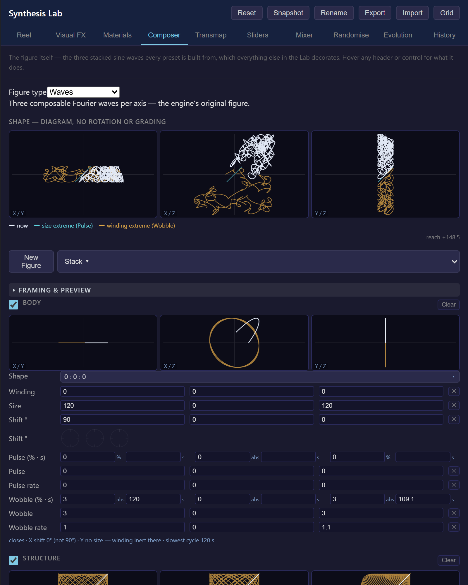

*The top of the Composer. The **Shape** panel comes first — that is the Score: the bare figure in all
three planes, X/Y, X/Z and Y/Z, with a legend naming its three traces and a *reach* readout on the
right. **New Figure** and **Stack** sit under it because they act on the whole figure. Then the one
closed header, **Framing & Preview**, and below that the first wave slot, **Body**, in full.*

**The Score is first on purpose.** It is what this tab is for; the settings that merely decorate the
figure are behind the one header below it.

#### Framing & Preview — the one closed header

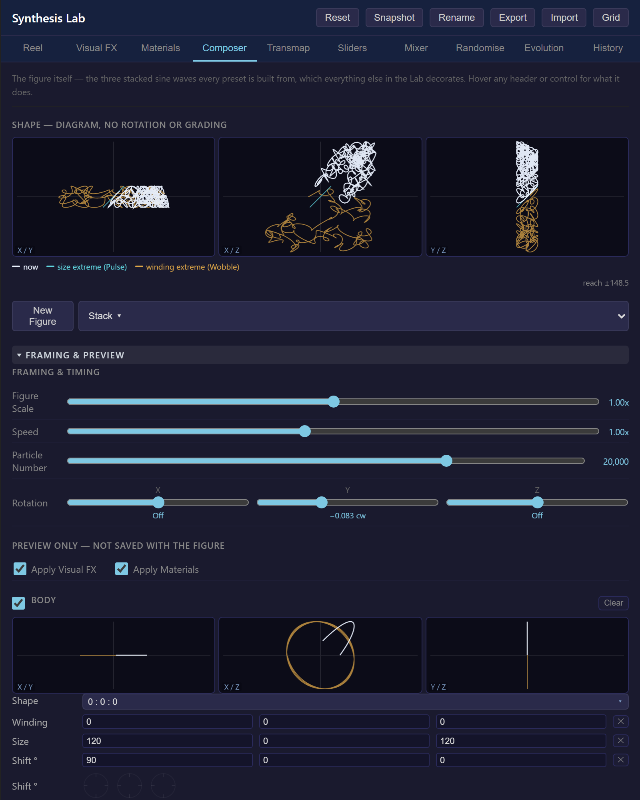

*Opened, it holds two sections with deliberately different promises: **Framing & Timing**, which is
saved with the preset, and **Preview only — not saved with the figure**, which is not. The header
itself makes no claim about saving, because it straddles the line; each section says it for itself.*

The header carries a badge when a preview switch is **off** — so a preview that is not showing the
preset says so even with the group shut.

**Framing & Timing** is the same size, speed, count and rotation controls as the Visual FX tab, on
exactly the same values — a change here is a change there, and both are saved with the preset.

> ⚠️ **The link is one-way while both tabs are open.** Dragging one of these sliders in Visual FX will
> not move the copy here. Change it in one place at a time.

**Preview only — not saved with the figure.** Two checkboxes, **both ticked normally**, that change only
how the running preview is drawn — never the figure, and never the look that gets saved.

| Checkbox | Untick it to… |
|---|---|
| **Apply Visual FX** | draw the preview with **no Visual FX at all** — no ribbon, lines, attractor, warp, network, fluid or crystals, and none of the **Deformation** operators (Symmetry, 3-D Symmetry, Twist, Taper, Bend, Fold, Inversion, Fractal Fold, 4D) or the per-particle spreads — while keeping the film look, the framing controls and the Composer's own figure controls. Use it to see the figure under the decoration |
| **Apply Materials** | draw the preview **without the material**, as plain stars, to see the figure the material is sitting on |

> **Nothing is saved either way.** The full look is still what gets exported, snapshotted and blended by
> the Mixer, and both boxes switch back on when you close the Lab or load another preset. They are a
> viewing aid, not an edit. A preset whose look depends on the liquid surface will look very different
> while Apply Materials is off — that is the point.

**The Score** (*Shape — diagram, no rotation or grading*) is the bare curve in model space, drawn in all
three planes at once. It deliberately has **no rotation, no canvas fit, no material and no grading** —
the live view beside the Lab already shows those. Its legend names three traces:

| Trace | What it shows |
|---|---|
| **now** | the figure as it is at this instant |
| **size extreme (Pulse)** | how far the figure travels when its **size** modulation is at full stretch |
| **winding extreme (Wobble)** | how far it travels when its **winding** modulation is at full stretch |

So a preset with no Pulse and no Wobble shows one trace; a modulated one shows the envelope it moves
inside. The **reach** figure on the right is the widest the curve gets, in model units.

> **The Score draws the figure the engine draws, including the four shape controls that live in Visual
> FX.** **Sharpness**, **Grow**, **Travel** and **Offset** are all reflected here, so a faceted or an
> open figure is faceted and open on the diagram too — the two are one calculation, not two that happen
> to agree.
>
> ⚠️ **Their breathing is not, and cannot be.** The Score shows no instant in time — that is why it takes
> no rotation and no grading either — so **Temper**, **Stretch**, **Sway** and **Flare** are absent and
> the diagram draws the figure at each operator's base value. That is exactly the figure the engine
> renders at the start of a cycle, not an approximation of one.
>
> ⚠️ **Offset is the one of the four you may read as doing nothing here**: the Score auto-fits its own
> box, so an offset alone moves the drawn curve and the fit moves it straight back. It shows where it
> composes with Travel and Grow, and the live view beside the Lab is where an orbit is judged.
>
> **This is also the diagram to read before touching per-level Sharpness.** The `now` trace is the sum
> of all three waves, so to find out which levels actually carry a figure, switch one off and watch what
> leaves — a level whose removal changes nothing is a level a Sharpness cell cannot reach.

**New Figure** replaces the wave table with a plain circle — one wave, winding 1 : 1 : 1, a quarter-turn
offset on Y — and resets the particle count and sweep rate to the library's most common values. It
leaves the render mode, the material and the film look alone, so you keep your look and start the shape
again.

#### The curve controls

When the figure type is **Self-similar curve**, the three wave slots are replaced by a single **Curve**
section. Every row here except **Rule** and **Smoothness** is a **triple** — the value, plus a **Depth**
and a **Rate** that make it wobble over time, exactly as the wave rows work.

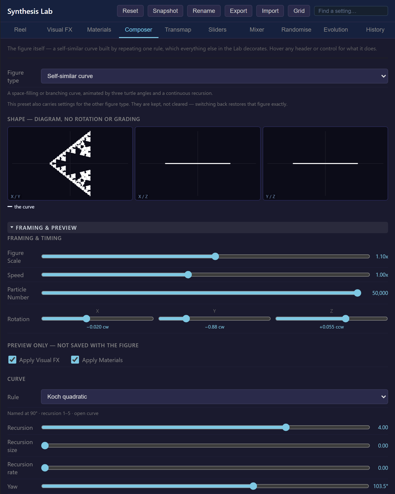

*`Curve Morph` in the Composer: the **Shape** diagram of the curve in its three planes, **Framing &
Preview** opened, then the **Curve** section — the **Rule** (Koch quadratic), the line naming its published
angle and recursion range, and the Recursion and Yaw rows with their wobble pairs.*

| Row | What it does |
|---|---|
| **Rule** | Which fractal. This is the figure's *identity* — Hilbert, dragon, Koch, Gosper, a plant, Minkowski. The line under it tells you the angle at which this rule is the named fractal, how deep it can recurse, and whether it closes into a loop. The last entry, **Customize**, lets you edit the rule's pattern itself (see *Customize — editing the generator* below). |
| **Recursion** | How many times the rule is applied. Fractional values blend two levels, so the curve **subdivides smoothly** — new detail appears *between* existing strokes rather than the whole figure growing. |
| **Yaw** | The turn angle, left and right. **The rule's published angle is a landmark, not a limit:** other angles give other named fractals, and sweeping this is the point of the whole type. |
| **Pitch**, **Roll** | The other two turn axes. They appear only for a rule whose pattern actually uses them — most rules are flat and turn in one plane only, so on those two rows are simply absent. |
| **Twist** | Rotates chosen copies of the curve about their own axis, at every level at once, so a flat curve opens into three dimensions. On **Dragon**, 180° *is* the Lévy C curve (and on **Lévy C**, the dragon): one slider folds one named fractal into the other. On **Plant** it turns the branches about the trunk; on **Hilbert 2D** and **Peano** the square lattice opens out. Shown only on rules that have copies to twist. |
| **Stretch** | Grows or shrinks the branches at every level at once, while the trunk keeps its length. 1× is the rule as published. Shown only on a rule with branches (**Plant**). |
| **Descend** | Travels *into* the curve, revealing finer structure as you go. It is **not** Figure Scale: the figure does not get bigger, it gets deeper. Available on **Hilbert 2D**, **Hilbert 3D** and **Peano** — the rules whose structure can be indexed backwards — and absent on the rest. On Peano each step into the curve is a factor of three rather than two. |
| **Smoothness** | Rounds the curve's corners toward a spline. At 0 the stroke is exactly as the rule draws it. Raising it also makes deeper recursions readable instead of solid. |

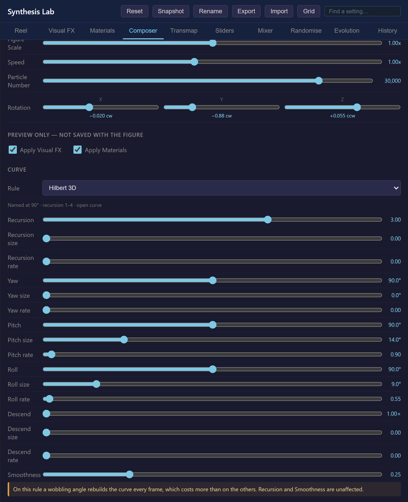

*`Curve Tilt` on **Hilbert 3D**, a rule that turns in three dimensions: below Yaw come the **Pitch** and **Roll**
rows (here both wobbling), then **Descend** — rows that a flat rule does not show — and the amber note that a
wobbling angle rebuilds this rule's curve every frame.*

**Two things that are easy to be surprised by:**

- **Picking a rule resets its shape.** Recursion, Yaw, Pitch, Roll, Twist and Stretch all go back to
  the new rule's own starting point, with no wobble. Each rule has a different useful range, so carrying
  a 120° angle onto a rule whose range stops at 60° would silently clamp it and give you a figure that is
  neither. Smoothness and Descend are kept.
- **On Hilbert 2D and Peano, Twist and Yaw take turns.** Twist works on these two only at the lattice
  angle, so while Twist is in use the Yaw rows are greyed out, and while Yaw is away from its landmark the
  Twist rows are. A note under the rows says which to set back.
- **Descend and Twist do not combine.** While the curve is descending, Twist and Stretch have no effect;
  set Descend back to 1× to use them.
- **On a few rules a wobbling angle is noticeably more expensive**, and the tab says so in a note when
  it applies. The space-filling rules — Hilbert, Moore, Peano — and the Twindragon have to rebuild the whole
  stroke every frame when an angle moves, because their shape is not a smooth function of the angle at any useful
  step. Recursion and Smoothness are unaffected on every rule.

##### Customize — editing the generator

Every rule is drawn the same way: a short **generator** — a few straight steps — is repeated, each step
replaced by a smaller copy of the whole generator, and so on down to the chosen recursion. **Customize**
lets you edit that generator directly.

- **Choosing Customize changes nothing on screen.** It starts from the rule you were on, with every
  setting kept, and the line under the Rule says *Same generator as …* for as long as your generator is
  still exactly that rule's. The first edit to a step makes it your own curve; undo the edit and it is the
  named rule again.
- **Choosing a named rule again replaces your edits**, with no confirmation, exactly as picking a named
  Film Look replaces a customized one.
- **Customize works on every rule except Bush 3D.** Bush 3D is a *growth* rule — each level adds branches
  at the tips and lengthens the stems — rather than one shape repeated inside itself, so it has no generator
  to edit; a plant-growth editor is planned as a future phase. On Bush 3D the entry is greyed out and says so.

Under the rows, a **Generator** table lists the steps, one per row:

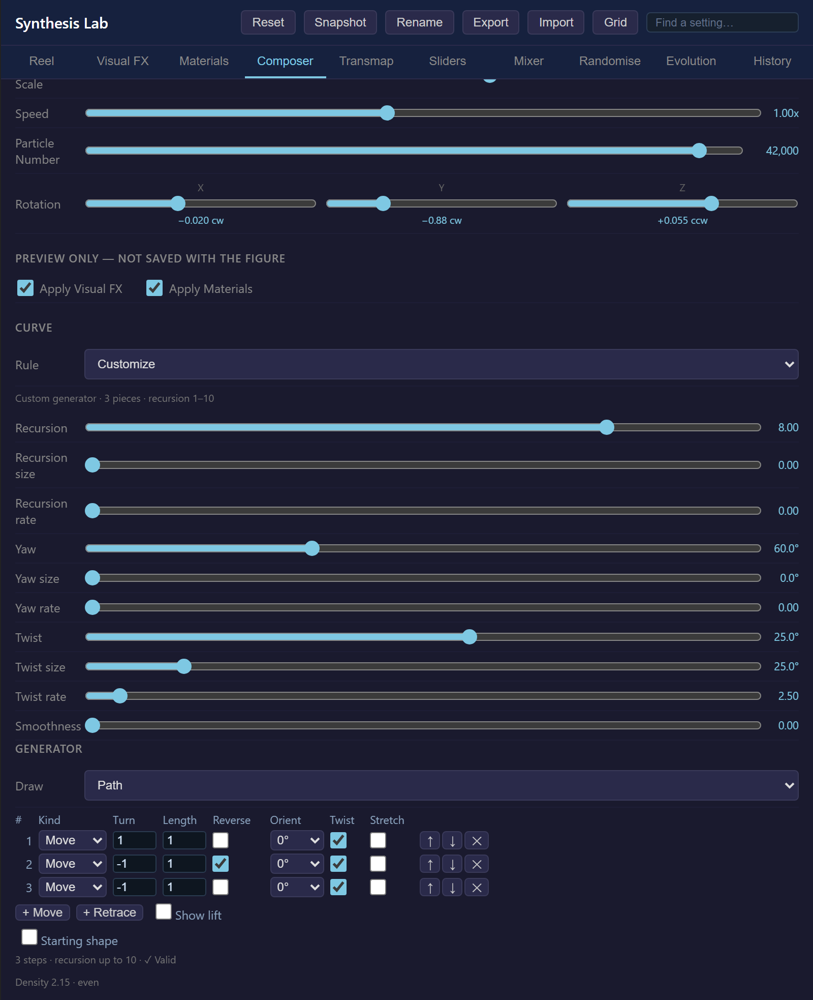

*`Curve Rosette Chain`, one of the two presets made under **Customize** (the other is `Chaos to Order`): the line under the Rule says *Custom
generator · 3 pieces*, the **Twist** rows exist because every step is marked for Twist, and the **Generator**
table shows its three moves (turns +1, −1, −1, the second reversed). Under the table: **+ Move**, **+ Retrace**,
**Show lift**, **Starting shape**, the status line and the density readout.*

| Column | What it does |
|---|---|
| **Kind** | **Move** walks a new segment. **Retrace** walks back along the most recent move not yet retraced — how a branch is drawn as one stroke. A retrace copies everything from its move, so its own cells are greyed out. |
| **Turn** | How far the step turns before it walks, in units of **Yaw**: 1 is one Yaw angle, −2 is two the other way. Because every turn is a multiple of Yaw, the Yaw slider still bends the whole generator together. |
| **Lift** | How far the step tilts out of the plane, in units of **Pitch**. The column is hidden until you tick **Show lift** (or a step already has one). |
| **Length** | The step's length relative to the others. Unequal lengths are fine. |
| **Reverse** | Walk this piece's copy backwards. |
| **Orient** | Rotate this piece about its own direction: 180° mirrors it, 90° and 270° turn it out of the plane. |
| **Twist**, **Stretch** | Let the **Twist** / **Stretch** rows act on this piece. Those rows appear as soon as one piece is marked. |
| **↑ ↓ ✕** | Move the step earlier or later, or remove it. Removing a move also removes the retrace that walks back along it. |

**Reading a generator — Terdragon as the example.** Choose Customize on **Terdragon** and the table shows
three moves with Turn **0, +1, −1**, all lengths 1, everything else off; Yaw is **120°**. Read it as a walk:

1. step 1 — turn 0, walk one unit;
2. step 2 — turn +1, i.e. 120° left, walk one unit;
3. step 3 — turn −1, i.e. 120° right, walk one unit — back to the first direction.

That small zig-zag is the whole rule. Three things make the table easier to read:

- **Every turn is relative to the previous step's direction**, not to the screen.
- **Step 1's turn never matters.** It only rotates the whole generator, and the figure is always fitted to
  its own start and end — so the shape lives in the turns of step 2 onward.
- **Orient is not a turning angle.** It rotates a piece's *copy* about its own direction (180° mirrors it).
  On Terdragon it is 0° everywhere because no copy is flipped.

**Where the triangles come from:** nowhere in the rule. Recursion replaces each of the three segments with
a smaller copy of the whole zig-zag, then does the same inside every copy — 3, 9, 27 … segments. Every
segment points along one of three directions 120° apart, so at depth the path runs along a triangular grid
and closes into the triangles you see. The same holds for every rule: the figure is what the generator
becomes when it is repeated, not something drawn by the rule itself. Change **Yaw** and every turn scales
together, so the triangles distort while the table stays the same; change one **Turn** and you have a new
generator.

**+ Move** adds a straight step at the end, **+ Retrace** a step back along the most recent open move.
**Draw** chooses **Path** (through the joints) or **Cells** (through the centre of each piece's square —
or cube, for a 3-D generator such as Hilbert 3D's); **Cells** is offered only when your generator fills
space — every piece one cell from the next and none visited twice — and it is what makes **Descend**
available. In Cells mode the turns and lifts are held at 90°.

**Starting shape.** Normally the copies are laid along one straight line. Tick **Starting shape** and a
second, smaller table appears: the steps of a shape the copies are laid along instead, which may close into
a loop. Ticking it adds one straight step, which changes nothing; add and edit steps from there. **Moore**
shows what it is for: its generator is exactly Hilbert 2D's, laid along a starting shape of four steps up
the square's centre line, a U-turn, and back down — each copy fills the square on one side of its step, so
the way up fills one half and the way back the other. The four closed tiles open the same way: Customize on the
**Koch snowflake** shows Koch's four steps on a starting triangle, on the **Pentigree** its six steps on a
pentagon, on the **Twindragon** the dragon's two steps out along one step and back, and on the **Fudgeflake**
the terdragon's three steps on a triangle. **Descend** is not available while a starting shape is set.

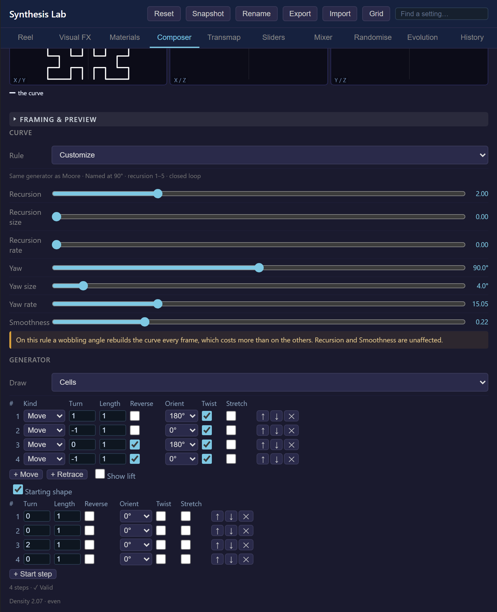

*Customize chosen on `Curve Weave` (Moore): the line under the Rule still says *Same generator as Moore*,
**Draw** is **Cells**, the **Generator** table holds Hilbert 2D's four moves, and **Starting shape** is ticked
with its own table — turns 0, 0, 2, 0: up the centre line, a U-turn, and back down.*

The line under the table says whether the generator can be drawn. **If it cannot** — for example a
Retrace with nothing to retrace, or a generator whose end comes back to its start — the figure keeps its
last good shape until you fix it, and the line says why. **Density** says how evenly the curve covers
space, which is how evenly it is lit: *even*, *uneven*, or *clumpy* where pieces pile on top of each other
and glow brighter there. Every named rule reads *even* or *uneven*.

> **Worked examples, one per thing to look at.** Many presets ship on this figure type; these each show
> one row doing its job:
>
> | To see | Load |
> |---|---|
> | **Yaw** sweeping between two named fractals | `Curve Morph` — the Koch production travelling from its own 90° to the 117° where it becomes a Sierpiński triangle |
> | **Recursion** subdividing | `Curve Subdivide` — new detail appearing between existing strokes, not the figure growing |
> | **Descend** travelling into the curve | `Curve Descent` and `Curve Volume` in three dimensions, `Curve Plane Dive` flat, where the zoom is easiest to read |
> | **Pitch** and **Roll**, the two rows most rules do not have | `Curve Tilt` |
> | **Twist** folding one named fractal into another | `Curve Fold` — the dragon folding into the Lévy C curve and back |
> | the fold as a **Mixer** crossfade | `Curve Fold A` and `Curve Scroll` — the dragon and, at a half-turn of Twist, the Lévy C curve: load them as Deck A and Deck B and drag the crossfader |
> | **Twist** opening a lattice | `Curve Hilbert Opening` and `Curve Peano Fold` |
> | **Twist** on a branching plant | `Curve Spiral Thicket` — the branches turning about the trunk |
> | **Stretch** | `Curve Breathing Thicket` — the branches growing and receding at every level at once |
> | **Yaw** between two named fractals on one rule | `Curve Koch Cesaro` — the Koch curve at 60° opening into the Cesàro curve at 85° |
> | **Descend** on a rule that divides by three | `Curve Peano Descent` |
> | a rule that **closes into a loop** | `Curve Weave` (Moore), `Curve Snowflake` (the Koch curve round a triangle, its recursion breathing so the flake subdivides), `Curve Pentigree` (the only five-fold figure), `Curve Twindragon` (two dragons back to back, a tile) and `Curve Fudgeflake` (three terdragons round a triangle) |
> | a **Customize** generator, edited in the table | `Curve Rosette Chain` — three steps no named rule has, a chain of hexagonal rosettes opening into 3-D as its Twist breathes |
> | a **Customize** curve no named rule draws | `Curve Golden Dragon` — the golden dragon, two steps of unequal length (1 and 0.75) at about 80°, curling into a chain of spirals |
> | the **same Customize steps with one copy reversed** | `Curve Golden Lightning` — the golden dragon's two steps with the second walked backwards: the spirals become a branching, lightning-like dendrite |
> | a **Customize** coastline under **3-D Symmetry** | `Curve Zigzag Cross` — six unit steps at right angles (turns 0, +1, −1, −1, +1, 0) breathing their angle, repeated round the vertices of a tetrahedron |
> | a **Customize** starting from a 3-D rule | `Chaos to Order` — the Hilbert 3-D lattice under Customize, drawn as cells, its Twist breathing so the lattice folds out of disorder into order and back |
> | **Bush 3D** growing, as a surface | `Growing Corals` — the growth rule with its Recursion breathing, so branches sprout and recede, drawn as Liquid under a 3-D Symmetry of overlapping copies |
> | a curve under a **liquid surface** | `Liquid Maze` — the Hilbert 3-D lattice of `Curve Subdivide`, its recursion breathing, drawn as liquid |
> | what the **different rules** look like | `Curve Lattice` (a cube-filling lattice), `Curve Gasket` (a triangle), `Curve Island` (a coastline), `Curve Thicket` (a branching plant), `Curve Triad` (a triangular grid, the only rule that turns at 120°), `Curve Dragonfold` (a folded ribbon) and `Curve Minkowski` (a square-wave coastline) |

#### A wave slot, control by control

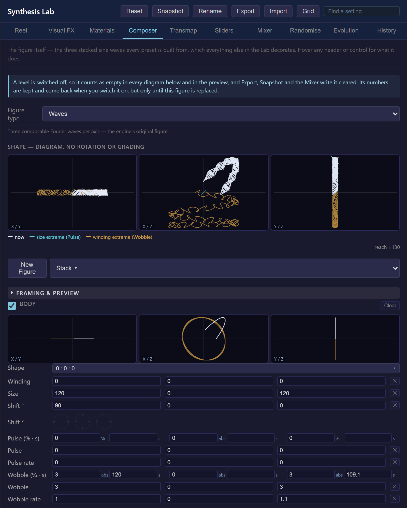

*Three slots in three states. **Body** in full: its nine rows, the three plane previews above them, the
**Shape** ratio dropdown, an **✕** on each row to clear that row across all three axes, **Clear** for
the whole wave, and the readout line underneath. **Structure** switched off — one line instead of
twenty-one inputs, and no **Clear**, because there is nothing visible to judge before destroying it.
**Detail** in full again below.*

Every slot has the same parts. The three columns of every row are the **X, Y and Z axes**.

| Part | What it does |
|---|---|
| **the checkbox** beside the name | Whether this wave counts. Switch it off to see the figure without it — its rows go with it, and one line says the values are kept |
| **Clear** (top right) | Sets **every** number on this whole wave — all seven values on all three axes — to zero. Immediately, with no confirmation and no undo. **It is hidden while the wave is switched off**, since you cannot judge what you would be destroying |
| **the three previews** | This wave **on its own**, in the three planes, so you can see what it contributes before it is summed with the others |
| **Shape** | Picks this wave's X : Y : Z winding relationship **by its shape** rather than by three numbers. Each row of the menu shows the real curve for that ratio |
| **✕** at the end of a row | Clears that one row across all three axes — the same as typing three zeros |
| **the readout line** | What this wave actually does; see below |

> ⚠️ **Switching a wave off is not the same as keeping it.** Its twenty-one inputs disappear while it is
> off and its numbers come back when you switch it on again — but while it is off **the wave is written
> out empty**, so **Export and Snapshot save it cleared**, and the numbers are gone for good once the
> figure is replaced. If you want to keep a wave you are not using, snapshot it while it is switched
> **on**.

> **Clear is harsher still**: unlike switching off, it keeps no copy of what was there.

> **The ratio picker keeps the largest whole number that divides all three windings as the base**, so
> re-picking the same ratio changes nothing. It scales the windings into the relationship you chose
> rather than overwriting them with fixed numbers.

#### The seven values on every axis

| Row | What it means |
|---|---|
| **Winding** | How many times this axis wraps before the curve closes. **A whole number closes the figure; a fraction leaves a visible seam** — which is a real shape, not an error, so nothing rounds it away |
| **Size** | How far this axis reaches, in model units before the canvas fit. **Zero on all three axes is what makes a wave silent** |
| **Shift °** | Where along the sine this axis starts, in degrees |
| **Pulse** | How much the **size** moves — this much is added to and subtracted from Size over time. Zero leaves the figure a fixed shape |
| **Pulse rate** | How fast the size moves. At a Pulse of zero the rate does nothing, whatever it is set to |
| **Wobble** | How much the **winding** moves — added to and subtracted from Winding over time, so the curve continuously re-wraps |
| **Wobble rate** | How fast the winding moves. At a Wobble of zero the rate does nothing |

Two of those rows appear **twice**, once in stored units and once in plain ones:

| Row | What it is |
|---|---|
| **Pulse (% · s)** | The same pulse, as a **percentage of Size** plus **how many seconds one full pulse takes** |
| **Wobble (% · s)** | The same wobble, as a **percentage of Winding** plus the period in seconds |

They are the easier pair to work in: "20 % over 4 seconds" is a sentence, where the stored numbers are
not. Editing either row moves the other.

> **Where Size or Winding is zero there is no percentage to take**, so the box shows the **absolute**
> amount and the unit beside it reads `abs` instead of `%`. In the screenshot above, Body's X winding is
> 0, so its Wobble depth reads `3 abs` rather than a percentage.

> **The seconds are at this figure's own sweep rate**, and **Speed** at the top of the tab scales the
> wall clock over them — so at 0.5× a "4 second" pulse really takes eight.

##### Shift ° — the one with a trap

**Shift ° is multiplied by the winding number.** The shift you actually get is *degrees × winding*, not
the number you typed.

That is why there are **two Shift ° rows**: the upper one holds the stored number, and the lower one is
three **dials** showing the phase the engine really applies, in real degrees. Drag a dial, or click one
of its quarter-turn marks, and it divides the winding back out to find the number to store.

> **At a winding of zero no phase can shift anything**, so the dial is disabled and says so. In the
> screenshot, Body's X axis has Winding 0 and Shift ° 90 — and the readout line reports
> *"X shift 0° (not 90°)"*, because 90 × 0 is 0.

> **Clearing Winding therefore disables the Shift dials for those axes too.**

##### Pulse — the figure breathing

Pulse makes the **size** rise and fall, so the figure swells and shrinks. Low values read as breathing;
high values as a pumping heart.

> **Over 100 % is allowed, and it means something specific**: the axis passes through zero and
> **inverts**, turning the figure inside out each cycle. Several library presets do this on purpose.

##### Wobble — the figure re-wrapping

Wobble makes the **winding** rise and fall, so the number of times the curve wraps keeps changing and
the figure continuously re-draws itself into a different knot. This is the modulation that makes a PSSS
figure look alive rather than merely spinning, and it is what most of the library's most interesting
presets use.

> **A wave can wind entirely by wobbling.** With Winding at 0 and Wobble above 0, the axis has no fixed
> wrap count at all — it only ever has the one the wobble is giving it at that instant. Body in the
> screenshot above is exactly this case.

#### The readout line

Under each wave slot is a line of plain-language findings about that wave. It is the fastest way to
understand a preset you did not write, and it reports things that are otherwise invisible:

| It may say | Meaning |
|---|---|
| `closes` | Every winding is a whole number, so the curve meets itself |
| `X shift 0° (not 90°)` | The stored shift and the real shift differ — here because the winding is 0 |
| `Y no size — winding inert there` | That axis has no reach, so its winding cannot show |
| `flat here — no reach in this plane` | The wave does not extend in the plane being drawn |
| `repeats every 120 s` | The modulation rates line up, so the whole wave has one repeating period |
| `slowest cycle 120 s` | The rates do **not** line up, so there is no single period — this is the longest of them |

#### Working in the Composer

1. **Start from a shape, not from numbers.** Use **New Figure** for a clean circle, or the **Shape**
   ratio dropdown to pick a winding relationship by eye.
2. **Get Body right on its own** before switching Structure and Detail on. Its three previews show it
   alone.
3. **Add Structure at a fraction of Body's size** and several times its winding. If it is the same size
   as Body it competes with it instead of decorating it.
4. **Add Detail only if the figure still looks bare** at full particle count.
5. **Then modulate.** Work in the **(% · s)** rows: a small Wobble over a long period is the single
   change that most reliably turns a static figure into a living one.
6. **Read the readout line** before concluding that a control is broken — most "it does nothing"
   moments are an axis with no size, or a shift against a zero winding.

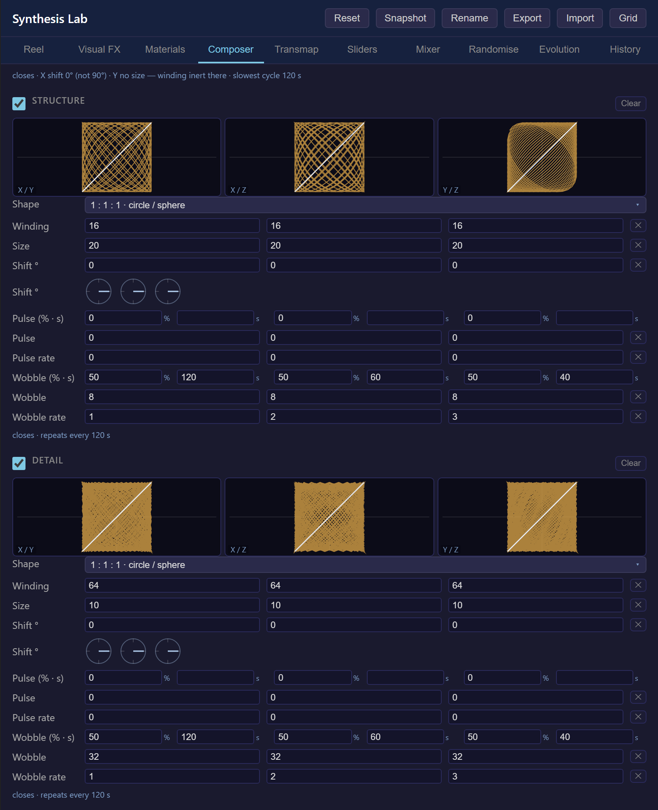

*Structure and Detail on the boot preset, showing the usual relationship between the three waves: Body
reaches 120 model units, Structure 20 at sixteen windings, Detail 10 at sixty-four. Coarse and large,
then finer and smaller — each slot's previews show its own contribution on its own.*

---

### 6.5 Transmap — drawing the wave field

The **chain** of warp layers is assembled in Visual FX, under **Image → Translation Map**. This tab does one narrower job: it draws
the **wave field** that the four wave styles read.

A wave field is a pattern of ripples laid across the frame. Picture a sheet of rubber with a regular set
of bumps pressed into it, held in front of the picture — the bumps are the field, and the warp style
decides whether the picture gets *slid* along them or *magnified* by them. This tab is where those
bumps are shaped.

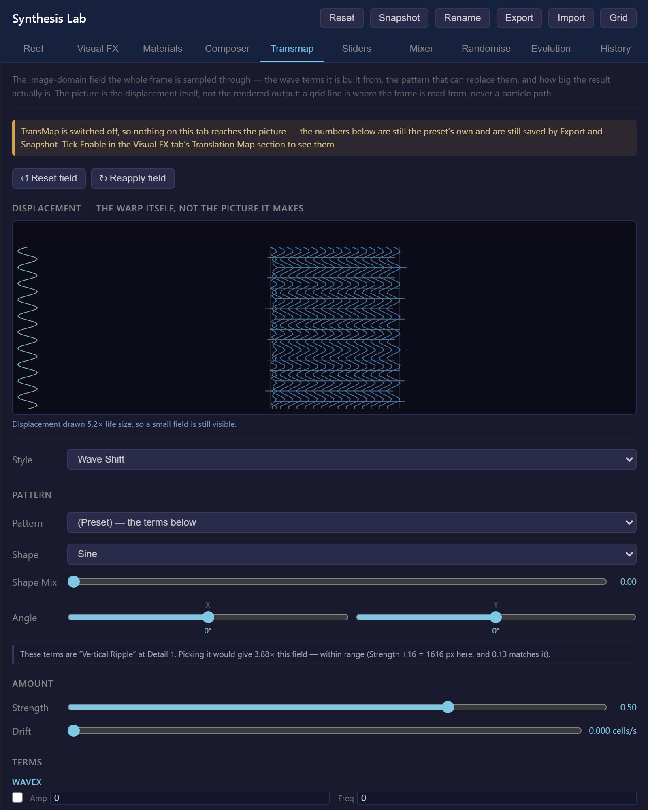

*The Transmap tab. The large panel is the field itself, drawn as a deformed grid at the live frame's own
shape — which is why it does not fill the box — with each live wave's profile drawn beside the edge it
varies along: here a green trace down the left, because that wave varies with height. **Only one
profile is drawn, because this preset's X wave is silent**, and the blue line
underneath says how much the drawing has been magnified so that a small field is still visible. The
amber bar at the top is there because the warp is switched off on this preset: the numbers below are
still the preset's own and are still saved.*

*Below the panel, **Style** picks the operation and **Pattern** chooses where the field comes from.
**Shape** and **Shape Mix** replace the sine the terms are built on, and **Angle** — one row, two cells
captioned X and Y — says which direction each of the two waves runs in. All three are at their
identities here, **Sine**, **0.00** and **0° / 0°**, so the field drawn above is the plain sine pair at
right angles that almost every shipped preset uses — **the pictures under The wave shape and The wave
direction below are the same tab with each of them moved off its identity**; the note under them names the pattern these terms match,
and says what it would cost to switch to it. **Strength** and **Drift** scale and move the result, the **Terms** that build it begin at the
foot of the picture, and the measured line that reports the warp in pixels is below them.*

> **The picture in this tab is the warp itself, not the warped image.** A grid that looks violently
> deformed can still produce a gentle effect, because what you finally see also depends on the style,
> the layer's weight and Chain Mix.

#### What this tab can and cannot edit

**Only four of the twelve styles are built from wave terms**: *Wave Shift*, *Wave Zoom*, *Zoom Overlay*
and *Zoom Combined*. The other eight build their displacement internally and have nothing here to edit.

- If the chain contains **none** of those four, the tab says so and tells you to add one in Visual FX.
  That is the expected message, not a fault.
- If the chain contains **more than one**, a **Layer** dropdown appears and picks the layer the whole tab
  is about. The number it shows is the layer's **position in the Visual FX chain list**, so the two views
  name the same row the same way.

**Style** is also here, restricted to those four, so you can change which of them the picked layer uses
without leaving the tab.

#### What happens to your preset when you change something here

This is worth being precise about, because the tab has one behaviour that surprises people.

**Everything you change here is live and immediate.** It applies to the preset you are working on as you
drag, exactly like Visual FX and Materials. **Nothing is written to the library.** To keep a change, use
**Snapshot** (this session) or **Export** (a file) — see §6.0.

**Most controls affect only the picked layer.** Style, Pattern, Shape, Shape Mix, Strength, Drift, the
zoom half and the zoom centre are all per-layer, and each layer keeps its own — so two layers reading the
same wave terms can still be drawn with different wave shapes.

> **⚠️ The wave Terms are the exception, and it is a big one. The two wave tables are the *preset's* own
> and are shared by every layer — so a term you type here moves all of them at once.** If your chain has
> a Wave Shift layer and a Wave Zoom layer, both read the same tables. Change an amplitude and both
> layers change. To make two layers differ, give them different **Patterns**, **Strengths**, **Drifts**
> or zoom centres — not different terms, because there is only one set.

**Picking a named Pattern does not freeze numbers; typing one does.** A named pattern re-solves its own
size on **every canvas**, so it looks right at any window shape, and the Terms below then *show* you the
numbers it solved for. The moment you type into one of those boxes, you adopt those numbers as fixed
values **at the current window size** — the readout changes to *"(Preset) — edited"* and the pattern
stops adapting. That is a legitimate thing to do, and it is how you start from a named pattern and tune
it; just know that you have traded "fits every screen" for "exactly these numbers".

**Undo is local to the field.**

| Button | What it does |
|---|---|
| **↺ Reset field** | Puts the field back to what it was **when you opened this tab** — the style, the pattern, the wave shapes, every slider and both sets of terms. **Nothing else in the preset is touched.** It greys out while the field still matches that starting point, so a lit button is also how you know you have changed something |
| **↻ Reapply field** | Puts back the changes Reset just undid, exactly as they were when you pressed it. Only a Reset arms it, so it is available once per Reset |

#### The nineteen named patterns

**Pattern** chooses where the field comes from. **(Preset)** means the Terms below are the source, which
is what almost every preset in the library does. The nineteen named patterns are ready-made fields, and
picking one takes over from the preset's own terms.

They are described below by what they look like. "Cycles" means how many times the ripple repeats across
the frame: a low number is one big slow swell, a high number a fine mesh.

| Pattern | What it looks like |
|---|---|
| **Coarse Swell** | One single cycle on both axes — **one broad lens over the whole frame**. The gentlest of them all, and the shape the library reaches for most often. Start here |
| **Macrolense** | Half a cycle, so you get **part** of one lens across the frame — an even broader, one-sided magnification than Coarse Swell |
| **Distant Lense** | Macrolense inverted: the same half-cycle pushing the other way, so the frame bulges where Macrolense pinched |
| **Vertical Ripple** | Eight cycles on one axis only, and nothing on the other — **plain parallel ripples**, like heat haze or old window glass. The single most common field in the legacy library |
| **Horizontal Ripple** | The same thing turned ninety degrees |
| **Grid Lattice** | Six cycles one way, four the other — the two ripples cross into a **regular lattice of bumps**, a grid of little lenses |
| **Fine Mesh** | Sixteen cycles on both axes: **the densest lattice**, so fine it reads as texture rather than as shape |
| **Interference** | One cycle on each axis but **opposing**, which gives one broad counter-turning cell — a slow twist across the whole frame rather than a repeating pattern |
| **Diagonal Shear** | Four cycles each way, opposed, so the field pushes along the diagonal — the picture **leans** rather than rippling |
| **Cross Shear** | Like Diagonal Shear but with one axis **twice as fine** as the other, so the lean is uneven and the pattern does not read as symmetric |
| **Broad Over Fine** | Eight cycles one way and one the other — **fine ripples on one axis, one big swell on the other**. The asymmetric counterpart of Grid Lattice |
| **Turbulent Weave** | Four ripples per axis at 1, 2, 4 and 8 cycles, each half the size of the last — a coarse shape **carrying its own fine detail**, which reads as organic turbulence rather than as a pattern |
| **Harmonic Cascade** | Four ripples at 1, 2, 3 and 4 cycles, opposed between the axes. Because the cycles are a harmonic series rather than doublings, the lobes are many and unevenly spaced — busier and less regular than Turbulent Weave |
| **Ember Cascade** | One broad swell carrying three fine ripples at 8, 16 and 14 cycles. The near-miss between 16 and 14 keeps the fine detail from lining up, so it shimmers — the fire presets' field |
| **Prime Comb** | Four ripples at 2, 3, 5 and 7 cycles, all the same size. Because those numbers share no factors they **never realign**, so the field never exactly repeats anywhere in the frame |
| **Beat Swell** | Four very slow ripples at almost — but not quite — the same cycle count. Nearly-equal waves drift in and out of step, so the field **swells and fades over time** instead of holding one shape |
| **Brick Weave** | Fine striping one way **crossed with** a coarse swell the other — seven cycles against three on one axis and three against seven on the other. The only crossed pair in the list, and what it reads as is a **brick course** rather than a lattice |
| **Oblique Lattice** | A broad three-cycle ridge on both axes carrying a second, much finer seven-cycle ripple. Because the fine ripple is well above the ridge's octave the two never settle into a grid, so it reads as **flowing organic ridges** |
| **Terraced Swell** | Two broad cells per axis with a non-harmonic fifth riding on them, so the contours never realign. **Designed to be used with the `Trapezoid` wave shape**, under which the field breaks into **stepped terraces** |

> **The last three are different in kind from the sixteen above them.** The sixteen were distilled from
> the library — each is a field that recurs across the shipped presets, which is why picking one often
> lands you exactly where a preset already was. **These three are designed rather than found**: they
> exist to reach a shape the other sixteen do not contain — two active ripples per axis, mirrored or
> crossed, instead of one or four — and the presets that use them are the **wave-shape demos** at the end
> of the library, which were built around them rather than the other way about.

> **A pattern replaces the preset's own field, it does not add to it.** To get back whatever the preset
> shipped with, set Pattern to **(Preset)**, or press **↺ Reset field**.

#### The wave shape

A wave field is built from waves added together, and **Shape** chooses which wave. Everything else in
this tab decides how big, how fine and where; this decides what the ripple's own profile looks like.

| Control | Effect |
|---|---|
| **Shape** | *Sine*, *Triangle*, *Trapezoid*, *Square* or *Sawtooth*. **Sine is the default**, and the whole library is built on it apart from the eight **wave-shape demos** at the end of the list |
| **Shape Mix** | How much of that shape is blended into the plain sine field. **0 is pure Sine whatever Shape says**; 1 is the shape alone |
| **Zoom Shape**, **Zoom Shape Mix** | *Zoom Combined* only. The zoom half is built by a separate pass, so it carries its own shape and its own mix — one half can be shaped and the other left smooth |

| Shape | What the warp looks like |
|---|---|
| **Sine** | The smooth lens everything in the library is built from. This is the "no shape" setting |
| **Triangle** | The same ripple with **straight sides and a crease** at each peak and trough instead of a curve — a harder-edged version of Sine rather than a different kind of field |
| **Trapezoid** | The crease flattens into a **plateau**: patches of constant displacement joined by straight ramps. Still a refinement of Sine, and the shape `Terraced Swell` was designed around |
| **Square** | **Two displacement values and nothing in between.** The image is cut into hard rectilinear blocks — nothing else in PSSS makes structure like this |
| **Sawtooth** | A steady ramp that **jumps back** at the end of every cycle: a repeating one-way slide rather than an oscillation |

> ⚠️⚠️ **PICK A SHAPE, LEAVE SHAPE MIX AT 0, AND NOTHING HAPPENS — THIS IS THE ONE THING TO KNOW ABOUT
> THIS PAIR.** *Sine* is one way of saying "no shape" and a mix of 0 is the other, and they are kept
> separate on purpose, so choosing *Square* by itself changes nothing at all. **An amber line appears
> under the rows saying so.** If you have picked a shape and the picture has not moved, that line is the
> answer: raise **Shape Mix**.

> ⚠️⚠️ **SQUARE AND SAWTOOTH TEAR THE IMAGE, AND THAT IS WHAT THEY ARE FOR.** A smooth wave *bends* the
> picture; those two jump, so neighbouring pixels come from places far apart and the image rips along
> hard lines. A second amber line says so when either is live. **On a zoom style the tear grows towards
> the edges**, because a zoom scales the displacement by distance from the centre. If you want a
> hard-edged field that still bends, use **Triangle** or **Trapezoid**.

> **Triangle and Trapezoid are refinements of Sine, not new categories.** Measured, the trapezoid's
> hardest edge sits inside the smoothness the sine field already has, so expect a crisper version of
> what the pattern was already doing rather than a new look. Square and Sawtooth are the ones that
> change the kind of picture.

> ⚠️ **The shape applies on `(Preset)` too, not only on a named pattern** — which is the opposite of
> **Detail**, whose row is hidden on `(Preset)`. A shape re-shapes the preset's own terms rather than
> replacing them. ⚠️ **But those terms were authored for Sine**, so a third amber line warns that a shape
> there re-reads the author's field instead of refining it. **If you want the shape to drive the
> structure, start from a named Pattern.**

> **Strength re-solves itself as you move Shape Mix**, so the warp keeps its measured size while its
> character changes — ⚠️ **except on `Macrolense` and `Distant Lense`**, which carry their own
> amplitudes and skip that step, so there the size moves with the shape and you will want to re-set
> Strength by eye.

> **The identification line names the shape as well as the pattern.** Without that it would report
> `Grid Lattice` for a picture you can see is a square mosaic. It stays quiet while Shape Mix is 0,
> because then the picture really is the sine field the pattern names.

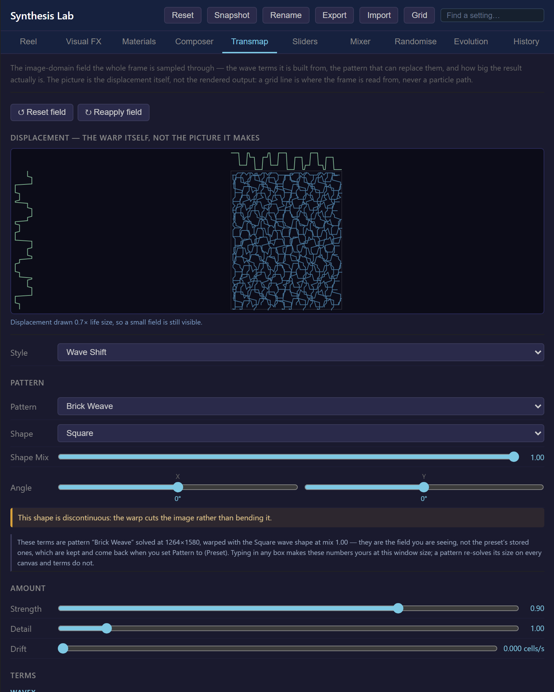

*A shaped field, on the preset `Warp Square Mosaic`. **Pattern** is **Brick Weave**, **Shape** is
**Square** and **Shape Mix** is **1.00** — and compare the drawing with the smooth one at the top of
this chapter. **Both edge profiles are square waves**: flat runs at one of two heights with a vertical
jump between them, instead of a curve. There are two of them because `Brick Weave` is the one crossed
pair in the catalogue, so neither axis is silent. The lattice they build is a mosaic of flat cells joined
by straight seams, which is what the **Square** row in the table above means by "two displacement values
and nothing in between".*

*There is no amber bar across the top of this tab, because this preset's warp is switched **on** —
unlike the preset in the first picture. The **Angle** cells are still at **0° / 0°**.*

*The amber line under **Angle** is the tear warning — "This shape is discontinuous: the warp cuts the
image rather than bending it." Below it, the identification line now **names the shape** as well as the
pattern — `These terms are pattern "Brick Weave" solved at 1264×1580, warped with the Square wave shape
at mix 1.00` — which is the sentence the last note above promises.*

#### The wave direction

A field is two waves, and **Angle X** and **Angle Y** say which way each of them runs. They sit on one
row with two cells, because the pair is one quantity: what matters is the angle *between* the two as much
as where either points.

| Control | Effect |
|---|---|
| **Angle X / Angle Y** | The direction each wave is sampled along, in degrees, from −90 to +90 in whole steps. **At 0 and 0 the two are at right angles** — the way almost every shipped preset is built, and bit-for-bit the field the engine draws with no orientation at all. The only presets built off it are the **warp-orientation demos** at the end of the library list |
| **Zoom Angle X / Y** | *Zoom Combined* only. The zoom half is built by a separate pass, so it can run at its own orientation — the zoom lattice can stay square while the shift half tilts |

> **Turn them apart and the lattice tilts; turn them together and you get stripes.** Moving one angle
> rotates one wave against the other, so the woven grid skews to an arbitrary orientation. Moving both by
> the same amount rotates the whole field rigidly. The pair that gives a **single direction** is the one
> where the two end up parallel.

> ⚠️ **The range stops at ±90 on purpose.** A wave at +120° draws exactly the field a wave at −60° draws
> with its amplitudes flipped, so a full circle would offer every orientation twice and the dial would be
> harder to aim with, not more capable. Every distinct direction is inside ±90.

> ⚠️⚠️ **THREE SETTINGS ARE DEGENERATE, AND AN AMBER LINE APPEARS UNDER THE ROW FOR EACH.** Nothing is
> blocked or clamped — these are legitimate fields and the lines simply say what you have:
>
> - **An angle at ±90° swaps that wave onto the other axis**, so it repeats the other direction instead
>   of adding a new one.
> - **The two waves parallel** makes the field one-directional: it varies along one axis and is flat
>   along the other.
> - **A parallel pair on Zoom Overlay can cancel completely.** That style adds the two waves together, so
>   where they are exact opposites the field measures 0 px and nothing warps at all. The measured line at
>   the bottom of the tab is what tells you whether that has happened.

> **A direction is not a size.** Rotating the waves does not change how big the warp is: Strength
> re-solves itself against the new orientation, so the measured peak stays where you set it.

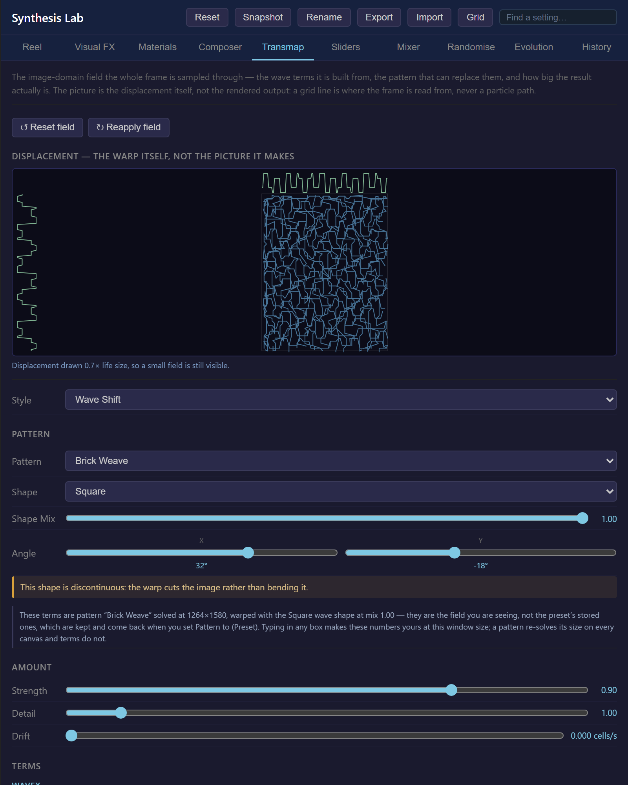

*A rotated field. **This is the previous picture's preset with nothing changed but the two Angle cells**
— `Warp Square Mosaic` again, still **Brick Weave** / **Square** / **Shape Mix 1.00**, and now
**Angle X 32°**, **Angle Y −18°**. Compare the two drawings: the seams were square to the frame, and
here they run **obliquely**, with long diagonal runs the axis-aligned version has none of. Both edge
profiles have changed too, because each wave is re-sampled along its own new direction.*

*Nothing else moved. **Strength is still 0.90** and the identification line still reads `Brick Weave`
warped with `Square` — a rotation is not a different pattern and not a different size.*

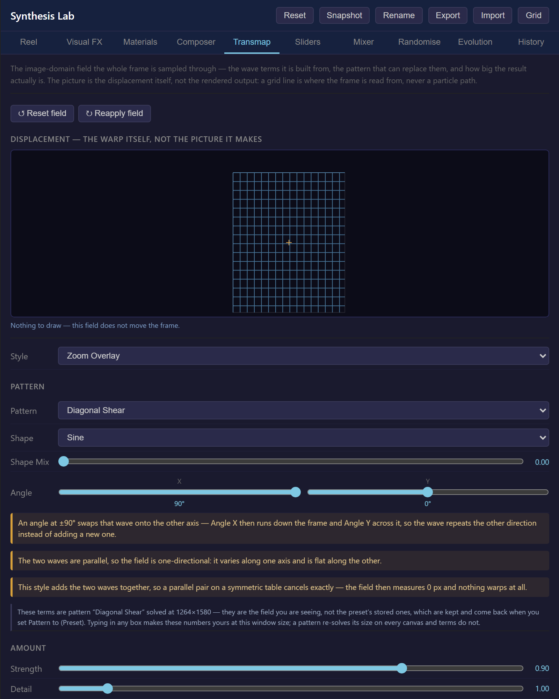

*A degenerate pair, and what the tab does about it. This is a **Zoom Overlay** layer — switched to the
**Diagonal Shear** pattern and then set to **Angle X 90°, Angle Y 0°**. **Three amber lines are showing at
once**, all three from the list above: ±90° swapping a wave onto the other axis, the pair being parallel
as a result, and a parallel pair on this style cancelling. ⚠️ **A fourth would join them on a
discontinuous shape** — the tear warning — but **Shape** here is **Sine** at **Shape Mix 0.00**, which is
the identity, so the shape has nothing to say.*

*⚠️ **The cancellation is real here and the picture is the proof.** The lattice at the top is a perfectly
regular grid, there are no profiles drawn along either edge, and the line under it reads **"Nothing to
draw — this field does not move the frame."** Nothing is switched off and no amount is at zero: the two
waves are exact opposites, so they add up to nothing.*

*⚠️ **Change the pattern and the same four lines can be telling you something milder.** `Diagonal Shear`
cancels because its two axes are the same ripple with opposite signs. On a pattern whose axes agree
**without** the sign flip — `Coarse Swell`, which is what this preset ships with — the identical angle pair
lights the identical four lines and the field carries on warping at full size. **That is why the measured
line at the foot of the tab, and not the notice, is what tells you whether anything has gone.***

#### The amount

| Control | Effect |
|---|---|
| **Strength** | Overall size of the warp. **0.5 is neutral** — the preset's terms used exactly as authored — so above it the field is stronger than the preset intended and below it weaker. **0 sits in the middle of the track, not at its end**, and means no warp; below 0 the same field is **inverted**, every offset pointing the opposite way at the same size |
| **Drift** | How fast the whole field slides, in grid cells per second. It moves the field **rigidly**: the shape and the size never change, only where it sits. 0 holds it still, which is what almost every preset in the library does |

> **The line at the bottom of the tab reports the result in pixels.** Because that is a size, only the
> *sign* of Strength tells you which way round the field is.

#### The terms — drawing the field by hand

A wave field is built from **sine waves added together**: four in **WaveX** and four in **WaveY**. Each
term has an **amplitude** (how far it pushes) and a **frequency** (how many times it repeats across the
frame), and a tick that decides whether it counts at all.

The four amplitudes in one direction **add up**, and the total is then scaled by **Strength**. So two
terms of equal size and opposite sign cancel, and four small terms can make a more intricate shape than
one large one.

| Control | Effect |
|---|---|
| **The tick** | Whether this term counts. Switching it off stores zero for both numbers; switching it back on restores what was there |
| **Amplitude** | How far this term pushes the frame. Type any value — what you type is stored exactly as typed |
| **Frequency** | How many times this term repeats across the frame |

Three rules about frequency that are easy to trip over:

- **Whole numbers close seamlessly**; fractions do not, so the pattern does not quite meet itself at the
  frame edge. That is a look rather than a mistake, and several library presets use it deliberately.
- **In the shift half, frequency 0 makes a term do nothing** however large its amplitude — a wave that
  repeats zero times is flat.
- **In the zoom half, frequency 0 is useful**: an amplitude alone gives a **steady zoom**, a constant
  push in or out with no oscillation at all.

**Zoom Combined has two sets.** Everything described above is the **shift** half; the **Zoom half**
section repeats it for the zoom, with its own four-plus-four terms. The two are genuinely separate
fields, not one field at two detail levels — which is what lets the shift and the zoom oppose each
other. **Zoom centre** sets where the zoom pushes away from, in percent of the frame, marked by the
crosshair on the picture above; *Wave Shift* ignores it.

#### Working in this tab

1. **Make sure you have a wave layer.** If the tab says it has nothing to edit, add Wave Shift, Wave
   Zoom, Zoom Overlay or Zoom Combined in Visual FX first.
2. **Start from a named Pattern** rather than from the terms. *Coarse Swell* and *Vertical Ripple* are
   the two that look like something immediately.
3. **Use Strength to judge it.** Take it to 0 and back to see what the layer is contributing.
4. **Try a Shape before you try the terms.** It is one dropdown and one slider, and it changes the
   field's character more than most term edits will — ⚠️ **but set `Shape Mix` above 0, or nothing
   happens at all.** `Square` on a lattice pattern is the quickest way to see what the control is.
5. **Only then touch the terms**, remembering that doing so fixes the numbers at this window size — and
   that the terms are shared by every layer in the chain.
6. **↺ Reset field** is always a way back, for as long as you stay in the tab.

---

### 6.6 Sliders — fourteen qualities, one dial each

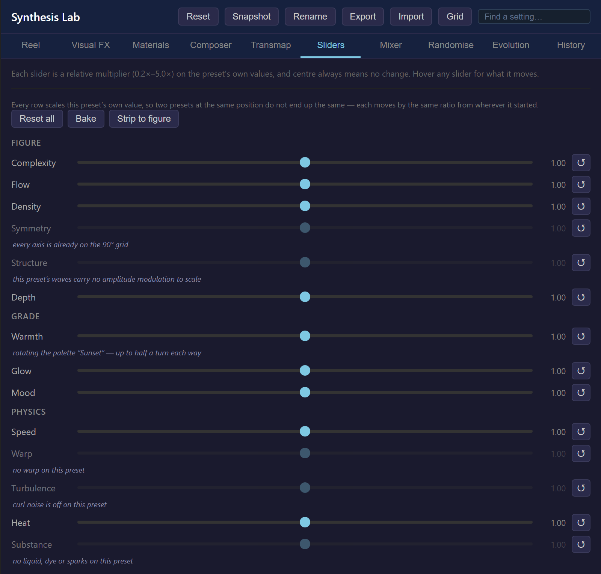

*The Sliders tab. The header carries **Reset all**, **Bake** and **Strip to figure**; the fourteen
rows are grouped under **Figure**, **Grade** and **Physics**. Five rows here are greyed out with a
one-line reason printed underneath — Symmetry, Structure, Warp, Turbulence and Substance have nothing
to act on in this preset, which is entirely normal. **Warmth** shows the other kind of line: that row
is enabled, and its line says which of its two laws is in force.*

The fastest tab for shaping a preset you already like. Every slider is a **relative multiplier on the
preset's own value**, and **centre always means no change**.

**This has one consequence worth understanding:** because each slider scales *this* preset's value, two
different presets at the same slider position do not end up the same. Each moves by the same *ratio*
from wherever it started.

**Figure** — the shape itself:

| Slider | Effect |
|---|---|
| **Complexity** | how fast the waves oscillate — higher knots the figure up |
| **Flow** | wave speed and how fast the figure breathes |
| **Density** | the particle count |
| **Symmetry** | pulls wave phases toward neat 90° angles. Upper half only |
| **Structure** | how strongly the wave amplitudes are modulated |
| **Depth** | rotation speed and the depth-size effect |

**Grade** — colour and light:

| Slider | Effect |
|---|---|
| **Warmth** | where a palette is active it rotates that palette's hue; where none is, it shifts the preset's own colour balance |
| **Glow** | particle halo, trail persistence, and above about 0.65 bloom as well |
| **Mood** | brightness and colour vividness together |

**Physics** — how the substance behaves:

| Slider | Effect |
|---|---|
| **Speed** | playback tempo, without editing the wave data |
| **Warp** | how hard the image warp pushes |
| **Turbulence** | curl-noise strength and scale together |
| **Heat** | the material's heat and emission |
| **Substance** | liquid thickness, dye opacity, spark budget |

**Rows that cannot do anything say so.** A slider that has nothing to act on this preset is **greyed
out with the reason printed underneath** — *"no material on this preset"*, *"curl noise is off on this
preset"*. **At least one row is greyed out on every preset in the library**, so this is normal, not a
fault. It is also a fast way to read what a preset *is*: six greyed rows means a bare figure with no
material, no warp and no liquid.

**The header controls:**

| Control | Effect |
|---|---|
| **Reset all** | every slider back to centre and the preset back to how you found it |
| **Bake** | adopt the current result as the new starting point and re-centre every slider |
| **Strip to figure** | show the bare curve — pixel points, no material, no warp, no grading |

> **`Bake` is the one control here that does not undo.** Everything else promises that centre restores
> the preset; Bake deliberately breaks that, because without it you cannot shape twice in a row. After
> a bake, centre means the baked result. Snapshot first if you are unsure.

> **`Strip to figure` changes only what you see.** The preset is untouched — an export taken with the
> strip on is identical to one taken with it off. It leaves speed alone so you can slow a figure down
> while inspecting it.

> **A Dye Field choice made in Visual FX survives a drag here; some other sections' do not.** Every
> slider re-applies the preset, and the Dye Field rows are carried across that — so a **Dye Colour** you
> picked in Visual FX stays picked. **The Liquid Surface, Cohesion, Liquid Field, Curl Noise, Sparks and
> Materials sections are not carried** — a change made there after you have opened this tab can be
> replaced by the preset's own value on the next drag, *Tint Source* being the one most likely to catch
> you. If it happens, set it again; **Bake** makes the current state the new starting point so later
> drags keep it.

---

### 6.7 Mixer — blending two presets

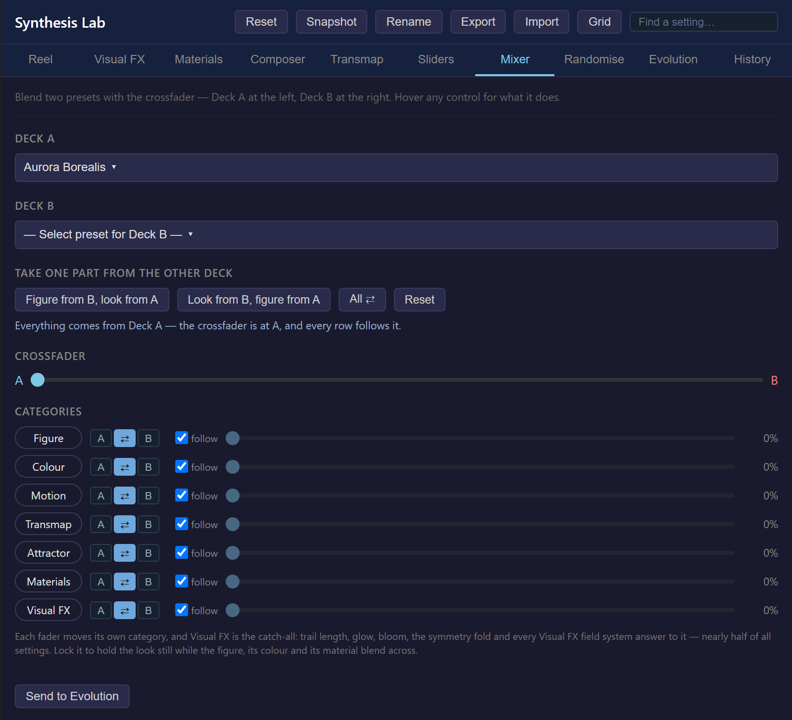

*The Mixer. **Deck A** is the preset blended *from*, **Deck B** the one blended *to*. Under them, the two
source buttons, **All ⇄** and **Reset**, with a line saying in words where everything currently comes from. Then
the master **Crossfader**, and under **Categories** one row per part of a preset — each with its lock
chip, its **A ⇄ B** buttons, a *follow* tick and its own fader.*

Load two presets as **Deck A** and **Deck B**. Deck A is filled with the preset you came in with; Deck B
you choose.

**Take one part from the other deck.** The two buttons at the top are the quickest way to use the
Mixer, and the most common:

| Button | What you get |
|---|---|
| **Figure from B, look from A** | Deck A's colours, grade, materials, image warp and other effects, on Deck **B**'s figure. The figure brings its **motion** (rotation and speed) and its **attractor** with it |
| **Look from B, figure from A** | the other way round |
| **All ⇄** | hands every row back to the crossfader, leaving the crossfader where it is — the way back from a mix you built row by row to blending everything at once, without resetting anything |
| **Reset** | everything back to how it was when you opened the Mixer — the preview returns to the preset you came in with, every row takes its settings from Deck A again, the crossfader goes back to A and any locks are released. **Deck B stays chosen**, so you can try a different mix of the same pair straight away |

**After a source button, the crossfader still works — on the part you took.** **Figure from B, look from
A** holds the look at Deck A and hands the figure to the crossfader, which it moves all the way to B.
Drag the crossfader back and the figure fades from Deck B's towards Deck A's while the look stays
exactly as it is. So the crossfader then means *how much of the other deck's figure* — or, after **Look
from B**, *how much of its look*.

A typical session: open the Mixer on a preset whose look you like, pick a preset whose **figure** you
want as Deck B, press **Figure from B, look from A**, then pull the crossfader back until the blend of
the two figures is right. If it is not right, press **Reset** and try another Deck B, or set the rows by
hand.

**The categories** are the seven parts a preset is made of — **Figure**, **Colour**, **Motion**,
**Transmap**, **Attractor**, **Materials** and **Visual FX** — and each row decides where its part comes
from:

| Buttons / controls | What the row does |
|---|---|
| **A** | holds this part at Deck A, whatever the crossfader does |
| **B** | holds it at Deck B, whatever the crossfader does |
| **⇄** | follows the master **Crossfader** — this is how every row starts |
| untick *follow*, then drag the row's fader | blends this part on its own, independently of the others |
| click the category chip | **freezes** the part at whatever is on screen, while the faders move |

**The rule is one sentence: the crossfader moves every row set to ⇄, and nothing else.** The line under
the buttons says the current state in words, for example *"Following the crossfader, now at B: Figure,
Motion, Attractor. Held at Deck A: Colour, Transmap, Materials, Visual FX."* When no row follows it, the
crossfader is **switched off** (greyed out) and the line says how to hand a row back — click **⇄** on a
row, or **All ⇄**.

**Visual FX is the catch-all.** Trail length, glow, bloom, the symmetry fold and every Visual FX field
system answer to it — nearly half of all settings — which is why it is usually the row to lock when you
want the look to stay still.

**Two things to know.** Some settings are categorical — a material, a render mode, a palette, a curve
rule — and cannot be half-way between two values. Those **snap** at the fader's midpoint rather than
blending. And **each fader has its own midpoint**, so snapping happens per category, not all at once at
the master.

> **The category chips are shared with the Randomise and Evolution tabs, where they mean something
> different.** Here a lit chip *freezes* a category. There it *excludes* it from change. Locking
> something here will also stop Randomise touching it until you unlock it. The chips carry the same
> seven names in all three tabs.

---

### 6.8 Randomise — guided accident

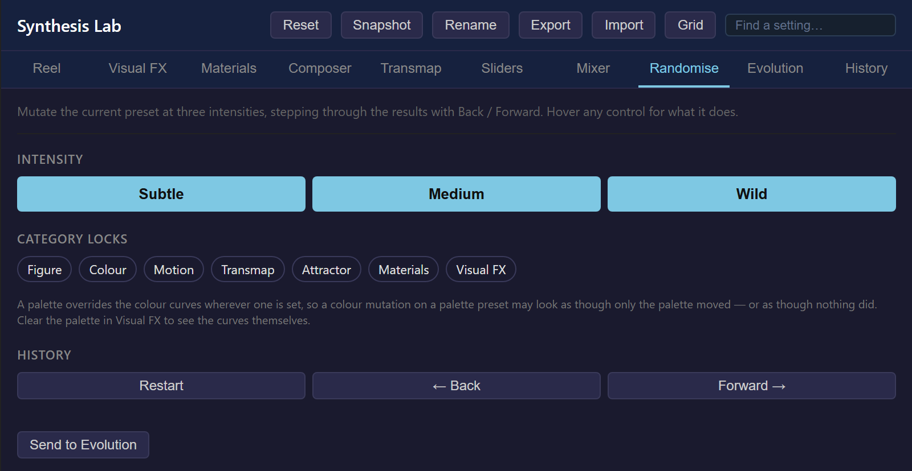

*The Randomise tab. **Intensity** holds the three buttons — **Subtle**, **Medium** and **Wild** — with
**Restart** beside them. **Category Locks** is the seven “keep untouched” chips, with the line beneath
them warning when a palette will mask a colour mutation. **History** at the foot steps back and
forward through what this tab has produced.*

Mutates the current preset. Each press is one mutation, and you step through the results with the
history buttons.

**Three intensities, and they are promises rather than just three sizes of the same nudge:**

| Button | What moves | Can it change an identity? |
|---|---|---|
| **Subtle** | small nudges | **No.** The palette, film look, material, particle mode, warp style and attractor are left exactly as they are |
| **Medium** | substantial change | **Yes** — about one press in four re-skins **one** of them |
| **Wild** | large, structure-breaking | Yes. Expect most results to be unusable and the occasional one to be worth keeping — that is the intended hit rate |

**Keep untouched.** Seven chips — Figure, Colour, Motion, Transmap, Attractor, Materials, Visual FX. A lit
chip **excludes** that category from mutation. This is how the tab becomes a precision tool rather than
a slot machine: lock everything except Colour and press *Medium* repeatedly to audition grades on a
figure you have settled.

**The intensity decides before the locks do.** Unlocking Colour does not make *Subtle* swap your
palette — locks decide *what may be touched*, the intensity decides *how far and whether an identity
may change*.

**History.** **Restart** returns to the preset you entered with. **← Back** and **Forward →** step
through the chain. Randomising after stepping back discards everything ahead. This chain belongs to
this tab only and is not your Snapshot history.

**The line under the Category Locks** warns you that a palette overrides the colour curves, so a colour
mutation on a palette preset can look as though nothing happened. It is printed on the panel rather
than hidden in a tooltip precisely because it looks like a fault.

> **Offset and Sway are never mutated, at any intensity and with every chip unlocked.** A random offset
> breaks the centring every preset is composed around and every rotation is taken about, so the results
> would read as the tab being broken rather than as variety. **Sharpness, Travel, Grow and their
> breathing are all in play**, so expect a *Wild* press to facet, open or ramp the figure.

---

### 6.9 Evolution — breeding presets

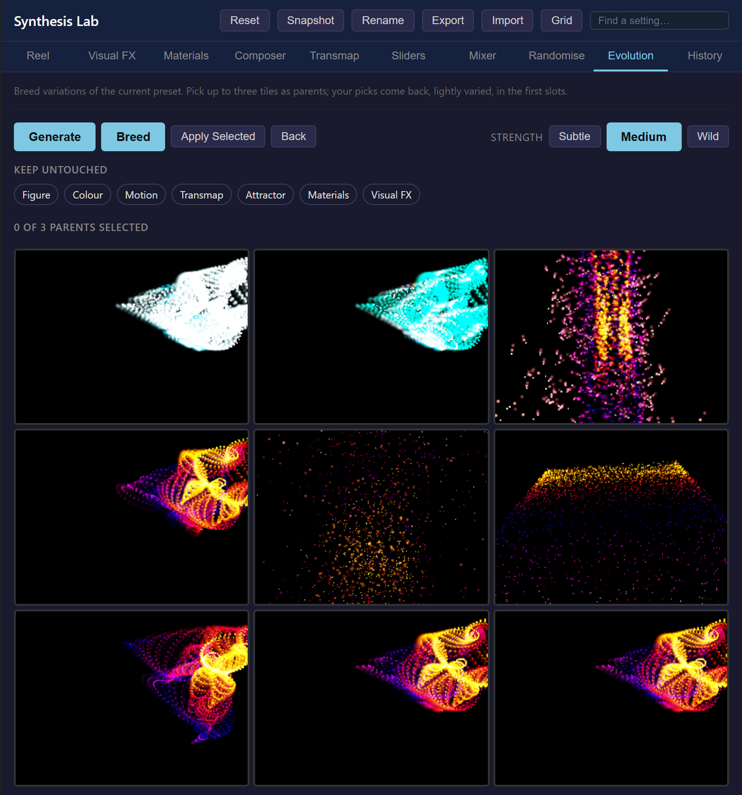

*The Evolution tab. The control row carries **Generate**, **Breed**, **Apply Selected** and **Back**,
with the three mutation-strength buttons beside them — here set to Wild. **Keep untouched** is the same
seven chips as Randomise, and the nine tiles below are all live.*

Nine live tiles, each a variation. Pick up to three as parents, breed, repeat.

| Control | Effect |
|---|---|
| **Generate** | nine fresh mutations of the current preset. This explores **away** from what you have |
| **Breed** | crosses your selected tiles into a new generation. This explores **between** them |
| **Apply Selected** | loads the selected tile as the working preset |
| **Back** | brings back the previous generation and the parents you had picked. One step only |
| **Strength** | *Subtle* / *Medium* / *Wild*, driving both Generate and Breed |
| **Keep untouched** | the same seven chips. Here a lock means both: not mutated **and** not inherited from any parent but your first pick |

**How a child is made.** Each child inherits all seven categories **whole from one parent or the
other**, and averages the numbers inside them. The practical effect is that **a child's look can be
traced to a parent by eye** — which is what makes nine tiles worth scanning rather than nine
variations of the same thing.

**Your picks come back.** After a breed, the parents you chose reappear in the first slots, lightly
varied — marked **★** for a parent you picked and **◆** for a tile carried over. A tile can be both.

> **The exact tile you picked is not in the new grid** — it comes back *varied*. That is deliberate, so
> no slot is ever a repeat of what you just looked at, and it is why **Back** exists.

**The counter** reads *"N of 3 parents selected"*. At three, the remaining tiles dim and further clicks
are ignored; click a picked tile to free a slot.

**A note on Wild.** Once breeding reaches colour and materials as well as shape, *Wild* can produce
tiles that look broken — a preset that inherited no material and draws almost nothing, or a palette
switched off by a grade that does not set one. That is the range of the engine becoming visible, not a
fault. Nine tiles at once is the best place for it to happen.

---

### 6.10 History — getting back

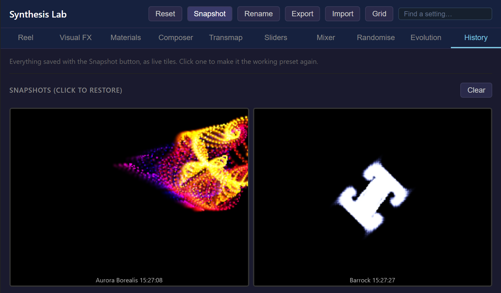

*The History tab with two snapshots taken. Each appears as a **live tile** — still animating, not a
thumbnail — in the order you took them, captioned with **the preset's name and the time** you took it.
Click one to make it the working preset again; **Clear** empties the grid.*

Every **Snapshot** appears here as a live tile. Click one to restore it, including the Visual FX state
it was saved with. **Clear** deletes every snapshot; it does not touch the library or the preset you
are working on.

Snapshot often. It is the only undo that survives switching tabs.

---

# Part III — Practice

## 7. The Preset Library

The library ships with **325 presets**. They are not a flat list: they fall into groups with quite
different purposes, and knowing which group you are looking at tells you how much to trust it as a
starting point.

| Group | How many | What it is for |
|---|---|---|
| **The classic collection** | 173 | the original figures, retuned for this engine. The most "finished" presets, and the best starting points |
| **Feature demonstrations** | 59 | one preset per capability, built to show a single thing clearly — plus a few the author made in the Lab and kept, which are not demos of anything |
| **Variants** | 73 | alternative treatments of classic figures — the same shape photographed differently, plus the newest feature demos |
| **Fire and flow sets** | 10 | heat and motion studies |
| **Material showcases** | 3 | end-to-end examples of the material system |
| **Warp chains** | 3 | examples of several warp layers combined |
| **Untouched originals** | 4 | classics that have not been retuned |
| | **325** | |

### 7.1 What the groups feel like

**The classic collection** is where to browse if you want something that already looks good. These
have been through repeated rounds of tuning; the colour, trail and grading choices in them are
considered rather than incidental.

**Variants** are the most instructive pair-wise. Find a classic and its variant and compare them: the
figure is often identical and everything else differs, which is the clearest possible lesson in how
much of the look comes from the image half rather than from the figure.

**Feature demonstrations** are deliberately plain. A preset built to show *curl noise* will show curl
noise and little else. They are the best place to learn what one control actually does, and a poor
place to look for something beautiful.

### 7.2 Finding your way around

Rather than scrolling, use **Filter ▾** and ask a question:

| You want | Filter by |
|---|---|
| something flowing and warm | Material: *Fire* or *Ember* |
| something crisp and geometric | Materials: *No material*, Figure: *Flat* |
| something cold and structural | Material: *Ice* plus Populations: *Crystals* |
| something strange | Attractor Type: anything |
| a figure that does not close into a loop | Figure: *Open figure* |
| something kaleidoscopic | any warp style |
| the plainest possible figure | Materials: *No material*, Colour: *No palette* |

### 7.3 A note on names

Preset names are descriptive but not systematic — *Boiling Milk* and *Flying Zebras* tell you
something, *Argus* and *Nexus* do not. **The filter is measured from what the preset actually does**,
so when a name and a filter disagree, trust the filter.

---

### 7.4 How to replace the standard library

The library and the reels that come with PSSS are **two data files in the distribution**, and you can
replace both with your own. PSSS exports exactly those two files, under exactly the right names, so the
job is **download and copy over**. There is nothing to rename and nothing to edit.

**Step 1 — curate what you want to ship.** Work in the browser until the library holds what you want.
**Import** brings in presets from `.json` files, **Rename** renames the selected one, and the Lab's
**Export** saves a single preset on its own. Then set up the reels you want in the **Reel** tab, and
tick the one that should play by itself as the **main reel**.

**Step 2 — export both files.**

| Button | Where | What it writes |
|---|---|---|
| **Export All** | the preview grid header | the **whole** library, as `psss_presets.json` |
| **Export Reels** | the Reel tab | every reel, plus which one is the main reel, as `psss_reels.json` |

**Step 3 — copy them in.** Replace the two files in the folder holding `index.html` and
`psss-engine.js`, keeping all four files together (§4.1). For the screensaver, replace the same two
files sitting beside `psss.scr` (§4.2) — it reads the identical pair.

That is the whole procedure. **Keep a copy of the originals first**, because nothing in PSSS can put
the shipped library back for you.

#### What to expect if something is wrong

The two files are deliberately **not** treated the same way:

| File | If it is missing or malformed |
|---|---|
| `psss_presets.json` | **Fatal.** The page loads and reports that the library is missing. Nothing is drawn, because there is nothing to draw |
| `psss_reels.json` | **Not fatal.** PSSS warns, then falls back to the reels built into the engine, and the rest of the program works normally |

#### Why these files are not quite JSON

If you open one in a text editor you will see that it does not begin with `{` but with
`g_psss_presets={` — the file is a tiny script that assigns the data, rather than plain JSON. That is
worth explaining, because it looks like a mistake and is not.

A page opened by **double-clicking** `index.html` runs from your filesystem rather than from a web
server, and browsers forbid such a page from *reading* neighbouring files — both of the usual ways of
doing it are blocked outright, as a security rule. What a local page *can* do is **run** a neighbouring
script. So the data is delivered as a script that assigns it, which is the only transport that works
from a folder on disk, and the same one the original PSSS used.

You do not have to deal with any of this: **the export buttons already write the files in that form.**
It only matters if you were planning to generate a library with some other tool, in which case your
file needs the same first line — `g_psss_presets=` or `g_psss_reels=` — before the opening `{`.

> **Import reads both forms.** You can hand **Import** or **Import Reels** either one of these files or
> a plain-JSON file, including one exported by an older version of PSSS. Nothing you have already saved
> has been orphaned.

#### Two things worth knowing

**A reel stores preset *names*, not presets.** So the two files have to agree. If you ship a reel file
that names presets your new library does not contain, those entries are shown as missing and skipped
when the reel plays — which is why it is worth exporting both files from the same session rather than
mixing an old reel file with a new library.

**Your own presets and the shipped ones are not separate groups once exported.** **Export All** writes
whatever the library holds at that moment — originals you kept, originals you renamed, and anything you
imported or made yourself — as one flat set. If you want only your own work in the distribution, delete
the rest *before* exporting rather than trying to edit the file afterwards.

---

## 8. Recipes

Six short recipes, and **every one starts from the same preset: `Cycloid`.** That is deliberate — using
one starting point makes each recipe a fair comparison with the others, and it lets you run all six in
one sitting without hunting for a new preset each time.

**To follow any of them:** find **Cycloid** in the preview grid (type `cyc` in the search box), click
its tile, then press **L** to open the Synthesis Lab. Each step below names the tab, the section and the
control, in that order.

**To get back to the start**, click the Cycloid tile again — that reloads the preset and discards your
edits. Press **Snapshot** first if you want to keep where you got to.

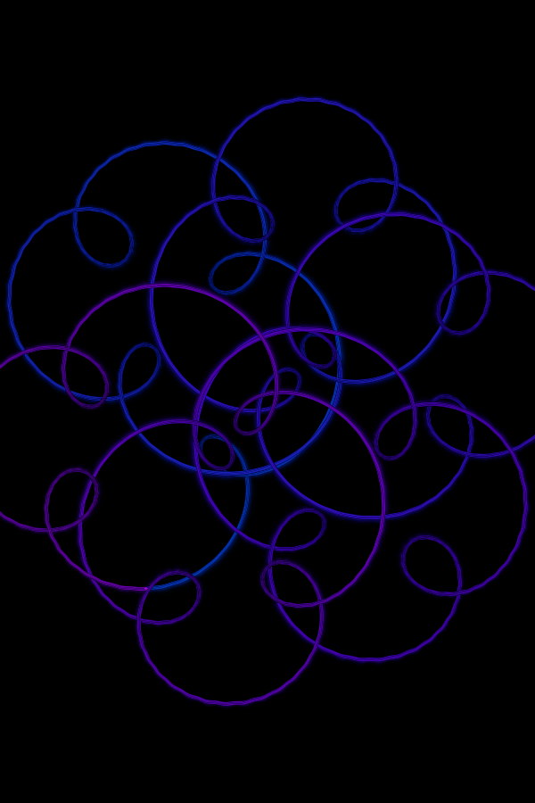

*Cycloid as it loads — the starting point for all six recipes. Overlapping looped circles in blue and
violet, thin and bright on black. It is shown once here rather than repeated before each recipe.*

> **Each "after" picture is a real capture of the steps listed above it**, with no retouching, and the
> numbers quoted are the ones the controls actually read after the change. The figure is animating, so
> the shape will not be in the same position as the picture above — compare the light, colour and
> texture rather than the exact pose.

---

### 8.1 Change the film look and colour

| Step | Tab | Section | Control | Set to |
|---|---|---|---|---|
| 1 | Visual FX | Colour → Film Look | **Look** | *Dramatic* |
| 2 | Visual FX | Colour → Film Look | **Look** | *Customize* |
| 3 | Visual FX | Colour → Film Look → Tone Map | **Exposure** | **2.5** |

**Why the order matters.** Steps 1 and 2 look redundant and are not. Picking a named look sets all
eighteen grading values at once; switching to **Customize** then *keeps* those values and opens them for
editing. So you are not starting from nothing in step 3 — you are starting from *Dramatic* and pushing
its exposure further. Doing it the other way round would throw your edit away, because picking a named
look re-seeds every value.

**What the exposure lift actually does here.** It is not simply "brighter". *Dramatic* puts a strong tone
curve under the image, and pushing exposure moves the whole picture further along that curve — so the
parts of the figure that were already bright saturate toward cream while the dimmer outer loops lift into
view. The result is a split in colour as well as brightness, which is why this is a *look* recipe rather
than a brightness one.

> **Exposure is the right first control for an image that is too dark or too bright**, because it moves
> everything through the curve together. It is also the easiest one to overdo: push much past 2.5 on this
> preset and the loops merge into a single white mass.

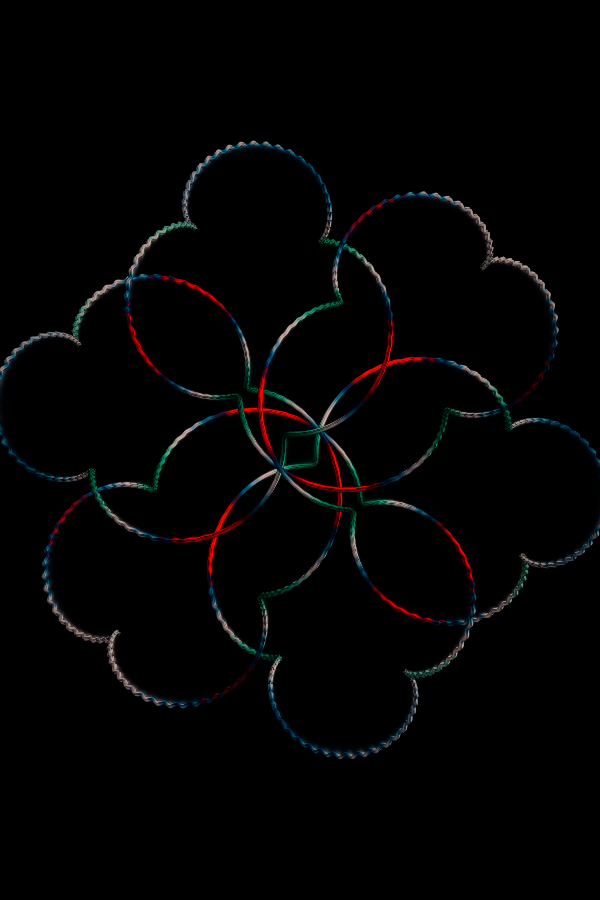

*After steps 1 to 3. The loops are now finely serrated bands rather than smooth lines — the grading has
brought out detail that was there all along — and they have separated by depth into warm cream through
the middle of the figure and cool teal around its rim. The figure is unmistakably the same one as above,
photographed completely differently.*

---

### 8.2 Make it liquid

| Step | Tab | Section | Control | Set to |
|---|---|---|---|---|
| 1 | Visual FX | Particles → Render Mode | **Mode** | *Liquid* |
| 2 | Visual FX | Particles → Render Mode | **Particle Size** | **2.00×** |
| 3 | Visual FX | Particles → Liquid Surface | **Iso Level** | **1.7** |

**Why it works.** *Liquid* is not a style but a different renderer: instead of adding light per particle
it merges nearby particles into **one closed surface**. Raising **Particle Size** makes each particle
reach further, so neighbouring ones overlap enough to fuse. **Iso Level** then decides where that
surface forms — **1.0 is the balanced setting, and above it the lobes separate into distinct droplets**
rather than fusing into one mass, which is what gives this figure its beaded look.

> **The Liquid Surface section only exists while the mode is *Liquid*.** It appears directly beneath
> Render Mode when you pick the mode in step 1, and disappears again if you leave it.

> Iso Level reads **1.711** after step 3 — the nearest its track reaches to 1.7.

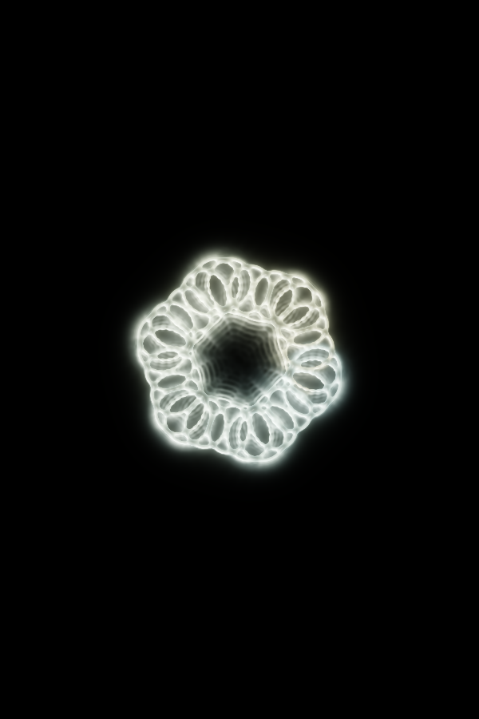

*After steps 1 to 3. The thin drawn loops have become strings of separate cyan **droplets**, beaded
along the curve and meeting in an open lattice with clear cells between them. That beading is Iso Level
1.7 doing its work: above 1.0 the surface forms tightly enough around each cluster that the lobes
separate instead of fusing into one continuous body.*

---

### 8.3 Let it burn

| Step | Tab | Section | Control | Set to |
|---|---|---|---|---|
| 1 | Materials | — | **Material** | *Fire* |
| 2 | Materials | — | **Splat Radius** | **2.0** |
| 3 | Materials | — | **Heat Gain** | **0.4** |

**Why it works.** Step 1 does most of the job: a material is a bundle of every setting below it, so
*Fire* brings the heat ramp, the rising buoyancy and the additive blending in one pick — and it will
probably switch the render mode to *Splat*, which is correct, because the two belong together.

Steps 2 and 3 then **restrain** it, which is the interesting part. **Splat Radius** sets the scale of
everything else in a material; dropping it to 2.0 — near its minimum — turns a continuous burning body
into fine individual sparks. **Heat Gain** below 1 keeps only the fastest particles hot, so the figure
glows at its edges instead of everywhere at once.

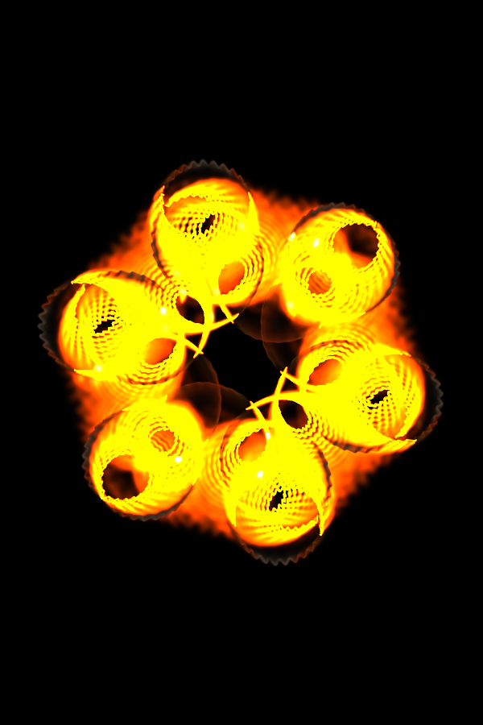

*After steps 1 to 3. The loops have filled in and saturated: six fat yellow lobes in a ring, rimmed in
orange where the heat falls away, around a dark centre the figure never reaches. The small Splat Radius
keeps each deposit tiny, but there are so many of them along the curve that they still accumulate to
full brightness — which is what an **additive** material does.*

---

### 8.4 Let it freeze

| Step | Tab | Section | Control | Set to |
|---|---|---|---|---|
| 1 | Materials | — | **Material** | *Ice* |
| 2 | Materials | Crystals → Crystals | **Enable** | on |
| 3 | Materials | Crystals → Crystals → Growth | **Enable Growth** | on |
| 4 | Visual FX | Colour → Colour Palette | **Palette** | *Classic · ice* |

**Why it works.** This is the opposite recipe to the last one. *Ice* is the one material that switches
**crystals** on by itself, so step 2 usually finds them already enabled — tick it anyway, because
nothing else in the tab will. Crystals are a **third population**: solid, faceted bodies that nucleate
on the figure, grow, hold, then melt. Unlike everything else in PSSS they *occlude*, so they read as
solid objects rather than as more light.

**Step 3 is what makes them build up.** With **Enable Growth** on, deposits land on crystals that have
already formed, so the structure thickens where the figure keeps passing instead of every crystal
reaching the same size. Give it a few seconds — crystals are born at a rate, so the structure
accumulates rather than appearing at once.

**Step 4 does the atmospheric work.** A palette replaces per-particle colour outright, and *Classic ·
ice* maps the figure into cold blues and whites in one pick.

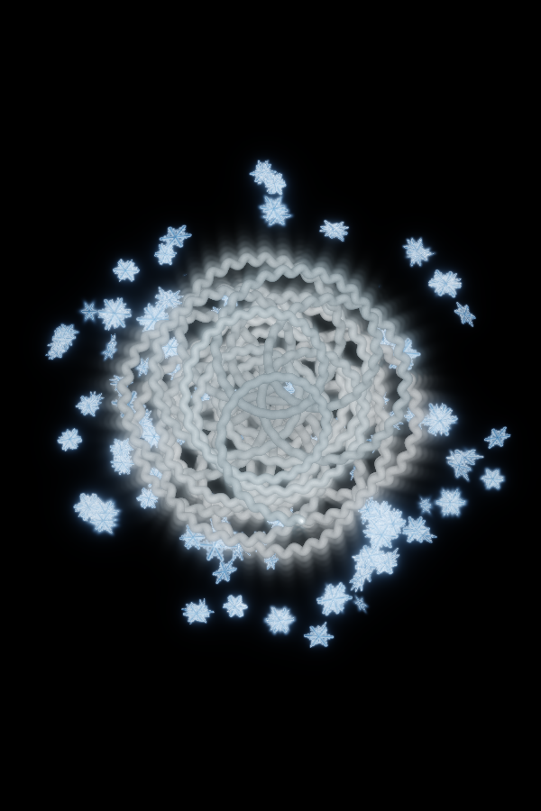

*After steps 1 to 4. The figure itself has become a pale braided coil, and the **individual snowflakes
scattered around it are the crystals** — discrete solid bodies, each with its own facets and its own
orientation, that nucleated on the curve and were left behind as it moved. They are opaque where they
overlap the coil, which is what makes them read as objects rather than as more light. Cold whites and
blues throughout, from the palette.*

---

### 8.5 See it through glass

| Step | Tab | Section | Control | Set to |
|---|---|---|---|---|
| 1 | Visual FX | Image → Translation Map | **Enable** | on |
| 2 | Visual FX | Image → Translation Map | **Style** | *Zoom Overlay* |
| 3 | Visual FX | Image → Translation Map | **Pattern** | *Grid Lattice* |
| 4 | Visual FX | Image → Translation Map | **Strength** | **16.0** |

**Why it works.** The warp is a **lens on the finished picture** — it bends the image, it does not move
the particles. *Zoom Overlay* magnifies the picture about a centre and lays that magnified copy **over**
the unzoomed one, so you see both at once. *Grid Lattice* is the field it does that through: two ripples
crossing at six and four cycles, which makes a regular grid of little lenses. **Strength** is how far
each lens pushes, and 16.0 is firm enough to be unmistakable while still leaving the figure readable.

> **Steps 3 and 4 are behind the `▸` expander** on the layer's row, not at section level. Click it to
> open that layer's own controls. ⚠️ **Setting one of them closes the panel again**, so expect to
> re-open it between steps 3 and 4 — that is the behaviour, not a fault.

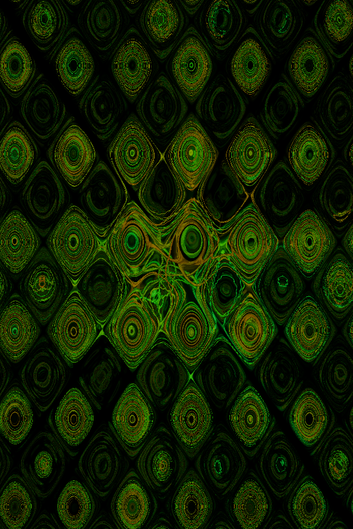

*After steps 1 to 4. The whole frame is now tiled with a regular grid of diamond-shaped cells, each
holding its own set of concentric rings — pressed glass rather than a window. The original figure is
still in there: it is the brighter violet tangle near the centre, which the lenses around it repeat and
distort outward. **Note that the warp fills the frame even where the figure is not** — it works on the
picture, so it acts on the empty background too.*

---

### 8.6 Make it fractal

| Step | Tab | Section | Control | Set to |
|---|---|---|---|---|
| 1 | Visual FX | Figure → Attractor | **Preset** | *Mandelbrot Full Set* |
| 2 | Visual FX | Figure → Attractor | **Blend** | **0.9** |

**Why it works.** The **Attractor** replaces the sine-wave curve with an entirely different family of
mathematical shape, keeping the current rendering and grading. *Mandelbrot Full Set* puts the particles
on the boundary of the Mandelbrot set.

**Blend is the whole recipe.** At 1.0 you get the attractor alone and the preset is gone; at 0 you get
the preset untouched. **0.9 keeps a tenth of Cycloid in the result** — which is why the picture below is
not just a Mandelbrot: the loops are still there, drawn around and through the fractal boundary. That
tenth is what makes the attractors worth blending rather than switching to.

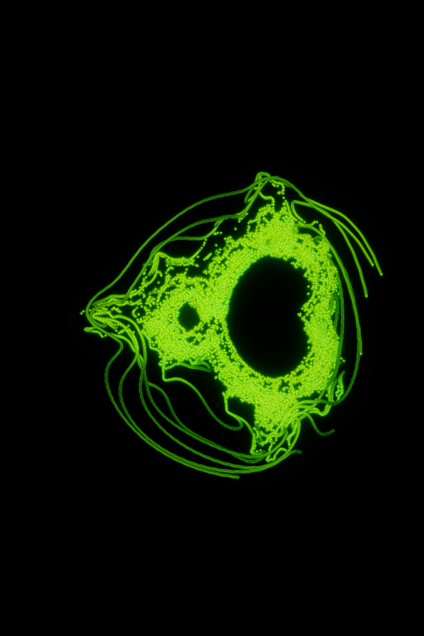

*After steps 1 and 2. The dense speckled body is the Mandelbrot set's boundary, hollow at its centre;
the smooth curves sweeping around and through it are what remains of Cycloid at a blend of 0.9. One
picture, two different kinds of mathematics — which is the whole argument for blending an attractor
rather than switching to it.*

**One more control belongs to this recipe, and only to a Julia or a Mandelbrot.** With one of those
running:

| Step | Tab | Section | Control | Set to |
|---|---|---|---|---|
| 3 | Visual FX | Particles → Per-Particle | **Driver**, then **Lightness** | *Escape time*, then **+0.6** |

Step 3 uses the fractal's own quantity — how fast each particle's point left the set — to light the
figure, so the escape bands appear as brightness as well as position. **The *Escape time*
driver is only in the dropdown while a fractal attractor is live**, which is why it is step 4 and not
step 1.

---

### 8.7 Make it architecture

Three controls that bend the figure rather than the picture. **Start from a sparse preset** -- `Pipes`,
`Quader` or `Cylinder` -- because everything here is easiest to read on a figure you can still see through.

| Step | Where | Control | Set it to |
|---|---|---|---|
| 1 | Visual FX | Figure → **Deformation → Fold** | **1** |
| 2 | Visual FX | Figure → **Deformation → Cell Size** | turn it **down** from 100 % until the outer arms start reflecting -- about **60 %** on `Pipes` |
| 3 | Visual FX | Figure → **Deformation → Twist Z** | **+0.35** |

**What to look for at each step.** After step 2 the figure should have **visibly bright creases** where it
reflects -- that is the fold working, because many parts of the curve now land on the same place. If the
creases are not bright, nothing is folding yet: keep turning Cell Size down. Step 3 spirals the chambers
through depth, so the structure reads as a solid you are looking into rather than a flat pattern.

> **If Twist does nothing, the figure is flat.** It works by rotating each point according to its depth, so
> a preset whose Z wave has no amplitude has nothing for it to act on -- about a fifth of the library. Try
> `Pipes`, `Quader`, `Sphere II` or any of the Material presets.

> **Two or more folds turn structure into foam.** Each fold multiplies the detail, so 1 or 2 is where the
> architecture is; 4 is available and is mostly useful with **Fold Scale** away from 1, which nests the
> copies instead of repeating them. Fold Scale also changes the brightness, because squeezing the figure
> really does crowd more particles into each pixel.

**Then bend the picture too.** Add a **Translation Map** layer of style **Conformal**, pick its **Function**, and the image warps
*lawfully* -- straight features bow into arcs while local shapes stay un-sheared. `z^n` blooms the frame
into n petals; **Log-polar** gives the self-similar spiral that pairs with the feedback decay. A 3D
deformation and an image warp do different things, and layering both gives what neither does alone.

**Worked examples ship for each operator**: `Pipes Twist`, `Cylinder Conformal`, `Pipes Droste`,
`Pipes Timescan`, `Pipes Wound Chambers`, `Quader Hyperspin` and `Pipes Taper Bend Spread`. Most are one
change from their parent, so loading the parent and the demo in turn shows exactly what that operator
contributes.

⚠️ **Two of them carry more than one operator, deliberately.** `Pipes Wound Chambers` is a box fold AND
a twist, and `Pipes Taper Bend Spread` is a taper, a bend and the per-particle channels together — so on
those two the way to isolate one operator is to zero the others in the panel, which is two drags.

⚠️ **The taper and the bend change the figure's brightness as well as its shape**, and that is the
deformation's own arithmetic rather than a tuning choice — see the note under **Deformation** about why
the engine corrects for it.

**And try it faceted.** The **Curve Basis** section, immediately above Deformation, rebuilds the curve
itself from straight segments — which is the most architectural the figure gets, and it composes with
everything above. `Quader Faceted` and `Cylinder Chamfered` are the worked examples, on two of the three
parents this recipe recommends. **Sharpness has one slider per wave level**, so you can
leave the fine detail smooth and facet only the broad shape: `Multiple Faceted Core` does exactly that,
and `Quader Square Spring` facets the Body and Structure levels together. ⚠️ **Sharpness is not a deformation** — it decides
what the curve is made of rather than bending a built one — so none of them carries the **Deformed** chip,
and nor do **Grow**, **Travel** or **Offset**.

**Every demo sits at the very END of the library list** — scroll to the bottom of the grid to find them
all together. The **Deformed** chip also filters to them and to anything you make.

### 8.9 Make it four-dimensional

The engine's strangest control, and the one with no three-dimensional equivalent at all. **Start from
`Quader` again**, for the same reasons.

| Step | Where | Control | Set it to |
|---|---|---|---|
| 1 | Visual FX | Figure → **Deformation → 4D Extent** | **0.70** |
| 2 | Visual FX | Figure → **Deformation → 4D Spin X-W** | **+0.18** |
| 3 | Visual FX | Figure → **Deformation → 4D Spin Y-W** | **−0.12** |
| 4 | Visual FX | Figure → **Deformation → 4D Spin Z-W** | **+0.09** |
| 5 | Visual FX | Particles → **Per-Particle → Driver**, then **Lightness** | *Along the curve*, then **+0.6** |

**What to look for at each step.** Step 1 alone makes one end of the curve bigger than the other, as if
you were looking along it — that is the fourth coordinate being projected, and nothing else in the engine
does it. Steps 2–4 are where it stops looking like perspective: the figure turns in a way that has parts of
it passing *through* each other and coming out the far side. Step 5 is the pairing that makes it legible —
brightening the figure along its own length tells your eye which end is which while it tumbles.

> **All three spin rows together, not one.** One plane on its own reads as an ordinary perspective change.
> It is the combination that produces the pass-through.

> **Keep 4D Extent below about 0.8.** At 1.00 the near end of the curve is drawn twice the size of the far
> end and the figure stops reading as one object.

> **`Quader Hyperspin` ships as the worked example** for this recipe — one change from `Quader`, so
> loading the parent and the demo in turn shows exactly what the operator contributes.
> **`Pipes Taper Bend Spread` does the same for the Per-Particle rows**, hosted on `Pipes` because that
> is where all four Drivers
> actually vary — and with **Ribbon Rendering switched off**, because a ribbon draws the path as one
> continuous band and a band has no per-particle marks for these rows to vary.

> **Every demo preset sits at the very END of the library list**, so scroll to the bottom of the grid to
> find all of them together rather than hunting for each one beside its parent.

## 9. Design Your Own

A complete walkthrough, from nothing to a finished preset. The order matters: **figure first, then
substance, then photography.** Working the other way round means re-tuning the grade every time you
change the shape.

### Step 0 — Set up

Open the **Lab**, go to **Composer**, and press **New Figure**. You now have a clean, simple shape.

Turn on **Sliders — Strip to figure**. This hides every atmospheric effect so you can see the curve you
are building. Turn it off whenever you want to check the real look; it changes nothing permanently.

### Step 1 — The figure (Composer)

**Pick a base shape.** Use the **Ratios** row. 2:3 and 3:4 are good starting points — complex enough to
be interesting, simple enough to stay readable.

**Set the Body winding per axis.** This is the main dial. Whole numbers close the loop; fractions leave
it open and drifting.

**Decide closed or open now,** because it affects everything downstream. A closed figure is a stable
object you can light and grade. An open one never repeats, which suits a screensaver.

**Add ornament.** Tick **Detail**, and use **Stack ▾** to set its winding as a multiple of the Body's —
2x or 3x. Multiples stay harmonically related; arbitrary numbers read as noise. Add **Structure** only
if Detail is not enough.

**Adjust Size per axis** for proportion, and **Shift °** to change where the curves cross without
changing the shape's family.

**Check the Score diagram in all three panes.** A figure that looks good in one plane and is a flat
line in another will disappoint as soon as it rotates.

> **Spend most of your time here.** A good figure carries a mediocre grade. The reverse is not true.

### Step 2 — Scale and motion (Visual FX → Figure → Framing & Timing)

| Control | What to aim for |
|---|---|
| **Figure Scale** | fills the frame without touching the edges |
| **Particle Number** | start around 3000–5000; raise it once you know the trail length |
| **Animation Speed** | slow enough to follow the shape |

Then set **rotation** so the figure turns. A completely static 3D figure reads as flat; a slow turn is
what reveals it as an object.

**Then, if the figure wants it, reach for the four shape controls in this group and in Curve Basis** —
**Travel** to open the loop into an arc, **Offset** to turn the spin into an orbit, **Sharpness** to
facet it and **Grow** to ramp it along the stroke. Each of them carries a breathing pair, so any of the
four can be made to cycle rather than hold. ⚠️ **Three things to hold on to**: none of these is caught
by the automatic canvas fit, so check the figure at the window shapes you care about; **Grow's identity
is `0`, not `1`**; and an open curve wants the palette's `Map` set to *Particle index* or it will show a
colour seam at its free end.

### Step 3 — What it is made of (Materials)

Turn **Strip to figure** off now.

**Pick one material and commit to it.** The nine are genuinely different characters: *Fire* rises,
*Ice* holds, *Smoke* disperses, *Liquid* pools. Expect the render mode to change with your choice.

**Then adjust two things only:** **Heat Gain** and **Emission**. These do most of the work. Resist the
rest until the look is nearly right.

**Add a population if the idea needs one.** Sparks for something volatile, crystals for something
accumulating. Both are additive, so neither takes anything away from the figure.

**Or choose no material at all.** A bare figure with a good palette and trail is a legitimate and often
striking result — most of the flat graphic presets are exactly that.

### Step 4 — Colour

**Decide where colour comes from, because the two routes exclude each other:**

- **A palette** — pick one, then pick its **mapping**. The mapping matters as much as the palette:
  *depth* reads as atmosphere, *index* as a rainbow along the figure, *velocity* as energy.
- **The preset's own colour curves** — set the palette to *none* first, or your edits will be replaced
  and will appear to do nothing.

### Step 5 — The trail

Find the trail-length control in **Visual FX → Particles → Render Mode** and sweep it slowly from one
end to the other, watching
the main view. This single control moves your preset between "a cloud of particles" and "a ribbon of
light".

**Set it before you grade.** Trail length changes how much light accumulates, so grading first means
grading twice.

### Step 6 — The warp, if any (Visual FX → Image, then Transmap)

Optional, and powerful enough to be worth skipping on a first preset.

1. In **Visual FX — Translation Map**, switch **Enable** on and add **one** layer.
2. Choose a **field** style — one that displaces on its own. **Wave Shift** is the gentlest start;
   **Vortex** and **Fractal Feedback** are the most transformative.
3. Set the weight **low**, raise it until just before it stops being readable, then back off.
4. Only then consider a **modifier** (*Time Warp*, *Band Split*, *Depth Parallax*). They have no
   displacement of their own and do nothing until a field layer is already in the chain.
5. If you picked one of the four wave styles, the **Transmap** tab shapes its field — start from a
   named **Pattern** there rather than from the individual terms.

> One layer at a modest weight is usually plenty. Chains of three or four are for deliberate
> kaleidoscopic work, not for general improvement.

### Step 7 — Photography (Visual FX → Colour → Film Look)

Now grade it. **Try all fifteen named looks** before touching anything manual. It takes a minute and is
often the end of the job.

If none fits, switch to **Customize** — it starts from whichever look was active — and adjust
**exposure**, then **bloom**, then **saturation**, in that order.

**Judge it full screen on a dark background.** Press **F**. Bloom and glow look quite different at tile
size.

### Step 8 — Refine with the Sliders

Go to **Sliders** and make small moves. Every row is a multiplier on what you have built, so this is
the safe place to taste-test. If you want to keep a result and shape again from there, press **Bake**.

### Step 9 — Save it

| Action | What it gives you |
|---|---|
| **Snapshot** | keeps the state in History for this session |
| **Export** | writes a `.json` file you can keep or share |
| **Import** | brings it back, into any copy of PSSS |

### Step 10 — Stress-test it

Before you call it finished:

- **Watch it for a full minute.** Figures that look good in a screenshot can be dull in motion, or can
  drift somewhere unattractive.
- **Full screen it.** Tiles flatter presets.
- **Resize the window.** The automatic fit should keep it framed.
- **Look at the Sliders tab's greyed rows.** They tell you what your preset does *not* use, which
  sometimes reveals an obvious missing ingredient.

### If you get stuck

| Symptom | Most likely cause |
|---|---|
| nothing is drawn at all | render mode *Splat* with no material selected |
| colour edits do nothing | a palette is active and is replacing them |
| the figure looks like a cloud, not a shape | trail too short, or too few particles |
| it looks like mush | too much warp, or too many warp layers |
| a slider does nothing | it is greyed out — read the reason printed under it |
| it looked better in the tile | tiles are lower quality; trust the main view |
| the figure looks flat | no rotation, or the figure has no reach in one plane |
---

# Appendix

## A. Credits and the Original PSSS

This engine is the third version of PSSS, and the first two were somebody else's work. It is worth
being clear about which part is whose.

### A.1 The author

PSSS — *Particle Systems Screen Saver* — was created by **Andreas Kardin**, who publishes as
**mephzara**. The idea, the name, the mathematics of driving particles along amplitude- and
frequency-modulated sine waves, and the great majority of the preset library all originate with him.
Many of the presets you will find in the library are his, carried across essentially unchanged.

| | |
|---|---|
| **Author** | Andreas Kardin (*mephzara*) |
| **Source of the JavaScript version** | <https://github.com/mephzara/psss_js> |
| **Live demo of the JavaScript version** | <http://mephzara.com/misc/psss_js/> |

**Thank you, Andreas Kardin** — for the original program, and for publishing the source so that it
could be taken further.

### A.2 The first version — a Delphi screensaver for Windows

The original PSSS was a **native Windows screensaver**, written in the late 1990s in **Delphi (Object
Pascal) with assembler** for the inner loops. It shipped as a `.scr` file and ran as a real
screensaver: Windows started it when the machine went idle, and it took over the screen.

It had to do all of this **on the processor**. This was the era before 3D acceleration was something a
program could assume, so projecting the particles, drawing them and fading the trail were all
hand-written software rendering — which is why the assembler was there, and why the particle counts of
the day were measured in thousands rather than hundreds of thousands.

It was released as **shareware** and did very well. It passed **50 000 downloads on its first night**
on a 3dfx shareware site, was carried by the big download sites of the day — Tucows, CNET,
Download.com — and was reviewed in magazines. It was also shown at the **Zeiss planetarium in Jena**
during the Liquid Sound Festival, with the animations synchronised to compositions by Jan Zehn. Some
users wrote their own music to go with it.

### A.3 The second version — a JavaScript rewrite for the browser

Roughly two decades later the author **rewrote PSSS in JavaScript** so that it would run in a web
browser with nothing to install, and **published the source**. This version draws into an HTML
`<canvas>` using the 2D drawing interface — still processor-based rendering, but now inside a browser
instead of a Windows screensaver, reachable from any machine with a link.

It is three files and no build step, and it is the version the demo link above runs. It is also the
version **this** engine was built from: the preset library, the wave mathematics and the visual
intent all came across from it.

### A.4 This version — TypeScript and WebGL2

The engine PSSS v2 described in this manual is a reimplementation of the JavaScript version. It keeps that
version's mathematics and its presets, and replaces nearly everything around them. The short version:
the earlier releases *draw* the figure, and this one *photographs* it.

| | The Delphi screensaver | The JavaScript version | This engine |
|---|---|---|---|
| **Runs as** | a Windows screensaver (`.scr`) | a web page | a web page — and a Windows screensaver again |
| **Written in** | Delphi (Object Pascal) and assembler | JavaScript, three files, no build step | TypeScript, built with Vite |
| **Drawing** | software rendering on the processor | the processor, into a 2D canvas | the graphics card, via WebGL2 |
| **Particles** | thousands | thousands | up to 200 000, plus separate populations for sparks and crystals |
| **Render modes** | one | one | six, including an accumulating splat mode and a merged liquid surface |
| **Colour** | per-particle colour | per-particle colour | a full grading chain — bloom, tone mapping, exposure, lift/gamma/gain, vignette — plus palettes and named film looks |
| **Materials** | none | none | named materials with heat, buoyancy, smoke, sparks and growing crystals |
| **The warp** | a single translation map | a single translation map | a chain of warp layers with twelve operators and chromatic dispersion |
| **Extra physics** | none | none | curl-noise turbulence, particle cohesion, a stirred liquid field, a dye field, a slime-mould network and fluid advection |
| **Editing** | edit the preset file | edit the preset file | the Synthesis Lab: eleven tabs, including a figure composer, a two-preset mixer, a randomiser and a genetic breeder |
| **Playback** | one preset at a time | one preset at a time | reels — named playlists with ordering and transitions |

Note the first row: this version runs in a browser *and* ships as a Windows screensaver, so after
twenty-five years PSSS is a screensaver again — which is what the name always said it was.

### A.5 What deliberately did not change

Two things were kept on purpose.

- **The preset format.** This engine still reads the JavaScript version's `psss_presets.json`, so an
  original preset loads here and looks like itself.
- **The original look.** The **Legacy** film look is still in the list, so you can always put a preset
  back into roughly the image the earlier versions would have produced.

The JavaScript source is kept alongside this engine as a read-only reference. When a question comes up
about what PSSS *originally* did, that copy is the answer rather than anyone's memory of it.
